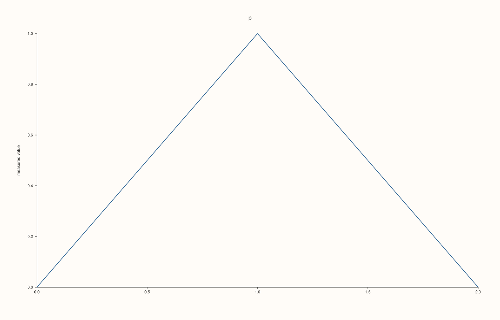
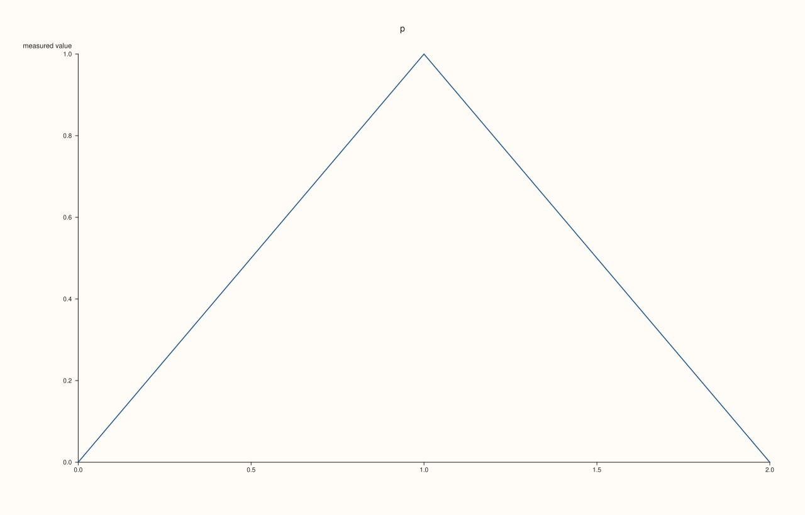
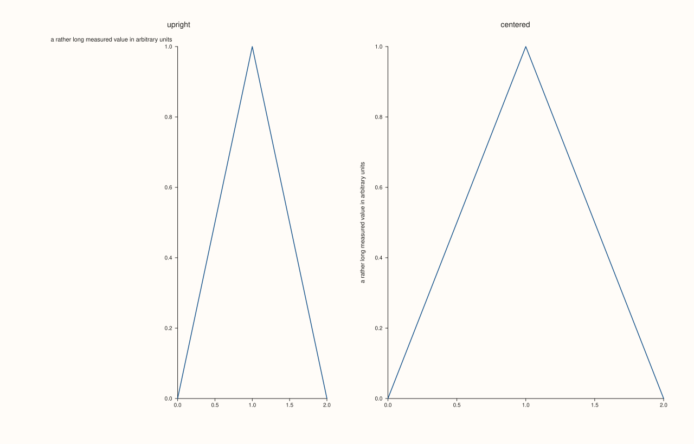

<!-- pluss-hand-authored -->

# Pane::y_label_centered

[Back to Pane API Reference](../../pane_api_reference)

## Signature

```cpp
Pane& Pane::y_label_centered(bool enable = true) noexcept
```

## What It Does

Chooses where the y label stands. By default (`false`) it is written upright, at the top of the axis, ending at the axis: it reads like a heading for the axis and takes no sideways room beyond its own width. With `true` it is turned to run vertically and is centred on the axis, along its length, outside the tick labels.

The two suit different figures. The upright label reads easily and keeps a long label legible; the centred one takes less width and is the usual convention for a tall, narrow plot. Either way the pane keeps room for the label, so it is never cut by the figure's edge. Only the y axis has the choice; the x label is always centred below its axis.

An explicit [`y_label_rotation`](y_label_rotation.md) is applied on top of either placement.

## Parameters

**enable** (`bool`, default `true`)
    `true` to turn the label vertical and centre it on the axis; `false` for the upright label at the top.

## Returns

`Pane&`
    The same pane, for chaining.

## Examples

Example 1. By default the label is upright, with its end at the axis.

```cpp
auto fig = studio("ycentered_default");
auto& pane = fig.pane2("p");
pane.trend(std::vector<double>{0, 1, 2}, std::vector<double>{0, 1, 0});
pane.y_label("measured value");
auto look = [](const std::string& svg, const std::string& text) {
  const auto hit = svg.find(">" + text + "<");
  if (hit == std::string::npos) return std::string("absent");
  const auto open = svg.rfind("<text", hit);
  const std::string tag = svg.substr(open, hit - open);
  const auto anchor = tag.find("text-anchor=\"");
  std::string out = "anchor " + tag.substr(anchor + 13, tag.find('"', anchor + 13) - anchor - 13);
  const auto rot = tag.find("rotate(");
  out += rot == std::string::npos ? ", upright" : ", rotated " + tag.substr(rot + 7, tag.find(' ', rot) - rot - 7);
  return out;
};
std::cout << look(fig.to_svg(), "measured value") << "\n";
fig.save_svg("figure.svg");
```

### Output

```text
anchor end, upright
```


Example 2. Centred, it is turned to run up the axis, middle-anchored on the axis.

```cpp
auto fig = studio("ycentered_on");
auto& pane = fig.pane2("p");
pane.trend(std::vector<double>{0, 1, 2}, std::vector<double>{0, 1, 0});
pane.y_label("measured value");
auto look = [](const std::string& svg, const std::string& text) {
  const auto hit = svg.find(">" + text + "<");
  if (hit == std::string::npos) return std::string("absent");
  const auto open = svg.rfind("<text", hit);
  const std::string tag = svg.substr(open, hit - open);
  const auto anchor = tag.find("text-anchor=\"");
  std::string out = "anchor " + tag.substr(anchor + 13, tag.find('"', anchor + 13) - anchor - 13);
  const auto rot = tag.find("rotate(");
  out += rot == std::string::npos ? ", upright" : ", rotated " + tag.substr(rot + 7, tag.find(' ', rot) - rot - 7);
  return out;
};
pane.y_label_centered();
std::cout << look(fig.to_svg(), "measured value") << "\n";
fig.save_svg("figure.svg");
```

### Output

```text
anchor middle, rotated -90.0000
```



Example 3. `y_label_centered(false)` is the default again: the figure is the one that never made the call.

```cpp
auto build = [&](int mode) {
  auto fig = studio("ycentered_off");
  auto& pane = fig.pane2("p");
  pane.trend(std::vector<double>{0, 1, 2}, std::vector<double>{0, 1, 0});
  pane.y_label("measured value");
  if (mode == 1) pane.y_label_centered(true);
  if (mode == 2) pane.y_label_centered(true).y_label_centered(false);
  return fig.to_svg();
};
std::cout << "off again == never set: " << (build(2) == build(0)) << ", on != off: " << (build(1) != build(0)) << "\n";
auto fig = studio("ycentered_off_out");
auto& pane = fig.pane2("p");
pane.trend(std::vector<double>{0, 1, 2}, std::vector<double>{0, 1, 0});
pane.y_label("measured value");
fig.save_svg("figure.svg");
```

### Output

```text
off again == never set: 1, on != off: 1
```



Example 4. A long label stays inside the figure in both placements: the pane makes room for the upright label at its left, and the centred label sits beside the axis.

```cpp
auto fig = studio("ycentered_long");
fig.mosaic(1, 2);
auto& upright = fig.pane2("upright");
upright.trend(std::vector<double>{0, 1, 2}, std::vector<double>{0, 1, 0});
upright.y_label("a rather long measured value in arbitrary units");
auto& centered = fig.pane2("centered");
centered.trend(std::vector<double>{0, 1, 2}, std::vector<double>{0, 1, 0});
centered.y_label("a rather long measured value in arbitrary units").y_label_centered();
fig.save_svg("figure.svg");
```



Example 5. With an explicit rotation the label is turned by that angle, and the placement decides where it is anchored.

```cpp
auto fig = studio("ycentered_rotation");
auto& pane = fig.pane2("p");
pane.trend(std::vector<double>{0, 1, 2}, std::vector<double>{0, 1, 0});
pane.y_label("measured value");
auto look = [](const std::string& svg, const std::string& text) {
  const auto hit = svg.find(">" + text + "<");
  if (hit == std::string::npos) return std::string("absent");
  const auto open = svg.rfind("<text", hit);
  const std::string tag = svg.substr(open, hit - open);
  const auto anchor = tag.find("text-anchor=\"");
  std::string out = "anchor " + tag.substr(anchor + 13, tag.find('"', anchor + 13) - anchor - 13);
  const auto rot = tag.find("rotate(");
  out += rot == std::string::npos ? ", upright" : ", rotated " + tag.substr(rot + 7, tag.find(' ', rot) - rot - 7);
  return out;
};
pane.y_label_centered().y_label_rotation(-45.0);
std::cout << look(fig.to_svg(), "measured value") << "\n";
fig.save_svg("figure.svg");
```

### Output

```text
anchor middle, rotated -45.0000
```


## Notes

- `noexcept`. Only the y axis has this switch.
- The call has no effect on a pane without a y label.

## See Also

- [`Pane::y_label`](y_label.md): the label.
- [`Pane::y_label_rotation`](y_label_rotation.md): rotate it by hand.
- [`Pane::y_label_gap`](y_label_gap.md): the distance from the tick labels.

<div class="pluss-inline-prev-next">
  <a class="prev-link" href="y_label.html">
    <span class="label">Previous</span>
    <span class="title">y_label</span>
  </a>
  <a class="next-link" href="y_label_gap.html">
    <span class="label">Next</span>
    <span class="title">y_label_gap</span>
  </a>
</div>
