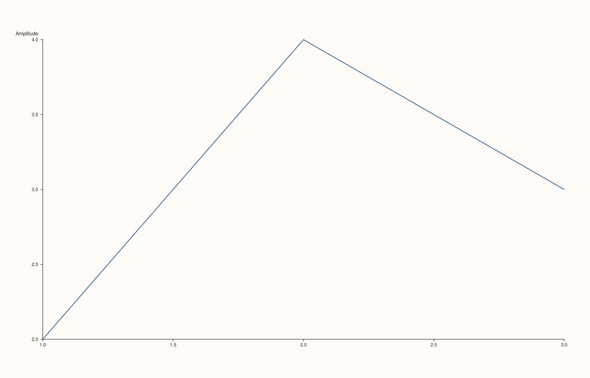
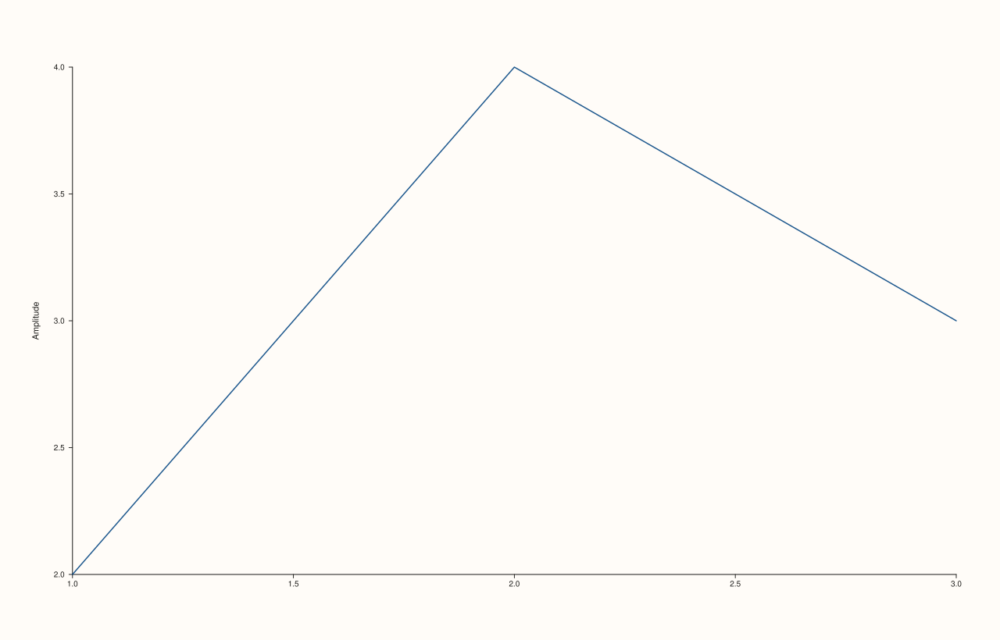

<!-- pluss-hand-authored -->

# Pane::y_label_centered

[Back to Pane API Reference](../../pane_api_reference)

## Signature

```cpp
Pane& Pane::y_label_centered(bool enable = true) noexcept
```

## What It Does

Toggles whether the y-axis's own label (set via [`y_label()`](y_label.md)) is centered
along the axis, as opposed to positioned at one end. This is a **y-axis-only** control —
there is no `x_label_centered()` or `z_label_centered()`; the x- and z-axes have no
equivalent method.

```{important} Writes to TWO fields: the value itself, and an "explicit" flag
Calling `y_label_centered(enable)` sets both `label_centered_on_axis` (the value read by
[`y_axis()`](axis_accessors.md)) *and* `label_centered_explicit` (a separate flag marking
that this was deliberately set, as opposed to left at its unset default). Both fields
start `false` on a fresh pane. Calling `y_label_centered(false)` explicitly still sets
`label_centered_explicit` to `true` — the explicit flag distinguishes "never called" from
"called with `false`," even though `label_centered_on_axis` reads as `false` either way.
See Example 1 vs. Example 3.
```

## Parameters

**enable** (`bool`, default `true`)
    `true` to center the y-axis label along the axis, `false` to position it at one end.

## Returns

`Pane&`
    A reference to the same pane, for chaining.

## Examples

Example 1. The default: neither field set — `label_centered_on_axis` and
`label_centered_explicit` both read `false`.

```cpp
using namespace pluss::pl;

auto fig = studio("label_centered_default");
auto& pane = fig.pane2();
pane.trend(std::vector<double>{1.0, 2.0, 3.0}, std::vector<double>{2.0, 4.0, 3.0});
pane.y_label("Amplitude");
fig.show();

std::cout << pane.y_axis().label_centered_on_axis << "\n";
std::cout << pane.y_axis().label_centered_explicit << "\n";
```

### Output

```text
0
0
```



Example 2. `y_label_centered(true)` — both fields become `true`.

```cpp
using namespace pluss::pl;

auto fig = studio("label_centered_true");
auto& pane = fig.pane2();
pane.trend(std::vector<double>{1.0, 2.0, 3.0}, std::vector<double>{2.0, 4.0, 3.0});
pane.y_label("Amplitude");
pane.y_label_centered(true);
fig.show();

std::cout << pane.y_axis().label_centered_on_axis << "\n";
std::cout << pane.y_axis().label_centered_explicit << "\n";
```

### Output

```text
1
1
```



Example 3. `y_label_centered(false)` — `label_centered_on_axis` reads `false`, the same as
the never-called default, but `label_centered_explicit` is now `true`, distinguishing an
explicit "off" from never having been touched.

```cpp
using namespace pluss::pl;

auto fig = studio("label_centered_false_explicit");
auto& pane = fig.pane2();
pane.trend(std::vector<double>{1.0, 2.0, 3.0}, std::vector<double>{2.0, 4.0, 3.0});
pane.y_label("Amplitude");
pane.y_label_centered(false);
fig.show();

std::cout << pane.y_axis().label_centered_on_axis << "\n";
std::cout << pane.y_axis().label_centered_explicit << "\n";
```

### Output

```text
0
1
```


## Notes

- `noexcept`.
- `enable` defaults to `true`.
- Writes two fields at once — see the important callout above. There's no way to reach
  `label_centered_explicit == true` without also setting `label_centered_on_axis` to
  whatever `enable` was.
- No corresponding `x_label_centered()`/`z_label_centered()` — this control exists only
  on the y-axis.

## See Also

- [`Pane::y_label`](y_label.md): the label this setting positions.
- [`Pane::y_axis`](axis_accessors.md): where both `label_centered_on_axis` and
  `label_centered_explicit` are read back from.

<div class="pluss-inline-prev-next">
  <a class="prev-link" href="z_tick_labels.html">
    <span class="label">Previous</span>
    <span class="title">z_tick_labels</span>
  </a>
  <a class="next-link" href="x_ticks.html">
    <span class="label">Next</span>
    <span class="title">x_ticks</span>
  </a>
</div>
