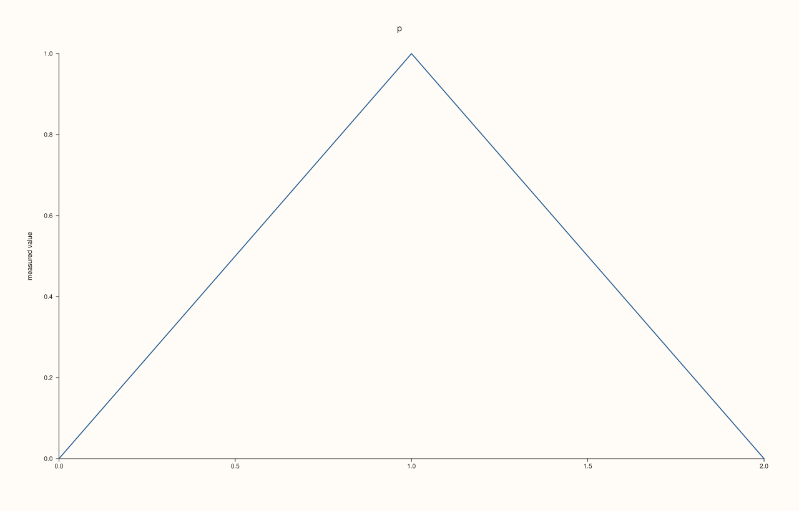
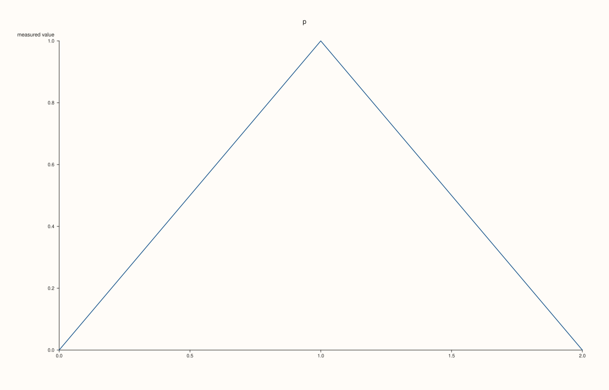
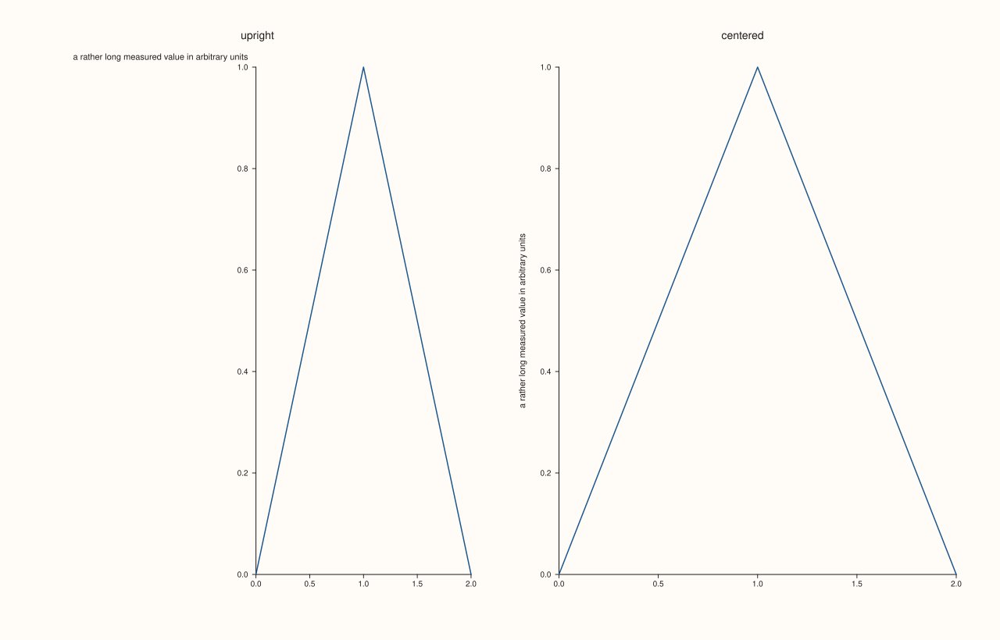
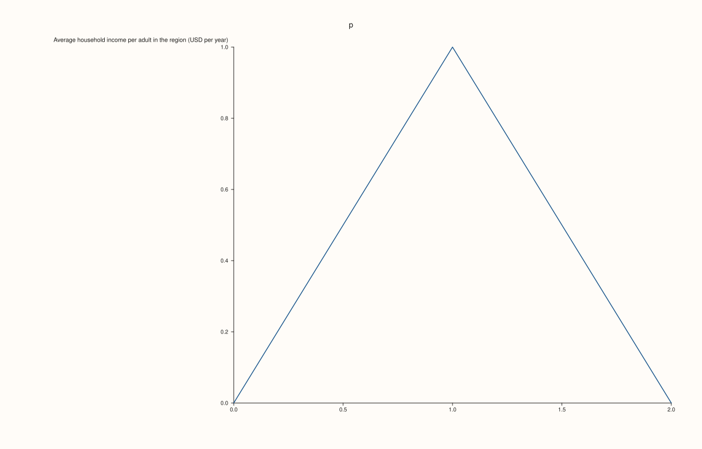

<!-- pluss-hand-authored -->

# Pane::y_label_centered

[Back to Pane API Reference](../../pane_api_reference)

## Signature

```cpp
Pane& Pane::y_label_centered(bool enable = true) noexcept
```

## What It Does

Chooses where the y label stands. Left alone, the label is placed automatically: while it is short it is written upright at the top of the axis, ending at the axis, like a heading; once its upright width would pass `y_label_upright_max_width_share` of the pane (0.15 by default; see [Style options](../types/StyleOptions.md)) it is turned to run vertically and is centred along the axis, outside the tick labels, so a long name is not cut by the figure's edge. Calling `y_label_centered` makes the choice yours: `true` always turns the label and centres it, `false` always keeps it upright at the top, whatever its length.

The two suit different figures. The upright label reads easily; the centred one takes less width and is the usual convention for a tall, narrow plot. A long upright label takes a wide margin at the left of the pane, which narrows the plot, so the automatic placement turns it; `false` is for the figure where you want the full name upright anyway. Either way the pane keeps room for the label, so it is never cut by the figure's edge. Only the y axis has the choice; the x label is always centred below its axis.

An explicit [`y_label_rotation`](y_label_rotation.md) is applied on top of either placement, and also switches off the automatic turning. A label too long even for the axis is shrunk, and ends in "..." unless [`y_label_full`](y_label_full.md) keeps it whole.

## Parameters

**enable** (`bool`, default `true`)

`true` to always turn the label vertical and centre it on the axis; `false` to always keep it upright at the top, however long it is. Not calling this leaves the choice to the automatic placement.

## Returns

`Pane&`
    The same pane, for chaining.

## Examples

Example 1. Left alone, a short label is upright, with its end at the axis.

```cpp
auto fig = studio("ycentered_default");
auto& pane = fig.pane2("p");
pane.trend(std::vector<double>{0, 1, 2}, std::vector<double>{0, 1, 0});
pane.y_label("measured value");
auto look = [](const std::string& svg, const std::string& text) {
  const auto hit = svg.find(">" + text + "<");
  if (hit == std::string::npos) return std::string("absent");
  const auto open = svg.rfind("<text", hit);
  const std::string tag = svg.substr(open, hit - open);
  const auto anchor = tag.find("text-anchor=\"");
  std::string out = "anchor " + tag.substr(anchor + 13, tag.find('"', anchor + 13) - anchor - 13);
  const auto rot = tag.find("rotate(");
  out += rot == std::string::npos ? ", upright" : ", rotated " + tag.substr(rot + 7, tag.find(' ', rot) - rot - 7);
  return out;
};
std::cout << look(fig.to_svg(), "measured value") << "\n";
fig.show();
```

### Output

```text
anchor end, upright
```


Example 2. Centred, it is turned to run up the axis, middle-anchored on the axis.

```cpp
auto fig = studio("ycentered_on");
auto& pane = fig.pane2("p");
pane.trend(std::vector<double>{0, 1, 2}, std::vector<double>{0, 1, 0});
pane.y_label("measured value");
auto look = [](const std::string& svg, const std::string& text) {
  const auto hit = svg.find(">" + text + "<");
  if (hit == std::string::npos) return std::string("absent");
  const auto open = svg.rfind("<text", hit);
  const std::string tag = svg.substr(open, hit - open);
  const auto anchor = tag.find("text-anchor=\"");
  std::string out = "anchor " + tag.substr(anchor + 13, tag.find('"', anchor + 13) - anchor - 13);
  const auto rot = tag.find("rotate(");
  out += rot == std::string::npos ? ", upright" : ", rotated " + tag.substr(rot + 7, tag.find(' ', rot) - rot - 7);
  return out;
};
pane.y_label_centered();
std::cout << look(fig.to_svg(), "measured value") << "\n";
fig.show();
```

### Output

```text
anchor middle, rotated -90.0000
```



Example 3. For a short label, `y_label_centered(false)` is the figure that never made the call: the automatic placement keeps a short label upright anyway. The next example shows where the two part.

```cpp
auto build = [&](int mode) {
  auto fig = studio("ycentered_off");
  auto& pane = fig.pane2("p");
  pane.trend(std::vector<double>{0, 1, 2}, std::vector<double>{0, 1, 0});
  pane.y_label("measured value");
  if (mode == 1) pane.y_label_centered(true);
  if (mode == 2) pane.y_label_centered(true).y_label_centered(false);
  return fig.to_svg();
};
std::cout << "off again == never set: " << (build(2) == build(0)) << ", on != off: " << (build(1) != build(0)) << "\n";
auto fig = studio("ycentered_off_out");
auto& pane = fig.pane2("p");
pane.trend(std::vector<double>{0, 1, 2}, std::vector<double>{0, 1, 0});
pane.y_label("measured value");
fig.show();
```

### Output

```text
off again == never set: 1, on != off: 1
```



Example 4. A long label stays inside the figure in both placements: with `false` the pane makes room for the upright label at its left, and the centred label sits beside the axis.

```cpp
auto fig = studio("ycentered_long");
fig.mosaic(1, 2);
auto& upright = fig.pane2("upright");
upright.trend(std::vector<double>{0, 1, 2}, std::vector<double>{0, 1, 0});
upright.y_label("a rather long measured value in arbitrary units").y_label_centered(false);
auto& centered = fig.pane2("centered");
centered.trend(std::vector<double>{0, 1, 2}, std::vector<double>{0, 1, 0});
centered.y_label("a rather long measured value in arbitrary units").y_label_centered();
fig.show();
```



Example 5. Left alone, a long label chooses for itself. The same long label is turned and centred when the call is not made, and stays upright when `y_label_centered(false)` is the choice.

```cpp
auto fig = studio("ycentered_auto_long");
auto& pane = fig.pane2("p");
pane.trend(std::vector<double>{0, 1, 2}, std::vector<double>{0, 1, 0});
const std::string longer = "Average household income per adult in the region (USD per year)";
pane.y_label(longer);
auto look = [](const std::string& svg, const std::string& text) {
  const auto hit = svg.find(">" + text + "<");
  if (hit == std::string::npos) return std::string("absent");
  const auto open = svg.rfind("<text", hit);
  const std::string tag = svg.substr(open, hit - open);
  const auto anchor = tag.find("text-anchor=\"");
  std::string out = "anchor " + tag.substr(anchor + 13, tag.find('"', anchor + 13) - anchor - 13);
  const auto rot = tag.find("rotate(");
  out += rot == std::string::npos ? ", upright" : ", rotated " + tag.substr(rot + 7, tag.find(' ', rot) - rot - 7);
  return out;
};
std::cout << "left alone:               " << look(fig.to_svg(), longer) << "\n";
pane.y_label_centered(false);
std::cout << "y_label_centered(false):  " << look(fig.to_svg(), longer) << "\n";
pane.y_label_centered(true);
std::cout << "y_label_centered(true):   " << look(fig.to_svg(), longer) << "\n";
pane.y_label_centered(false);
fig.show();
```

### Output

```text
left alone:               anchor middle, rotated -90.0000
y_label_centered(false):  anchor end, upright
y_label_centered(true):   anchor middle, rotated -90.0000
```



Example 6. With an explicit rotation the label is turned by that angle, and the placement decides where it is anchored.

```cpp
auto fig = studio("ycentered_rotation");
auto& pane = fig.pane2("p");
pane.trend(std::vector<double>{0, 1, 2}, std::vector<double>{0, 1, 0});
pane.y_label("measured value");
auto look = [](const std::string& svg, const std::string& text) {
  const auto hit = svg.find(">" + text + "<");
  if (hit == std::string::npos) return std::string("absent");
  const auto open = svg.rfind("<text", hit);
  const std::string tag = svg.substr(open, hit - open);
  const auto anchor = tag.find("text-anchor=\"");
  std::string out = "anchor " + tag.substr(anchor + 13, tag.find('"', anchor + 13) - anchor - 13);
  const auto rot = tag.find("rotate(");
  out += rot == std::string::npos ? ", upright" : ", rotated " + tag.substr(rot + 7, tag.find(' ', rot) - rot - 7);
  return out;
};
pane.y_label_centered().y_label_rotation(-45.0);
std::cout << look(fig.to_svg(), "measured value") << "\n";
fig.show();
```

### Output

```text
anchor middle, rotated -45.0000
```


## Notes

- `noexcept`. Only the y axis has this switch.
- The call has no effect on a pane without a y label.
- Once called, the automatic placement is off for this axis: `true` and `false` stay in force whatever the label's length.

## See Also

- [`Pane::y_label`](y_label.md): the label.
- [`Pane::y_label_rotation`](y_label_rotation.md): rotate it by hand.
- [`Pane::y_label_full`](y_label_full.md): keep a long turned label whole.
- [`Pane::y_label_gap`](y_label_gap.md): the distance from the tick labels.

<div class="pluss-inline-prev-next">
  <a class="prev-link" href="y_label.html">
    <span class="label">Previous</span>
    <span class="title">y_label</span>
  </a>
  <a class="next-link" href="y_label_full.html">
    <span class="label">Next</span>
    <span class="title">y_label_full</span>
  </a>
</div>
