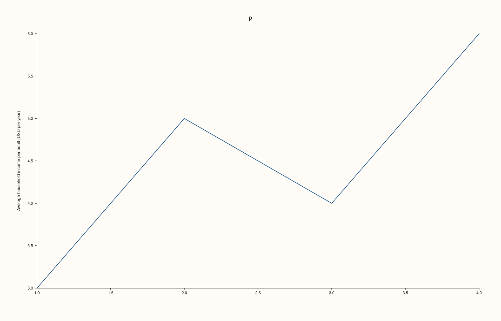
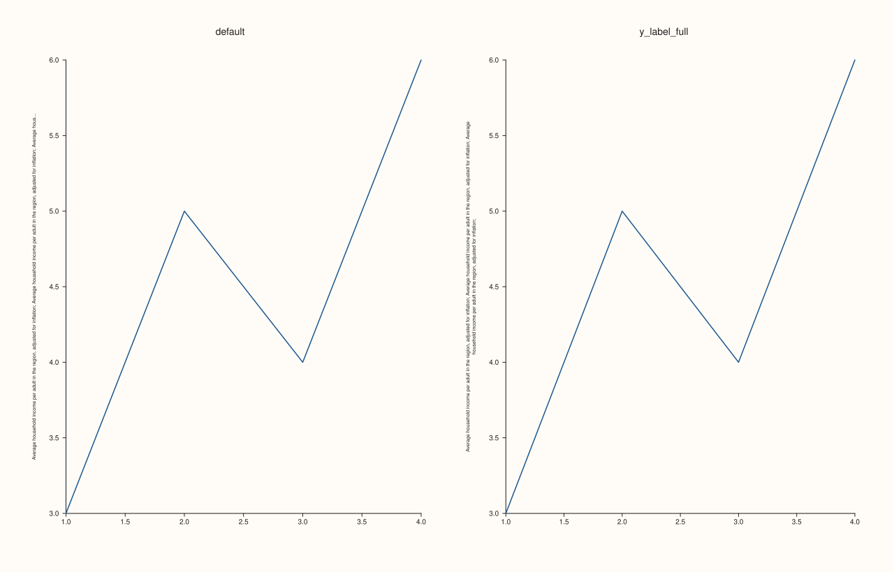
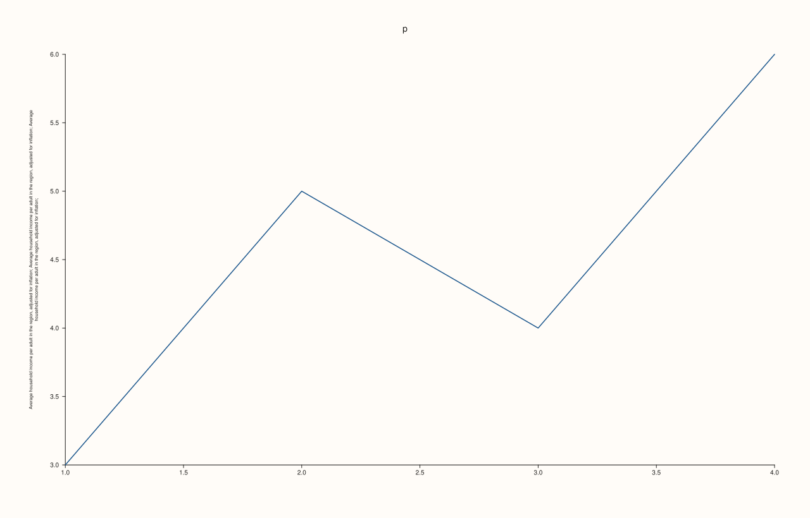
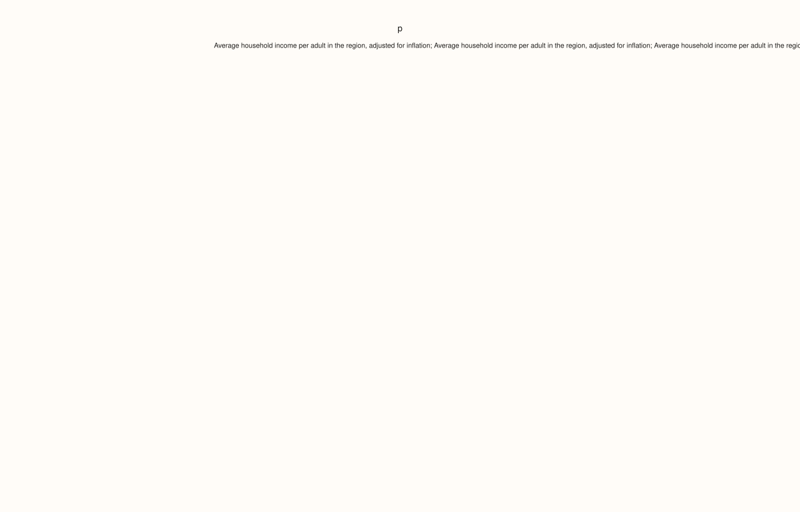
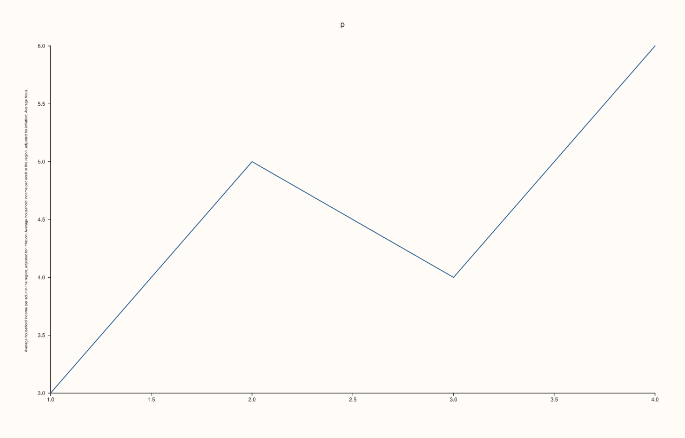

<!-- pluss-hand-authored -->

# Pane::y_label_full

[Back to Pane API Reference](../../pane_api_reference)

## Signature

```cpp
Pane& Pane::y_label_full(bool enable = true) noexcept
```

## What It Does

Keeps the whole text of a long y label. A y label that is turned to run up the axis (by the automatic placement, or by [`y_label_centered`](y_label_centered.md)) is fitted to the length of the axis: its font shrinks until it fits, down to a smallest readable size (`y_label_fit_min_font_pt`, 7 points), and a label that is still too long ends in "...", the text after that point being dropped.

With `y_label_full` the text is never dropped. The label still shrinks to the smallest readable size; if it does not fit even then, it is wrapped at word breaks into several columns, set side by side along the axis, and the pane makes room at its left for each extra column. The columns are `y_label_line_height_em` apart (1.25 times the label font by default; see [Style options](../types/StyleOptions.md)). Nothing else about the label changes: it is still centred beside the axis, outside the tick labels.

The call matters only for a label that is turned and is longer than the axis. A label that fits, an upright label, and a label with an angle of its own ([`y_label_rotation`](y_label_rotation.md)) are drawn exactly as without it. One word longer than the axis cannot be wrapped and runs past the ends of the axis.

## Parameters

**enable** (`bool`, default `true`)

`true` to keep the whole label, wrapping it into columns when it is too long for the axis; `false` for the default, where a label too long for the axis ends in "...".

## Returns

`Pane&`
    The same pane, for chaining.

## Examples

Example 1. A label that fits needs nothing. This label is turned and fits the axis at the default size, so the figure is the same with and without `y_label_full`.

```cpp
auto build = [&](bool keep) {
  auto fig = studio("y_label_full_fits");
  auto& pane = fig.pane2("p");
  pane.trend(std::vector<double>{1, 2, 3, 4}, std::vector<double>{3, 5, 4, 6});
  pane.y_label("Average household income per adult (USD per year)");
  if (keep) pane.y_label_full();
  return fig.to_svg();
};
std::cout << "same figure with and without y_label_full: " << (build(true) == build(false)) << "\n";
auto fig = studio("y_label_full_fits_out");
auto& pane = fig.pane2("p");
pane.trend(std::vector<double>{1, 2, 3, 4}, std::vector<double>{3, 5, 4, 6});
pane.y_label("Average household income per adult (USD per year)").y_label_full();
fig.show();
```

### Output

```text
same figure with and without y_label_full: 1
```



Example 2. A label too long for the axis. Left alone it shrinks to the smallest readable size and ends in "..."; with `y_label_full` the same label is wrapped into columns and every word is drawn. The counts below are how many times the word "adult" appears in the figure (the label has it three times).

```cpp
std::string name;
for (int i = 0; i < 3; ++i) name += "Average household income per adult in the region, adjusted for inflation; ";
auto count = [](const std::string& svg, const std::string& word) {
  std::size_t n = 0;
  for (auto at = svg.find(word); at != std::string::npos; at = svg.find(word, at + 1)) ++n;
  return n;
};
auto build = [&](bool keep) {
  auto fig = studio("y_label_full_overlong");
  auto& pane = fig.pane2("p");
  pane.trend(std::vector<double>{1, 2, 3, 4}, std::vector<double>{3, 5, 4, 6});
  pane.y_label(name);
  if (keep) pane.y_label_full();
  return fig.to_svg();
};
for (bool keep : {false, true}) {
  const std::string svg = build(keep);
  std::cout << (keep ? "y_label_full: " : "default:      ") << count(svg, "adult") << " of 3 phrases drawn, ellipsis " << (svg.find("...</text>") != std::string::npos ? "yes" : "no") << "\n";
}
auto fig = studio("y_label_full_overlong_out");
fig.mosaic(1, 2);
auto& cut = fig.pane2("default");
cut.trend(std::vector<double>{1, 2, 3, 4}, std::vector<double>{3, 5, 4, 6});
cut.y_label(name);
auto& whole = fig.pane2("y_label_full");
whole.trend(std::vector<double>{1, 2, 3, 4}, std::vector<double>{3, 5, 4, 6});
whole.y_label(name).y_label_full();
fig.show();
```

### Output

```text
default:      2 of 3 phrases drawn, ellipsis yes
y_label_full: 3 of 3 phrases drawn, ellipsis no
```



Example 3. The columns. Each column is a separate piece of text turned to run up the axis, and the pane gains room at its left for each one after the first. Counting the turned texts shows how many columns the label took.

```cpp
std::string name;
for (int i = 0; i < 3; ++i) name += "Average household income per adult in the region, adjusted for inflation; ";
auto turned = [](const std::string& svg) {
  std::size_t n = 0;
  for (auto at = svg.find("rotate(-90"); at != std::string::npos; at = svg.find("rotate(-90", at + 1)) ++n;
  return n;
};
for (bool keep : {false, true}) {
  auto fig = studio("y_label_full_columns");
  auto& pane = fig.pane2("p");
  pane.trend(std::vector<double>{1, 2, 3, 4}, std::vector<double>{3, 5, 4, 6});
  pane.y_label(name);
  if (keep) pane.y_label_full();
  const std::string svg = fig.to_svg();
  std::cout << (keep ? "y_label_full: " : "default:      ") << turned(svg) << " turned text(s)\n";
}
auto fig = studio("y_label_full_columns_out");
auto& pane = fig.pane2("p");
pane.trend(std::vector<double>{1, 2, 3, 4}, std::vector<double>{3, 5, 4, 6});
pane.y_label(name).y_label_full();
fig.show();
```

### Output

```text
default:      1 turned text(s)
y_label_full: 2 turned text(s)
```



Example 4. A label you placed yourself is left as you placed it. With `y_label_rotation(0.0)` or `y_label_centered(false)` the label is upright, nothing is cut, and `y_label_full` changes nothing.

```cpp
std::string name;
for (int i = 0; i < 3; ++i) name += "Average household income per adult in the region, adjusted for inflation; ";
auto build = [&](int mode, bool keep) {
  auto fig = studio("y_label_full_by_hand");
  auto& pane = fig.pane2("p");
  pane.trend(std::vector<double>{1, 2, 3, 4}, std::vector<double>{3, 5, 4, 6});
  pane.y_label(name);
  if (mode == 1) pane.y_label_rotation(0.0);
  if (mode == 2) pane.y_label_centered(false);
  if (keep) pane.y_label_full();
  return fig.to_svg();
};
std::cout << "rotation 0 set:          same with y_label_full: " << (build(1, true) == build(1, false)) << "\n";
std::cout << "y_label_centered(false): same with y_label_full: " << (build(2, true) == build(2, false)) << "\n";
auto fig = studio("y_label_full_by_hand_out");
auto& pane = fig.pane2("p");
pane.trend(std::vector<double>{1, 2, 3, 4}, std::vector<double>{3, 5, 4, 6});
pane.y_label(name).y_label_centered(false).y_label_full();
fig.show();
```

### Output

```text
rotation 0 set:          same with y_label_full: 1
y_label_centered(false): same with y_label_full: 1
```



Example 5. `y_label_full(false)` is the default again: the figure is the one that never made the call.

```cpp
std::string name;
for (int i = 0; i < 3; ++i) name += "Average household income per adult in the region, adjusted for inflation; ";
auto build = [&](int mode) {
  auto fig = studio("y_label_full_off");
  auto& pane = fig.pane2("p");
  pane.trend(std::vector<double>{1, 2, 3, 4}, std::vector<double>{3, 5, 4, 6});
  pane.y_label(name);
  if (mode == 1) pane.y_label_full(true);
  if (mode == 2) pane.y_label_full(true).y_label_full(false);
  return fig.to_svg();
};
std::cout << "off again == never set: " << (build(2) == build(0)) << ", on != off: " << (build(1) != build(0)) << "\n";
auto fig = studio("y_label_full_off_out");
auto& pane = fig.pane2("p");
pane.trend(std::vector<double>{1, 2, 3, 4}, std::vector<double>{3, 5, 4, 6});
pane.y_label(name);
fig.show();
```

### Output

```text
off again == never set: 1, on != off: 1
```



## Notes

- `noexcept`. Only the y axis has this switch.\n- The call has no effect on a pane without a y label, on an upright label, or on a label that fits the axis.\n- The smallest readable font is the style option `y_label_fit_min_font_pt`; the distance between columns is `y_label_line_height_em`.\n- A word longer than the axis cannot be wrapped and runs past its ends.

## See Also

- [`Pane::y_label`](y_label.md): the label.
- [`Pane::y_label_centered`](y_label_centered.md): turn and centre the label, or keep it upright.
- [`Pane::y_label_rotation`](y_label_rotation.md): rotate it by hand.
- [`Pane::y_label_gap`](y_label_gap.md): the distance from the tick labels.

<div class="pluss-inline-prev-next">
  <a class="prev-link" href="y_label_centered.html">
    <span class="label">Previous</span>
    <span class="title">y_label_centered</span>
  </a>
  <a class="next-link" href="y_label_gap.html">
    <span class="label">Next</span>
    <span class="title">y_label_gap</span>
  </a>
</div>
