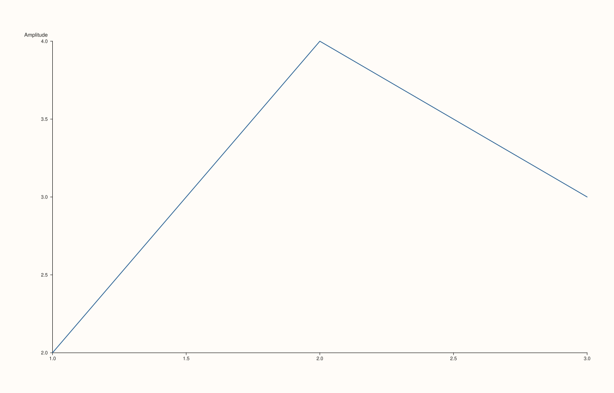

<!-- pluss-hand-authored -->

# Pane::y_label_gap

[Back to Pane API Reference](../../pane_api_reference)

## Signatures

```cpp
Pane& Pane::y_label_gap(double points)          // sets an explicit gap
Pane& Pane::clear_y_label_gap() noexcept          // clears back to the default
```

## What It Does

The y-axis counterpart of [`x_label_gap()`](x_label_gap.md)/
[`clear_x_label_gap()`](x_label_gap.md). Every validation detail carries over unchanged
(finite and non-negative) — see [`x_label_gap()`](x_label_gap.md) for the full
worked-example set.

## Parameters

**points** (`double`, setter only)
    The gap size in points. Must be finite and non-negative.

## Returns

`Pane&`
    A reference to the same pane, for chaining.

## Examples

Example 1. A wider gap on the y-axis.

```cpp
using namespace pluss::pl;

auto fig = studio("y_label_gap_wide");
auto& pane = fig.pane2();
pane.trend(std::vector<double>{1.0, 2.0, 3.0}, std::vector<double>{2.0, 4.0, 3.0});
pane.y_label("Amplitude");
pane.y_label_gap(25.0);
fig.show();

std::cout << *pane.y_axis().label_gap << "\n";
```

### Output

```text
25
```



## Notes

See [`x_label_gap()`](x_label_gap.md)'s Notes — every detail applies identically here.

## See Also

- [`Pane::x_label_gap`](x_label_gap.md): the x-axis equivalent, with the full
  worked-example set for validation failures.
- [`Pane::z_label_gap`](z_label_gap.md): the z-axis equivalent.
- [`Pane::y_tick_label_gap`](y_tick_label_gap.md): the closer-in tick/label spacing.

<div class="pluss-inline-prev-next">
  <a class="prev-link" href="x_label_gap.html">
    <span class="label">Previous</span>
    <span class="title">x_label_gap</span>
  </a>
  <a class="next-link" href="z_label_gap.html">
    <span class="label">Next</span>
    <span class="title">z_label_gap</span>
  </a>
</div>
