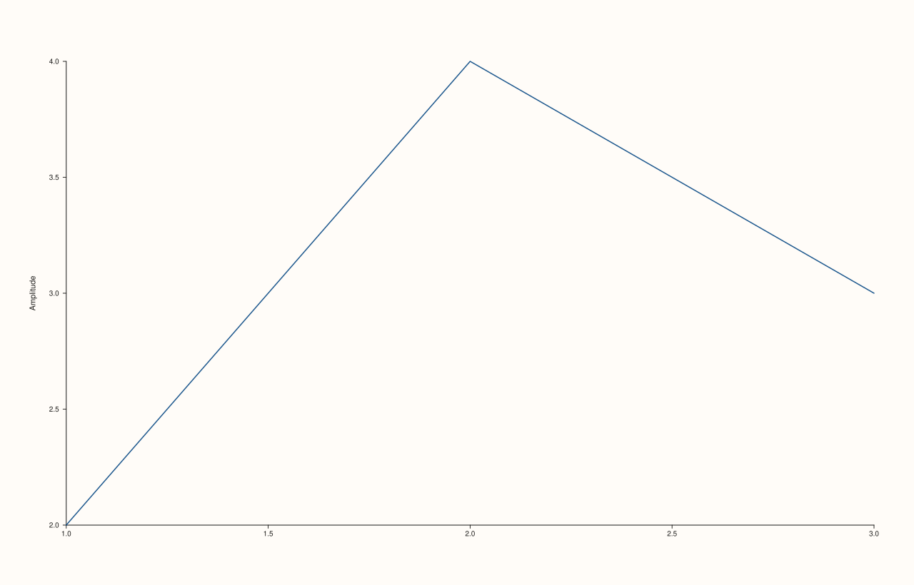

<!-- pluss-hand-authored -->

# Pane::y_label_rotation

[Back to Pane API Reference](../../pane_api_reference)

## Signatures

```cpp
Pane& Pane::y_label_rotation(double degrees)          // sets an explicit rotation
Pane& Pane::clear_y_label_rotation() noexcept          // clears back to the default
```

## What It Does

The y-axis counterpart of [`x_label_rotation()`](x_label_rotation.md)/
[`clear_x_label_rotation()`](x_label_rotation.md). Every detail carries over unchanged —
only validated for finiteness — see [`x_label_rotation()`](x_label_rotation.md) for the
full worked-example set.

## Parameters

**degrees** (`double`, setter only)
    The rotation angle in degrees. Must be finite.

## Returns

`Pane&`
    A reference to the same pane, for chaining.

## Examples

Example 1. A vertical (`-90` degree) rotation, a common choice for y-axis labels.

```cpp
using namespace pluss::pl;

auto fig = studio("y_label_rotation_neg90");
auto& pane = fig.pane2();
pane.trend(std::vector<double>{1.0, 2.0, 3.0}, std::vector<double>{2.0, 4.0, 3.0});
pane.y_label("Amplitude");
pane.y_label_rotation(-90.0);
fig.show();

std::cout << *pane.y_axis().label_rotation_deg << "\n";
```

### Output

```text
-90
```



## Notes

See [`x_label_rotation()`](x_label_rotation.md)'s Notes — every detail applies identically
here.

## See Also

- [`Pane::x_label_rotation`](x_label_rotation.md): the x-axis equivalent, with the full
  worked-example set for validation failures.
- [`Pane::z_label_rotation`](z_label_rotation.md): the z-axis equivalent.
- [`Pane::y_label_centered`](y_label_centered.md): a y-axis-only layout toggle, unrelated
  to rotation.

<div class="pluss-inline-prev-next">
  <a class="prev-link" href="x_label_rotation.html">
    <span class="label">Previous</span>
    <span class="title">x_label_rotation</span>
  </a>
  <a class="next-link" href="z_label_rotation.html">
    <span class="label">Next</span>
    <span class="title">z_label_rotation</span>
  </a>
</div>
