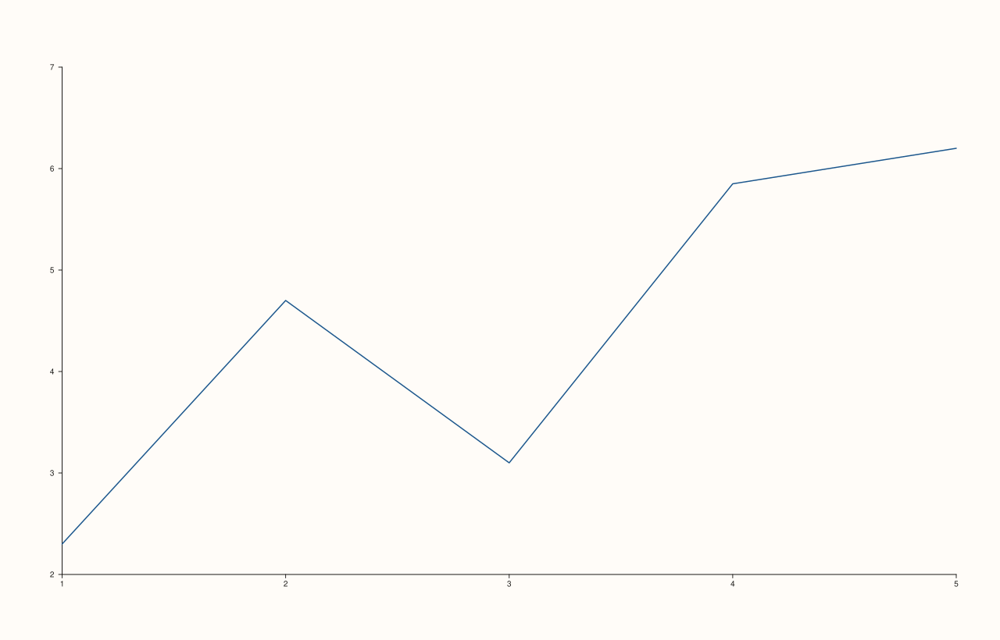
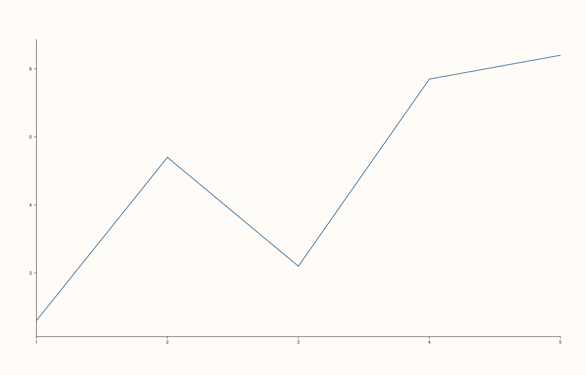

<!-- pluss-hand-authored -->

# Pane::y_limit_method

[Back to Pane API Reference](../../pane_api_reference)

## Signature

```cpp
Pane& Pane::y_limit_method(LimitMethod method) noexcept
```

## What It Does

The y-axis counterpart of [`x_limit_method()`](x_limit_method.md): chooses how the y-axis
range is computed during automatic fitting (`TickAligned`/`Tight`/`Padded`). Every
behavioral detail carries over unchanged — including having zero effect once
[`y_limits()`](y_limits.md) sets an explicit range. See
[`x_limit_method()`](x_limit_method.md)'s page for the full worked example set (all three
values compared directly, plus the manual-limits-make-it-inert demonstration) — every one
of those examples is already written against `y_limit_method()`.

## Parameters

**method** (`LimitMethod`)
    `TickAligned` (default), `Tight`, or `Padded`.

## Returns

`Pane&`
    A reference to the same pane, for chaining.

## Examples

Example 1. `TickAligned` (the default) vs. `Padded`, on the same non-round data.

```cpp
using namespace pluss::pl;

const std::vector<double> x{1.0, 2.0, 3.0, 4.0, 5.0};
const std::vector<double> y{2.3, 4.7, 3.1, 5.85, 6.2};

auto fig1 = studio("limit_method_default");
auto& pane1 = fig1.pane2();
pane1.trend(x, y);
fig1.show();

auto fig2 = studio("limit_method_padded");
auto& pane2 = fig2.pane2();
pane2.trend(x, y);
pane2.y_limit_method(LimitMethod::Padded);
fig2.show();

std::cout << (fig1.to_svg() == fig2.to_svg()) << "\n";
```

### Output

```text
0
```





## Notes

See [`x_limit_method()`](x_limit_method.md)'s Notes — every detail applies identically
here.

## See Also

- [`Pane::x_limit_method`](x_limit_method.md): the x-axis equivalent, with the full
  worked-example set.
- [`Pane::z_limit_method`](z_limit_method.md) / [`Pane::color_limit_method`](color_limit_method.md):
  the z- and color-axis equivalents.
- [`Pane::y_limits`](y_limits.md): what makes this method inert once set explicitly.

<div class="pluss-inline-prev-next">
  <a class="prev-link" href="x_limit_method.html">
    <span class="label">Previous</span>
    <span class="title">x_limit_method</span>
  </a>
  <a class="next-link" href="z_limit_method.html">
    <span class="label">Next</span>
    <span class="title">z_limit_method</span>
  </a>
</div>
