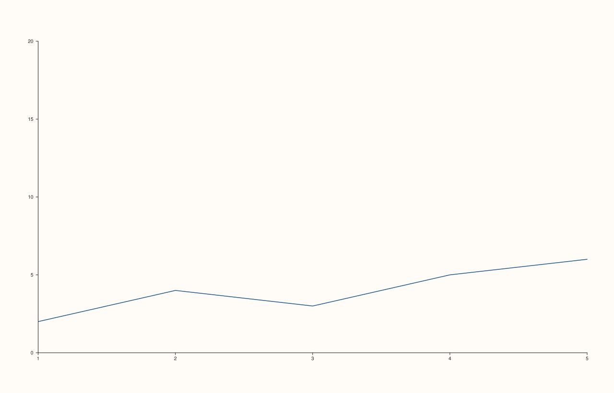

<!-- pluss-hand-authored -->

# Pane::y_limits

[Back to Pane API Reference](../../pane_api_reference)

## Signatures

```cpp
Pane& Pane::y_limits(Range1d limits)   // sets an explicit, manual range
Pane& Pane::auto_y() noexcept          // clears back to automatic fitting
```

## What It Does

The y-axis counterpart of [`x_limits()`](x_limits.md)/[`auto_x()`](x_limits.md): sets an
explicit y-axis display range (flipping `limit_mode` to `Manual`), or clears it back to
automatic fitting via `auto_y()`. Every validation detail carries over unchanged, with
`"y_limits"` in place of `"x_limits"` in throw messages — the range must be finite and
strictly increasing, and must additionally be strictly positive if
[`scale_y()`](scale_y.md)'s current scale is `ScaleKind::Log10`.

Every worked example on [`x_limits()`](x_limits.md)'s own page is in fact already written
against `y_limits()` (the mechanics are identical regardless of axis) — see that page for
the full set, including all three range-validation failures and the auto-fit round-trip.

## Parameters

**limits** (`Range1d`)
    The explicit `{low, high}` range to display.

## Returns

`Pane&`
    A reference to the same pane, for chaining.

## Examples

Example 1. An explicit y-range, clipping the plotted data's own natural range.

```cpp
using namespace pluss::pl;

auto fig = studio("limits_manual");
auto& pane = fig.pane2();
pane.trend(std::vector<double>{1.0, 2.0, 3.0, 4.0, 5.0}, std::vector<double>{2.0, 4.0, 3.0, 5.0, 6.0});
pane.y_limits(Range1d{0.0, 20.0});
fig.show();

std::cout << (pane.y_axis().limit_mode == LimitMode::Manual) << "\n";
std::cout << pane.y_axis().limits->low << " " << pane.y_axis().limits->high << "\n";
```

### Output

```text
1
0 20
```



Example 2. `auto_y()` clears it back — identical output to never having called
`y_limits()`.

```cpp
using namespace pluss::pl;

auto fig = studio("limits_cleared_back_to_auto");
auto& pane = fig.pane2();
pane.trend(std::vector<double>{1.0, 2.0, 3.0, 4.0, 5.0}, std::vector<double>{2.0, 4.0, 3.0, 5.0, 6.0});
pane.y_limits(Range1d{0.0, 20.0});
pane.auto_y();
fig.show();

std::cout << (pane.y_axis().limit_mode == LimitMode::AutoFit) << "\n";
```

### Output

```text
1
```


## Notes

See [`x_limits()`](x_limits.md)'s Notes — every detail applies identically here.

## See Also

- [`Pane::x_limits`](x_limits.md): the x-axis equivalent, with the full worked-example set.
- [`Pane::z_limits`](z_limits.md): the z-axis equivalent.
- [`Pane::scale_y`](scale_y.md): the other half of the log10 cross-validation.
- [`Pane::y_limit_method`](y_limit_method.md): governs automatic fitting only.

<div class="pluss-inline-prev-next">
  <a class="prev-link" href="x_limits.html">
    <span class="label">Previous</span>
    <span class="title">x_limits</span>
  </a>
  <a class="next-link" href="z_limits.html">
    <span class="label">Next</span>
    <span class="title">z_limits</span>
  </a>
</div>
