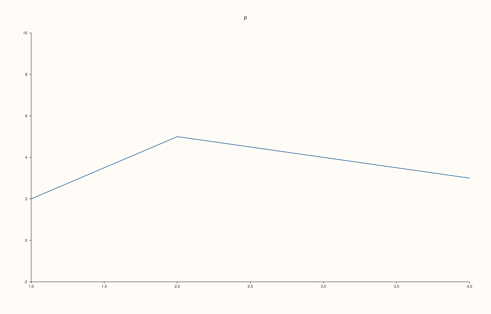
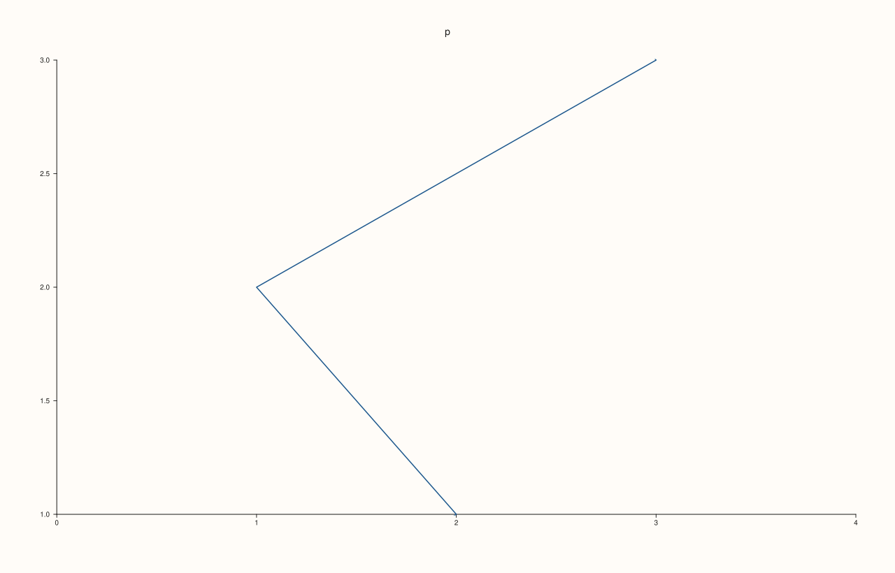
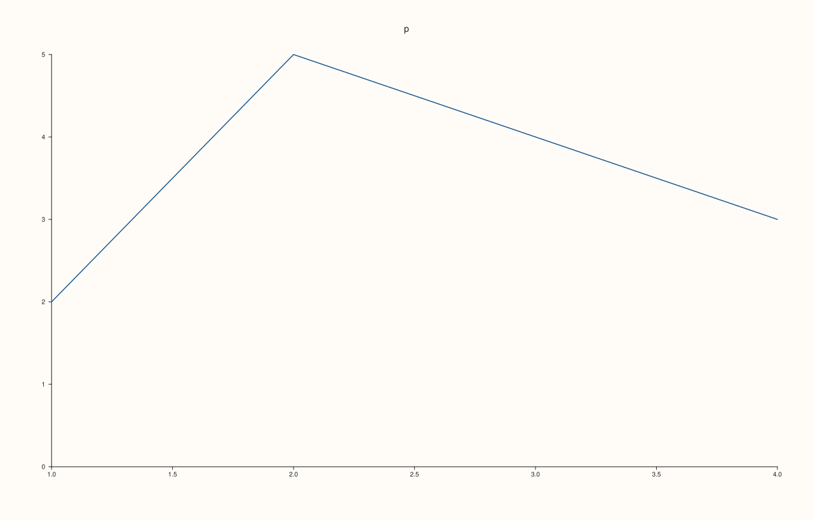
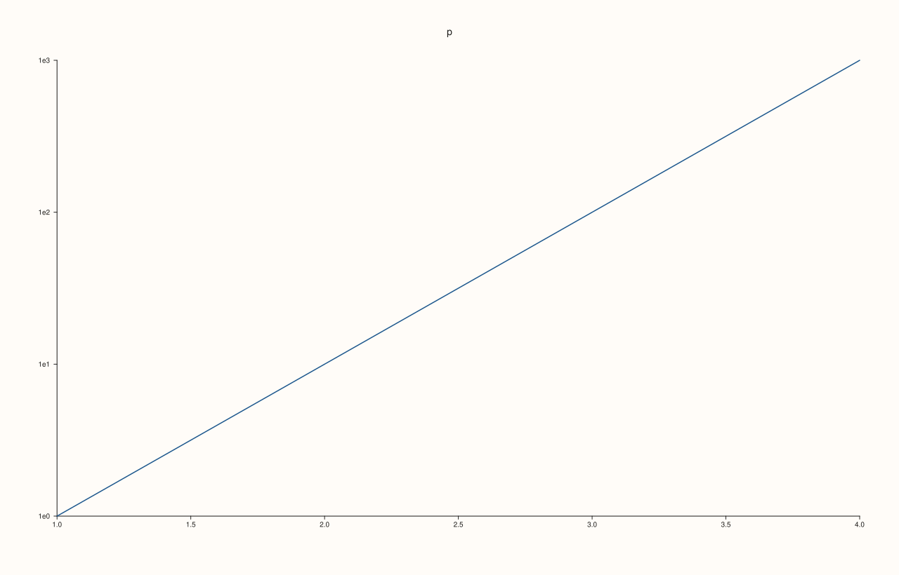

<!-- pluss-hand-authored -->

# Pane::y_limits

[Back to Pane API Reference](../../pane_api_reference)

## Signature

```cpp
Pane& Pane::y_limits(Range1d limits)
Pane& Pane::auto_y() noexcept
```

## What It Does

Sets the range the y axis displays, overriding the automatic fit to the data. The range is stored in `y_axis().limits` and the axis switches from `LimitMode::AutoFit` to `LimitMode::Manual`; the data is then drawn against exactly that range, and the part of it outside the range is cut at the edge of the plot area. [`auto_y`](auto_y.md) is the way back: it discards the range and returns to automatic fitting, which is then governed by [`y_limit_method`](y_limit_method.md); on an axis that is already automatic it does nothing.

The range must be finite on both ends and strictly increasing (`low < high`): a reversed, empty or non-finite range throws `pluss::Error` and the previous range is kept. With a logarithmic scale ([`scale_y`](scale_y.md) with `ScalePolicy::log10()`) both ends must also be positive; the same rule is applied the other way round when the scale is switched to log10 with a manual range already set. The call takes effect when the figure is rendered, so it can precede or follow the traces.

## Parameters

**limits** (`Range1d`)
    The displayed range, `{low, high}`. Finite and strictly increasing; positive for a log scale.

## Returns

`Pane&`
    The same pane, for chaining.

## Examples

Example 1. Default, manual, back to automatic. A new axis fits its range to the data (`limit_mode` is `AutoFit`, 0); `y_limits` stores the range and switches to `Manual` (1); `auto_y()` returns to automatic.

```cpp
auto fig = studio("y_limits_readback");
auto& pane = fig.pane2("p");
pane.trend(std::vector<double>{1, 2, 3, 4}, std::vector<double>{2, 5, 4, 3});
auto show = [&] {
  const auto& axis = pane.y_axis();
  std::cout << "mode " << static_cast<int>(axis.limit_mode) << ", limits " << (axis.limits ? std::to_string(axis.limits->low) + " .. " + std::to_string(axis.limits->high) : std::string("none")) << "\n";
};
std::cout << "new axis: "; show();
pane.y_limits(Range1d{-2.0, 10.0});
std::cout << "after y_limits: "; show();
pane.auto_y();
std::cout << "after auto_y: "; show();
pane.y_limits(Range1d{-2.0, 10.0});
fig.save_svg("figure.svg");
```

### Output

```text
new axis: mode 0, limits none
after y_limits: mode 1, limits -2.000000 .. 10.000000
after auto_y: mode 0, limits none
```


Example 2. The effect on the picture. The range {-2, 10} is much wider than the data, so the data occupies part of the axis and the ticks follow the range; the figure differs from the automatic one.

```cpp
auto build = [&](bool manual) {
  auto fig = studio("y_limits_effect");
  auto& pane = fig.pane2("p");
  pane.trend(std::vector<double>{1, 2, 3, 4}, std::vector<double>{2, 5, 4, 3});
  pane.x_tick_labels(false);
  pane.z_tick_labels(false);
  if (manual) pane.y_limits(Range1d{-2.0, 10.0});
  return fig.to_svg();
};
auto texts = [](const std::string& svg) {
  std::string out;
  for (std::size_t at = svg.find("<text"); at != std::string::npos; at = svg.find("<text", at + 1)) {
    const auto gt = svg.find('>', at);
    out += svg.substr(gt + 1, svg.find("</text>", gt) - gt - 1) + " ";
  }
  return out;
};
std::cout << "automatic ticks: " << texts(build(false)) << "\n";
std::cout << "manual ticks:    " << texts(build(true)) << "\n";
auto fig = studio("y_limits_effect_out");
auto& pane = fig.pane2("p");
pane.trend(std::vector<double>{1, 2, 3, 4}, std::vector<double>{2, 5, 4, 3});
pane.y_limits(Range1d{-2.0, 10.0});
fig.save_svg("figure.svg");
```

### Output

```text
automatic ticks: p 2.0 2.5 3.0 3.5 4.0 4.5 5.0 
manual ticks:    p -2 0 2 4 6 8 10 
```



Example 3. A range narrower than the data. Only the part of the data inside the range is shown; the rest is cut at the edge of the plot area and nothing is drawn outside it.

```cpp
auto fig = studio("y_limits_narrow");
auto& pane = fig.pane2("p");
pane.trend(std::vector<double>{0, 2, 1, 3, 2, 4, 3}, std::vector<double>{0, 1, 2, 3, 4, 5, 6});
pane.y_limits(Range1d{1.0, 3.0});
std::cout << "range: " << pane.y_axis().limits->low << " .. " << pane.y_axis().limits->high << "\n";
fig.save_svg("figure.svg");
```

### Output

```text
range: 1 .. 3
```



Example 4. Back to automatic. After `auto_y()` the figure equals the one that never set a range, and the limit method (`y_limit_method`) applies again.

```cpp
auto build = [&](bool set_then_auto) {
  auto fig = studio("y_limits_auto");
  auto& pane = fig.pane2("p");
  pane.trend(std::vector<double>{1, 2, 3, 4}, std::vector<double>{2, 5, 4, 3});
  if (set_then_auto) pane.y_limits(Range1d{-50.0, 50.0}).auto_y();
  return fig.to_svg();
};
std::cout << "equal: " << (build(true) == build(false)) << "\n";
auto fig = studio("y_limits_auto_out");
auto& pane = fig.pane2("p");
pane.trend(std::vector<double>{1, 2, 3, 4}, std::vector<double>{2, 5, 4, 3});
fig.save_svg("figure.svg");
```

### Output

```text
equal: 1
```


Example 5. Invalid ranges are refused and the previous range is kept. The range must be finite and strictly increasing, so a reversed range, an empty one and a non-finite one each throw `pluss::Error`.

```cpp
auto fig = studio("y_limits_invalid");
auto& pane = fig.pane2("p");
pane.trend(std::vector<double>{1, 2, 3, 4}, std::vector<double>{2, 5, 4, 3});
pane.y_limits(Range1d{0.0, 5.0});
const double inf = std::numeric_limits<double>::infinity();
const Range1d bad[] = {{5.0, 0.0}, {3.0, 3.0}, {0.0, inf}, {std::numeric_limits<double>::quiet_NaN(), 1.0}};
for (const Range1d& range : bad) {
  try {
    pane.y_limits(range);
  } catch (const pluss::Error& e) {
    std::cout << range.low << " .. " << range.high << ": " << e.message() << "\n";
  }
}
std::cout << "kept: " << pane.y_axis().limits->low << " .. " << pane.y_axis().limits->high << "\n";
fig.save_svg("figure.svg");
```

### Output

```text
5 .. 0: y_limits: range must be finite and strictly increasing
3 .. 3: y_limits: range must be finite and strictly increasing
0 .. inf: y_limits: range must be finite and strictly increasing
nan .. 1: y_limits: range must be finite and strictly increasing
kept: 0 .. 5
```



Example 6. With a log scale the range must be positive. After `scale_y(log10)` a range that includes zero throws, and switching to `log10` while such a range is set throws as well; the axis keeps its previous state in both cases.

```cpp
auto fig = studio("y_limits_log");
auto& pane = fig.pane2("p");
pane.trend(std::vector<double>{1, 2, 3, 4}, std::vector<double>{1, 10, 100, 1000});
pane.scale_y(ScalePolicy::log10());
try {
  pane.y_limits(Range1d{0.0, 100.0});
} catch (const pluss::Error& e) {
  std::cout << "after log10: " << e.message() << "\n";
}
pane.y_limits(Range1d{1.0, 1000.0});
std::cout << "positive range accepted: " << pane.y_axis().limits->low << " .. " << pane.y_axis().limits->high << "\n";
auto other = studio("y_limits_log_order");
auto& flat = other.pane2("flat");
flat.trend(std::vector<double>{1, 2, 3}, std::vector<double>{2, 4, 3});
flat.y_limits(Range1d{-1.0, 5.0});
try {
  flat.scale_y(ScalePolicy::log10());
} catch (const pluss::Error& e) {
  std::cout << "limits first, then log10: " << e.message() << "\n";
}
fig.save_svg("figure.svg");
```

### Output

```text
after log10: y_limits: log10 limits must be strictly positive
positive range accepted: 1 .. 1000
limits first, then log10: scale_y: log10 limits must be strictly positive
```



## Notes

- `y_limits` throws, so it is not `noexcept`; `auto_y` never throws.
- A manual range ignores [`y_limit_method`](y_limit_method.md) completely; the method only shapes the automatic range.

## See Also

- [`Pane::auto_y`](auto_y.md): back to automatic.
- [`Pane::y_limit_method`](y_limit_method.md): how the automatic range is chosen.
- [`Pane::scale_y`](scale_y.md): linear, log and symmetric-log axes.
- [`Pane::x_limits`](x_limits.md): the same setting for the x axis.
- [`Pane::z_limits`](z_limits.md): the same setting for the z axis.

<div class="pluss-inline-prev-next">
  <a class="prev-link" href="y_limit_method.html">
    <span class="label">Previous</span>
    <span class="title">y_limit_method</span>
  </a>
  <a class="next-link" href="y_major_grid.html">
    <span class="label">Next</span>
    <span class="title">y_major_grid</span>
  </a>
</div>
