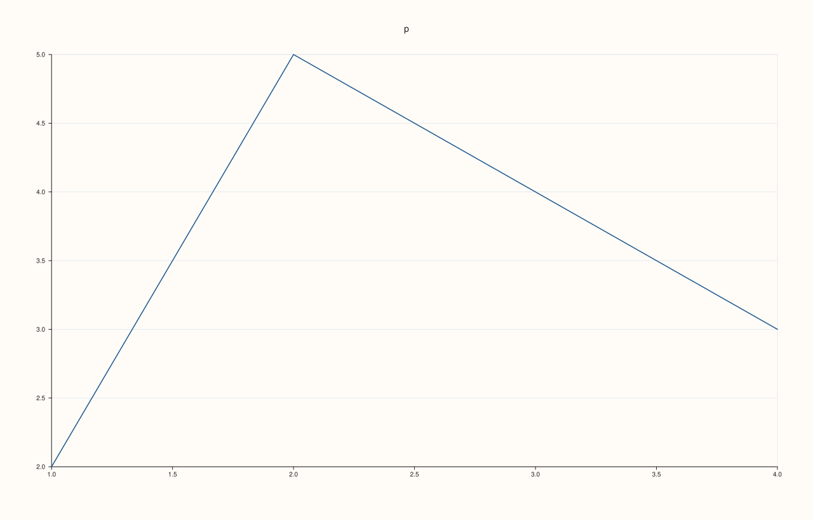
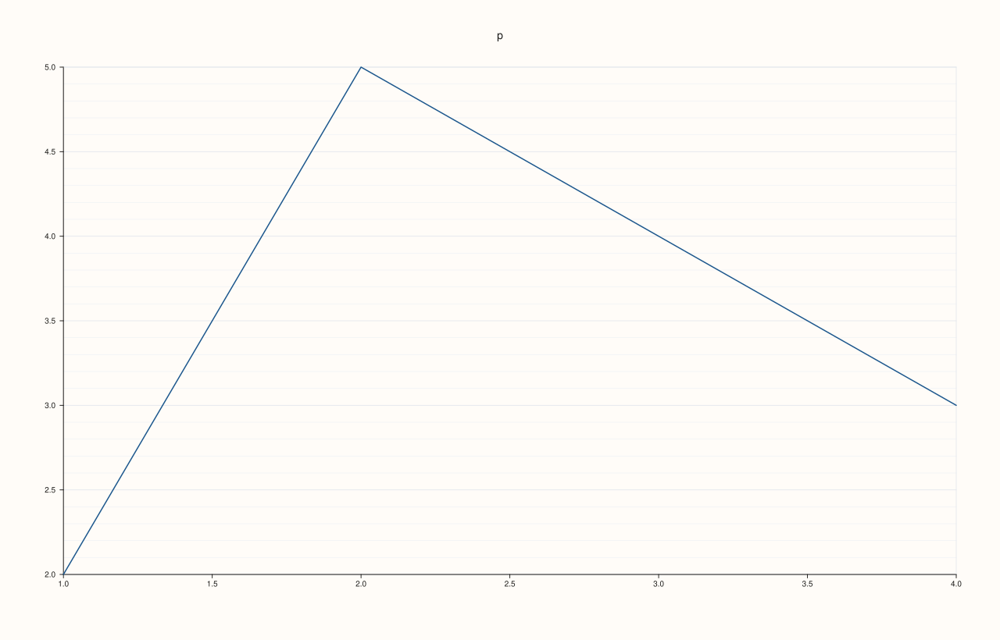

<!-- pluss-hand-authored -->

# Pane::y_major_grid

[Back to Pane API Reference](../../pane_api_reference)

## Signature

```cpp
Pane& Pane::y_major_grid(bool enable = true) noexcept
```

## What It Does

Turns the major grid of the y axis on or off. The major grid is the set of lines drawn across the plot at the major tick positions of the y axis; it is off by default. `true` (the default argument) turns it on, `false` turns it off, and the state is stored in `y_axis().major_grid`. Turning it off again gives exactly the figure that never turned it on.

The two grids of an axis are independent: the minor grid can be on with the major grid off. Each axis has its own, and [`Pane::grid`](grid.md) sets all of them at once; [`Pane::grid_style`](grid_style.md) summarises the state of the whole pane as `None`, `Major` or `MajorMinor`. The call never throws and is read when the figure is rendered.

## Parameters

**enable** (`bool`, default `true`)
    `true` draws the grid, `false` removes it.

## Returns

`Pane&`
    The same pane, for chaining.

## Examples

Example 1. Off by default. `y_axis().major_grid` is false for a new axis; the call with no argument turns it on, `false` turns it off, and the last call wins.

```cpp
auto fig = studio("y_major_grid_readback");
auto& pane = fig.pane2("p");
pane.trend(std::vector<double>{1, 2, 3, 4}, std::vector<double>{2, 5, 4, 3});
std::cout << "new axis: " << pane.y_axis().major_grid << "\n";
pane.y_major_grid();
std::cout << "after y_major_grid(): " << pane.y_axis().major_grid << "\n";
pane.y_major_grid(false);
std::cout << "after y_major_grid(false): " << pane.y_axis().major_grid << "\n";
pane.y_major_grid(true);
fig.save_svg("figure.svg");
```

### Output

```text
new axis: 0
after y_major_grid(): 1
after y_major_grid(false): 0
```



Example 2. The effect. Turning the major grid on adds grid lines to the figure, which can be counted as extra paths in the SVG; turning it off again restores the figure exactly.

```cpp
auto build = [&](bool on) {
  auto fig = studio("y_major_grid_effect");
  auto& pane = fig.pane2("p");
  pane.trend(std::vector<double>{1, 2, 3, 4}, std::vector<double>{2, 5, 4, 3});
  pane.y_major_grid(on);
  return fig.to_svg();
};
auto paths = [](const std::string& svg) { std::size_t n = 0; for (auto at = svg.find("<path"); at != std::string::npos; at = svg.find("<path", at + 1)) ++n; return n; };
std::cout << "paths without: " << paths(build(false)) << ", with: " << paths(build(true)) << "\n";
std::cout << "off again equals never set: " << (build(false) == build(false)) << "\n";
auto fig = studio("y_major_grid_effect_out");
auto& pane = fig.pane2("p");
pane.trend(std::vector<double>{1, 2, 3, 4}, std::vector<double>{2, 5, 4, 3});
pane.y_major_grid();
fig.save_svg("figure.svg");
```

### Output

```text
paths without: 19, with: 28
off again equals never set: 1
```


Example 3. Per axis. The y grid does not turn on the grid of the other axes, and each axis has its own switches.

```cpp
auto fig = studio("y_major_grid_axes");
auto& pane = fig.pane2("p");
pane.trend(std::vector<double>{1, 2, 3, 4}, std::vector<double>{2, 5, 4, 3});
pane.y_major_grid();
std::cout << "x: " << pane.x_axis().major_grid << ", y: " << pane.y_axis().major_grid << ", z: " << pane.z_axis().major_grid << "\n";
fig.save_svg("figure.svg");
```

### Output

```text
x: 0, y: 1, z: 0
```


Example 4. The pane's grid summary. `Pane::grid_style()` reports `None` (0), `Major` (1) or `MajorMinor` (2) from the axis switches; the major grid of this axis moves it as shown.

```cpp
auto fig = studio("y_major_grid_summary");
auto& pane = fig.pane2("p");
pane.trend(std::vector<double>{1, 2, 3, 4}, std::vector<double>{2, 5, 4, 3});
std::cout << "no grid: " << static_cast<int>(pane.grid_style()) << "\n";
pane.y_major_grid();
std::cout << "major on: " << static_cast<int>(pane.grid_style()) << "\n";
pane.y_minor_grid();
std::cout << "major and minor on: " << static_cast<int>(pane.grid_style()) << "\n";
pane.y_major_grid(true);
fig.save_svg("figure.svg");
```

### Output

```text
no grid: 0
major on: 1
major and minor on: 2
```



Example 5. Independent of the minor grid. The major grid can be on while the minor grid is off; the counts show how many paths each combination draws.

```cpp
auto paths = [](const std::string& svg) { std::size_t n = 0; for (auto at = svg.find("<path"); at != std::string::npos; at = svg.find("<path", at + 1)) ++n; return n; };
auto build = [&](bool major, bool minor) {
  auto fig = studio("y_major_grid_independent");
  auto& pane = fig.pane2("p");
  pane.trend(std::vector<double>{1, 2, 3, 4}, std::vector<double>{2, 5, 4, 3});
  pane.y_major_grid(major).y_minor_grid(minor);
  return fig.to_svg();
};
std::cout << "none: " << paths(build(false, false)) << ", major only: " << paths(build(true, false)) << ", minor only: " << paths(build(false, true)) << ", both: " << paths(build(true, true)) << "\n";
auto fig = studio("y_major_grid_independent_out");
auto& pane = fig.pane2("p");
pane.trend(std::vector<double>{1, 2, 3, 4}, std::vector<double>{2, 5, 4, 3});
pane.y_major_grid().y_minor_grid();
fig.save_svg("figure.svg");
```

### Output

```text
none: 19, major only: 28, minor only: 43, both: 52
```


## Notes

- `noexcept`.
- To turn the grid of every axis on or off in one call, use [`Pane::grid`](grid.md).

## See Also

- [`Pane::y_minor_grid`](y_minor_grid.md): the minor grid of the same axis.
- [`Pane::grid`](grid.md): all axes at once.
- [`Pane::grid_style`](grid_style.md): the summary of the grid.
- [`Pane::x_major_grid`](x_major_grid.md): the same setting for the x axis.
- [`Pane::z_major_grid`](z_major_grid.md): the same setting for the z axis.

<div class="pluss-inline-prev-next">
  <a class="prev-link" href="y_limits.html">
    <span class="label">Previous</span>
    <span class="title">y_limits</span>
  </a>
  <a class="next-link" href="y_minor_grid.html">
    <span class="label">Next</span>
    <span class="title">y_minor_grid</span>
  </a>
</div>
