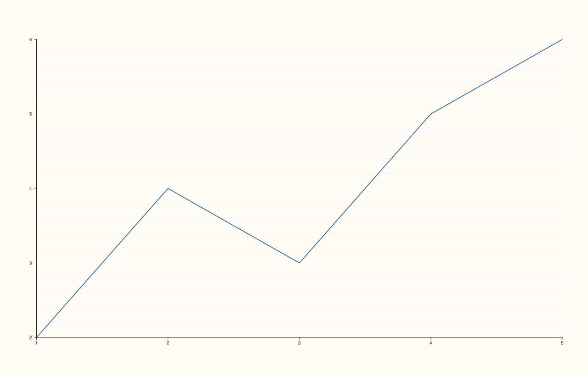

<!-- pluss-hand-authored -->

# Pane::y_minor_grid

[Back to Pane API Reference](../../pane_api_reference)

## Signature

```cpp
Pane& Pane::y_minor_grid(bool enable = true) noexcept
```

## What It Does

The y-axis counterpart of [`x_minor_grid()`](x_minor_grid.md): toggles minor gridlines for
the y-axis specifically. Every detail carries over unchanged, including the "turning one
axis off doesn't necessarily drop the aggregate" behavior — see
[`x_minor_grid()`](x_minor_grid.md)'s important callout and worked example.

## Parameters

**enable** (`bool`, default `true`)
    `true` to show minor gridlines on the y-axis, `false` to hide them.

## Returns

`Pane&`
    A reference to the same pane, for chaining.

## Examples

Example 1. Enabling minor gridlines on the y-axis alone — sufficient by itself to make the
aggregate [`grid_style()`](grid.md) report `MajorMinor`.

```cpp
using namespace pluss::pl;

auto fig = studio("y_minor_grid_check");
auto& pane = fig.pane2();
pane.trend(std::vector<double>{1.0, 2.0, 3.0, 4.0, 5.0}, std::vector<double>{2.0, 4.0, 3.0, 5.0, 6.0});
pane.y_minor_grid(true);
fig.show();

std::cout << pane.y_axis().minor_grid << "\n";
std::cout << (pane.grid_style() == GridStyle::MajorMinor) << "\n";
```

### Output

```text
1
1
```



## Notes

See [`x_minor_grid()`](x_minor_grid.md)'s Notes — every detail applies identically here.

## See Also

- [`Pane::x_minor_grid`](x_minor_grid.md): the x-axis equivalent, with the full
  worked-example set for the "doesn't necessarily drop the aggregate" behavior.
- [`Pane::z_minor_grid`](z_minor_grid.md): the z-axis equivalent.
- [`Pane::y_major_grid`](y_major_grid.md): the major-gridline counterpart for the y-axis.

<div class="pluss-inline-prev-next">
  <a class="prev-link" href="x_minor_grid.html">
    <span class="label">Previous</span>
    <span class="title">x_minor_grid</span>
  </a>
  <a class="next-link" href="z_minor_grid.html">
    <span class="label">Next</span>
    <span class="title">z_minor_grid</span>
  </a>
</div>
