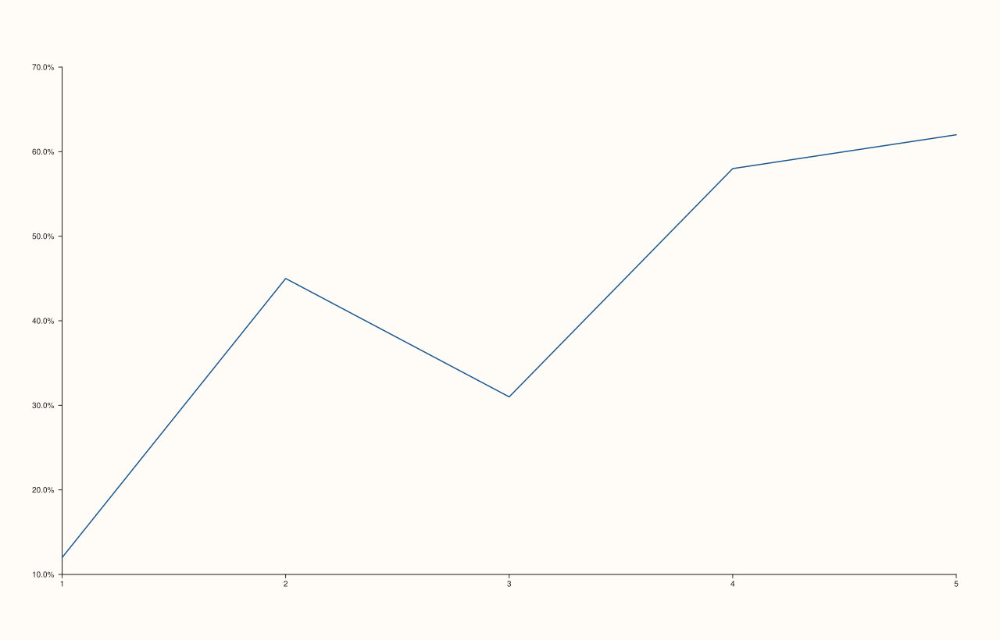

<!-- pluss-hand-authored -->

# Pane::y_tick_format

[Back to Pane API Reference](../../pane_api_reference)

## Signature

```cpp
Pane& Pane::y_tick_format(TickFormat format) noexcept
```

## What It Does

The y-axis counterpart of [`x_tick_format()`](x_tick_format.md): chooses how the y-axis's
numeric tick labels are rendered as text, from the same eight `TickFormat` values
(`Auto`/`Plain`/`Fixed3`/`Fixed6`/`Scientific`/`Engineering`/`Integer`/`Percent`). Every
worked example on [`x_tick_format()`](x_tick_format.md)'s own page is in fact already
written against `y_tick_format()` — see that page for the full set covering all eight
values.

## Parameters

**format** (`TickFormat`)
    One of the eight formatting styles.

## Returns

`Pane&`
    A reference to the same pane, for chaining.

## Examples

Example 1. `TickFormat::Percent` on the y-axis.

```cpp
using namespace pluss::pl;

auto fig = studio("tick_format_percent");
auto& pane = fig.pane2();
pane.trend(std::vector<double>{1.0, 2.0, 3.0, 4.0, 5.0}, std::vector<double>{0.12, 0.45, 0.31, 0.58, 0.62});
pane.y_tick_format(TickFormat::Percent);
fig.show();

std::cout << (pane.y_axis().tick_format == TickFormat::Percent) << "\n";
```

### Output

```text
1
```



## Notes

See [`x_tick_format()`](x_tick_format.md)'s Notes — every detail applies identically here,
including the Auto/Plain coincidence caveat for ordinary-magnitude data.

## See Also

- [`Pane::x_tick_format`](x_tick_format.md): the x-axis equivalent, with the full
  worked-example set covering all eight `TickFormat` values.
- [`Pane::z_tick_format`](z_tick_format.md): the z-axis equivalent.
- [`Pane::y_auto_tick_decimals`](y_auto_tick_decimals.md): fine-tunes `Auto`'s decimal
  precision specifically.

<div class="pluss-inline-prev-next">
  <a class="prev-link" href="x_tick_format.html">
    <span class="label">Previous</span>
    <span class="title">x_tick_format</span>
  </a>
  <a class="next-link" href="z_tick_format.html">
    <span class="label">Next</span>
    <span class="title">z_tick_format</span>
  </a>
</div>
