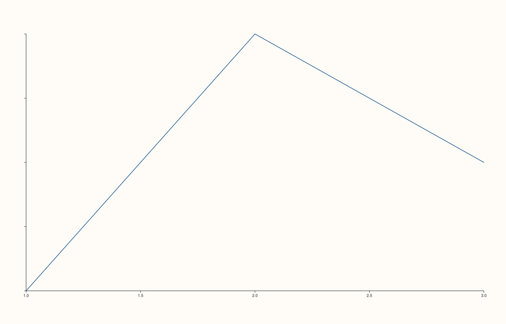

<!-- pluss-hand-authored -->

# Pane::y_tick_labels

[Back to Pane API Reference](../../pane_api_reference)

## Signature

```cpp
Pane& Pane::y_tick_labels(bool enable = true) noexcept
```

## What It Does

The y-axis counterpart of [`x_tick_labels()`](x_tick_labels.md): toggles whether y-axis
tick labels are drawn. Every detail carries over unchanged — see
[`x_tick_labels()`](x_tick_labels.md) for the full explanation.

## Parameters

**enable** (`bool`, default `true`)
    `true` to show tick labels, `false` to hide them.

## Returns

`Pane&`
    A reference to the same pane, for chaining.

## Examples

Example 1. Hidden y-axis tick labels.

```cpp
using namespace pluss::pl;

auto fig = studio("y_tick_labels_hidden");
auto& pane = fig.pane2();
pane.trend(std::vector<double>{1.0, 2.0, 3.0}, std::vector<double>{2.0, 4.0, 3.0});
pane.y_tick_labels(false);
fig.show();

std::cout << pane.y_axis().tick_labels_visible << "\n";
```

### Output

```text
0
```



## Notes

See [`x_tick_labels()`](x_tick_labels.md)'s Notes — every detail applies identically here.

## See Also

- [`Pane::x_tick_labels`](x_tick_labels.md): the x-axis equivalent, with the full
  explanation.
- [`Pane::z_tick_labels`](z_tick_labels.md): the z-axis equivalent.

<div class="pluss-inline-prev-next">
  <a class="prev-link" href="x_tick_labels.html">
    <span class="label">Previous</span>
    <span class="title">x_tick_labels</span>
  </a>
  <a class="next-link" href="z_tick_labels.html">
    <span class="label">Next</span>
    <span class="title">z_tick_labels</span>
  </a>
</div>
