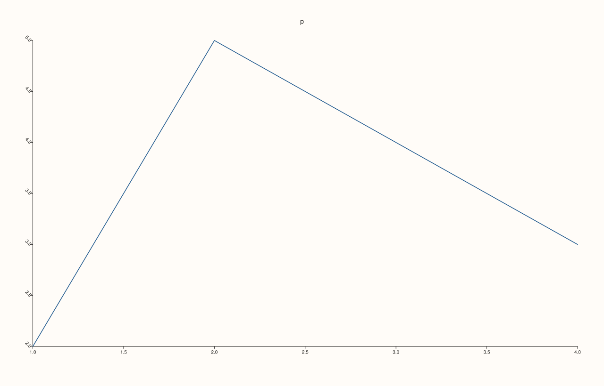
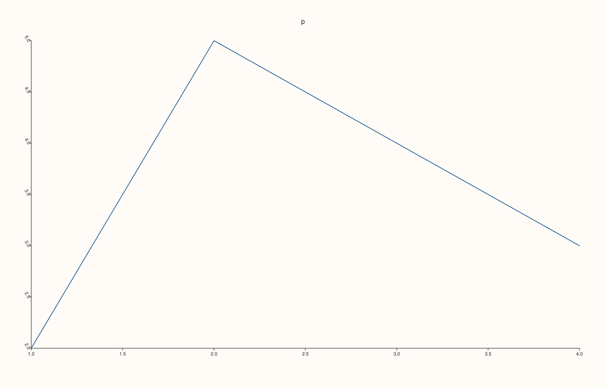
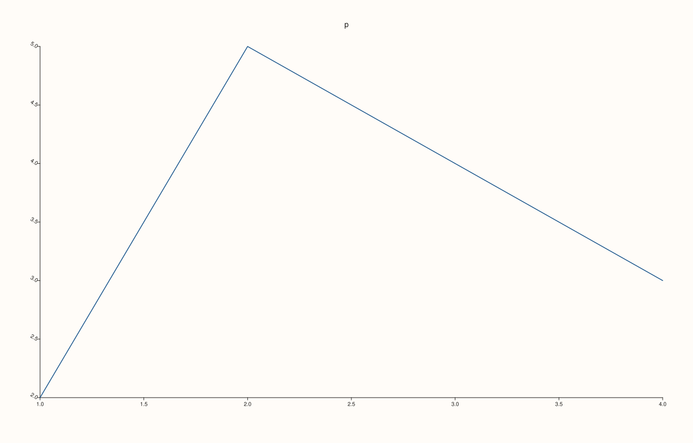

<!-- pluss-hand-authored -->

# Pane::y_tick_rotation

[Back to Pane API Reference](../../pane_api_reference)

## Signature

```cpp
Pane& Pane::y_tick_rotation(double degrees)
Pane& Pane::clear_y_tick_rotation() noexcept
```

## What It Does

Rotates the tick labels of the y axis by an explicit angle in degrees. The angle is stored in `y_axis().tick_rotation_deg` as an optional value: empty until set, which means the renderer chooses the angle for the axis. `y_tick_rotation` stores the angle and `clear_y_tick_rotation()` removes it, restoring the automatic choice, so a figure that sets and then clears an angle is exactly the figure that never set one.

The angle must be finite. Infinity and NaN are refused with `pluss::Error` and the stored value is left as it was; every finite number is stored as given, so 90, -90 and 720 are all accepted and are not reduced to a range. It is per axis, and it is read when the figure is rendered.

## Parameters

**degrees** (`double`)
    The angle in degrees. Finite.

## Returns

`Pane&`
    The same pane, for chaining.

## Examples

Example 1. Default, set, clear. A new pane has no override (`tick_rotation_deg` is empty); the call stores the angle exactly as given, and `clear_y_tick_rotation()` removes it.

```cpp
auto fig = studio("y_tick_rotation_readback");
auto& pane = fig.pane2("p");
pane.trend(std::vector<double>{1, 2, 3, 4}, std::vector<double>{2, 5, 4, 3});
auto show = [&] { const auto& v = pane.y_axis().tick_rotation_deg; std::cout << (v ? std::to_string(*v) : std::string("none")) << "\n"; };
std::cout << "new pane: "; show();
pane.y_tick_rotation(45.0);
std::cout << "after y_tick_rotation(45): "; show();
pane.clear_y_tick_rotation();
std::cout << "after clear_y_tick_rotation(): "; show();
fig.save_svg("figure.svg");
```

### Output

```text
new pane: none
after y_tick_rotation(45): 45.000000
after clear_y_tick_rotation(): none
```


Example 2. Any finite angle. The values 0, 45, 90, -90 and 720 are all accepted and stored as given, with no normalisation; the saved figure is rotated 45 degrees.

```cpp
auto fig = studio("y_tick_rotation_angles");
auto& pane = fig.pane2("p");
pane.trend(std::vector<double>{1, 2, 3, 4}, std::vector<double>{2, 5, 4, 3});

for (double degrees : {0.0, 45.0, 90.0, -90.0, 720.0}) {
  pane.y_tick_rotation(degrees);
  std::cout << degrees << " stored as " << *pane.y_axis().tick_rotation_deg << "\n";
}
pane.y_tick_rotation(45.0);
fig.save_svg("figure.svg");
```

### Output

```text
0 stored as 0
45 stored as 45
90 stored as 90
-90 stored as -90
720 stored as 720
```



Example 3. The effect. Rotating changes the figure, and the rotated text carries a rotation in the SVG; the angle 0 equals the figure with no override.

```cpp
auto build = [&](const char* mode) {
  auto fig = studio("y_tick_rotation_effect");
  auto& pane = fig.pane2("p");
  pane.trend(std::vector<double>{1, 2, 3, 4}, std::vector<double>{2, 5, 4, 3});
  
  if (std::string(mode) == "0") pane.y_tick_rotation(0.0);
  if (std::string(mode) == "60") pane.y_tick_rotation(60.0);
  return fig.to_svg();
};
std::cout << "60 differs from none: " << (build("60") != build("none")) << ", rotate() present: " << (build("60").find("rotate(60") != std::string::npos) << "\n";
std::cout << "explicit 0 equals none: " << (build("0") == build("none")) << "\n";
auto fig = studio("y_tick_rotation_effect_out");
auto& pane = fig.pane2("p");
pane.trend(std::vector<double>{1, 2, 3, 4}, std::vector<double>{2, 5, 4, 3});

pane.y_tick_rotation(60.0);
fig.save_svg("figure.svg");
```

### Output

```text
60 differs from none: 1, rotate() present: 1
explicit 0 equals none: 1
```



Example 4. Only finite angles. Infinity and NaN are refused with `pluss::Error` and the stored angle is kept; every finite number is accepted.

```cpp
auto fig = studio("y_tick_rotation_invalid");
auto& pane = fig.pane2("p");
pane.trend(std::vector<double>{1, 2, 3, 4}, std::vector<double>{2, 5, 4, 3});

pane.y_tick_rotation(30.0);
for (double bad : {std::numeric_limits<double>::infinity(), -std::numeric_limits<double>::infinity(), std::numeric_limits<double>::quiet_NaN()}) {
  try {
    pane.y_tick_rotation(bad);
  } catch (const pluss::Error& e) {
    std::cout << bad << ": " << e.message() << "\n";
  }
}
std::cout << "kept: " << *pane.y_axis().tick_rotation_deg << "\n";
fig.save_svg("figure.svg");
```

### Output

```text
inf: y_tick_rotation: angle must be finite
-inf: y_tick_rotation: angle must be finite
nan: y_tick_rotation: angle must be finite
kept: 30
```



Example 5. Clearing restores the default. After `clear_y_tick_rotation()` the figure equals the one that never set an angle.

```cpp
auto build = [&](bool set_then_clear) {
  auto fig = studio("y_tick_rotation_clear");
  auto& pane = fig.pane2("p");
  pane.trend(std::vector<double>{1, 2, 3, 4}, std::vector<double>{2, 5, 4, 3});
  
  if (set_then_clear) pane.y_tick_rotation(75.0).clear_y_tick_rotation();
  return fig.to_svg();
};
std::cout << "equal: " << (build(true) == build(false)) << "\n";
auto fig = studio("y_tick_rotation_clear_out");
auto& pane = fig.pane2("p");
pane.trend(std::vector<double>{1, 2, 3, 4}, std::vector<double>{2, 5, 4, 3});

fig.save_svg("figure.svg");
```

### Output

```text
equal: 1
```


## Notes

- `y_tick_rotation` throws, so it is not `noexcept`; `clear_y_tick_rotation` never throws.
- Rotated text needs room: the gap between the axis and its labels is set with [`y_tick_label_gap`](y_tick_label_gap.md).

## See Also

- [`Pane::y_label_rotation`](y_label_rotation.md): the other rotation.
- [`Pane::x_tick_rotation`](x_tick_rotation.md): the same setting for the x axis.
- [`Pane::z_tick_rotation`](z_tick_rotation.md): the same setting for the z axis.

<div class="pluss-inline-prev-next">
  <a class="prev-link" href="y_tick_labels.html">
    <span class="label">Previous</span>
    <span class="title">y_tick_labels</span>
  </a>
  <a class="next-link" href="y_ticks.html">
    <span class="label">Next</span>
    <span class="title">y_ticks</span>
  </a>
</div>
