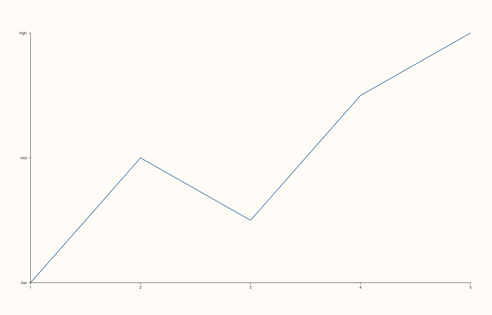

<!-- pluss-hand-authored -->

# Pane::y_ticks

[Back to Pane API Reference](../../pane_api_reference)

## Signatures

```cpp
Pane& y_ticks(Series positions, pluss::msharp::RangeView::Of<std::string_view> labels)
Pane& y_ticks(Series positions, std::initializer_list<std::string_view> labels)

template <class Positions>
Pane& y_ticks(Positions&& positions, pluss::msharp::RangeView::Of<std::string_view> labels)
  requires(!std::same_as<std::remove_cvref_t<Positions>, Series>)

template <class Positions>
Pane& y_ticks(Positions&& positions, std::initializer_list<std::string_view> labels)
  requires(!std::same_as<std::remove_cvref_t<Positions>, Series>)

Pane& clear_y_ticks() noexcept
```

## What It Does

The y-axis counterpart of [`x_ticks()`](x_ticks.md)/[`clear_x_ticks()`](x_ticks.md): places
explicit tick marks with labels on the y-axis, across the same four overload shapes for
`positions`/`labels`. Every validation detail carries over unchanged — see
[`x_ticks()`](x_ticks.md) for the full worked-example set covering both failure modes.

## Parameters

**positions** (`Series` or series-convertible)
    The tick positions, in data coordinates. Must be non-empty.

**labels** (`RangeView::Of<std::string_view>` or `std::initializer_list<std::string_view>`)
    The label text for each position. Must match `positions`'s count.

## Returns

`Pane&`
    A reference to the same pane, for chaining.

## Examples

Example 1. Explicit y-axis ticks.

```cpp
using namespace pluss::pl;

auto fig = studio("y_ticks_explicit");
auto& pane = fig.pane2();
pane.trend(std::vector<double>{1.0, 2.0, 3.0, 4.0, 5.0}, std::vector<double>{2.0, 4.0, 3.0, 5.0, 6.0});
pane.y_ticks(std::vector<double>{2.0, 4.0, 6.0}, std::initializer_list<std::string_view>{"low", "mid", "high"});
fig.show();

std::cout << pane.y_axis().ticks->labels.size() << "\n";
```

### Output

```text
3
```



## Notes

See [`x_ticks()`](x_ticks.md)'s Notes — every detail applies identically here.

## See Also

- [`Pane::x_ticks`](x_ticks.md): the x-axis equivalent, with the full worked-example set
  for validation failures.
- [`Pane::z_ticks`](z_ticks.md): the z-axis equivalent.
- [`Pane::y_categories`](y_categories.md): a convenience wrapper built on top of this
  method.

<div class="pluss-inline-prev-next">
  <a class="prev-link" href="x_ticks.html">
    <span class="label">Previous</span>
    <span class="title">x_ticks</span>
  </a>
  <a class="next-link" href="z_ticks.html">
    <span class="label">Next</span>
    <span class="title">z_ticks</span>
  </a>
</div>
