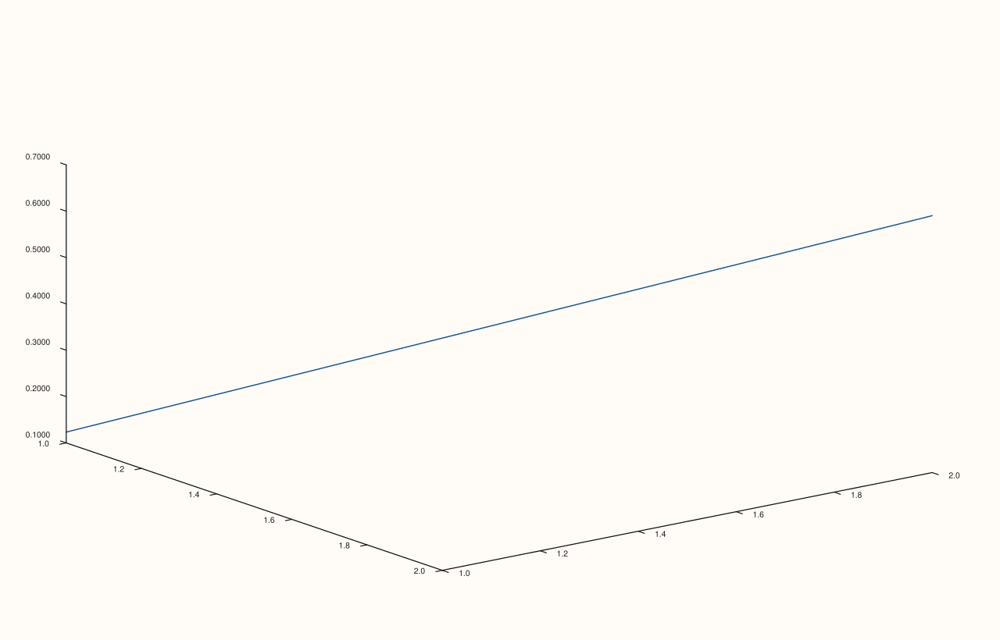

<!-- pluss-hand-authored -->

# Pane::z_auto_tick_decimals

[Back to Pane API Reference](../../pane_api_reference)

## Signatures

```cpp
Pane& Pane::z_auto_tick_decimals(int decimals)       // sets an explicit decimal count
Pane& Pane::clear_z_auto_tick_decimals() noexcept    // clears back to automatic
```

## What It Does

The z-axis counterpart of [`x_auto_tick_decimals()`](x_auto_tick_decimals.md)/
[`y_auto_tick_decimals()`](y_auto_tick_decimals.md), meaningful primarily on 3D
(`Volumetric`) panes. Every validation detail carries over unchanged — see
[`x_auto_tick_decimals()`](x_auto_tick_decimals.md) for the full worked-example set.

## Parameters

**decimals** (`int`, setter only)
    The number of digits after the decimal point. Must be in `[0, 8]`.

## Returns

`Pane&`
    A reference to the same pane, for chaining.

## Examples

Example 1. An explicit override on the z-axis of a 3D pane.

```cpp
using namespace pluss::pl;

auto fig = studio("z_auto_tick_decimals_3");
auto& pane = fig.pane3();
pane.path3(std::vector<double>{1.0, 2.0}, std::vector<double>{1.0, 2.0}, std::vector<double>{0.123456, 0.654321});
pane.z_auto_tick_decimals(4);
fig.show();

std::cout << *pane.z_axis().auto_tick_decimals << "\n";
```

### Output

```text
4
```



## Notes

See [`x_auto_tick_decimals()`](x_auto_tick_decimals.md)'s Notes — every detail applies
identically here. Most useful on 3D panes; on 2D panes the z-axis state exists but is
inert.

## See Also

- [`Pane::x_auto_tick_decimals`](x_auto_tick_decimals.md) /
  [`Pane::y_auto_tick_decimals`](y_auto_tick_decimals.md): the x- and y-axis equivalents,
  with the full worked-example set.
- [`Pane::z_tick_format`](z_tick_format.md): the overall style this setting fine-tunes.

<div class="pluss-inline-prev-next">
  <a class="prev-link" href="y_auto_tick_decimals.html">
    <span class="label">Previous</span>
    <span class="title">y_auto_tick_decimals</span>
  </a>
  <a class="next-link" href="x_tick_rotation.html">
    <span class="label">Next</span>
    <span class="title">x_tick_rotation</span>
  </a>
</div>
