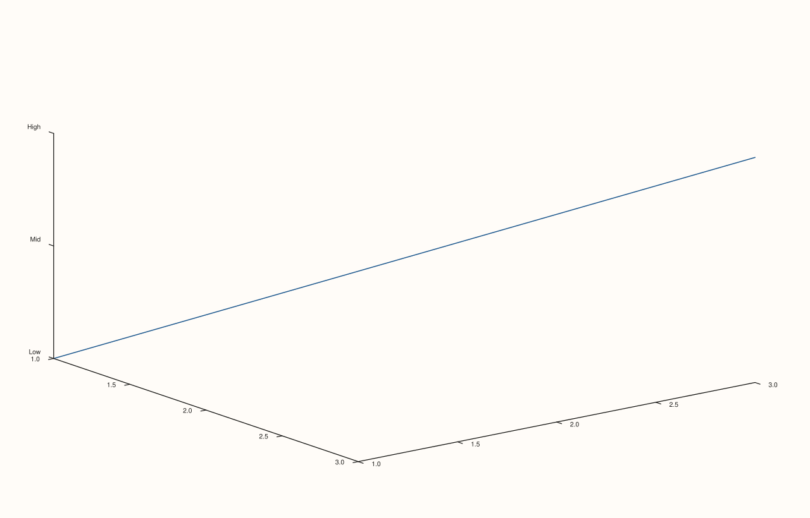

<!-- pluss-hand-authored -->

# Pane::z_categories

[Back to Pane API Reference](../../pane_api_reference)

## Signature

```cpp
Pane& Pane::z_categories(
    pluss::msharp::RangeView::Of<std::string_view> labels,
    double first = 1.0,
    double step = 1.0)
```

## What It Does

The z-axis counterpart of [`x_categories()`](x_categories.md)/
[`y_categories()`](y_categories.md), meaningful primarily on 3D (`Volumetric`) panes. A
convenience layer on top of [`z_ticks()`](z_ticks.md) that auto-generates evenly (or
arithmetically) spaced positions from `first`/`step`. Every validation detail carries over
unchanged — see [`x_categories()`](x_categories.md) for the full worked-example set.

## Parameters

**labels** (`RangeView::Of<std::string_view>`, accepts a braced `initializer_list` too)
    The category labels, in position order. Must be non-empty.

**first** (`double`, default `1.0`)
    The position of the first category. Must be finite.

**step** (`double`, default `1.0`)
    The spacing between consecutive positions. Must be finite and non-zero.

## Returns

`Pane&`
    A reference to the same pane, for chaining.

## Examples

Example 1. Categorical z-axis labels on a 3D pane.

```cpp
using namespace pluss::pl;

auto fig = studio("z_categories_default");
auto& pane = fig.pane3();
pane.path3(std::vector<double>{1.0, 2.0, 3.0}, std::vector<double>{1.0, 2.0, 3.0}, std::vector<double>{1.0, 2.0, 3.0});
pane.z_categories(std::initializer_list<std::string_view>{"Low", "Mid", "High"});
fig.show();

std::cout << pane.z_axis().ticks->labels.size() << "\n";
```

### Output

```text
3
```



## Notes

See [`x_categories()`](x_categories.md)'s Notes — every detail applies identically here.
Most useful on 3D panes; on 2D panes the z-axis state exists but is inert.

## See Also

- [`Pane::x_categories`](x_categories.md) / [`Pane::y_categories`](y_categories.md): the
  x- and y-axis equivalents, with the full worked-example set.
- [`Pane::z_ticks`](z_ticks.md): the underlying mechanism this method builds on.

<div class="pluss-inline-prev-next">
  <a class="prev-link" href="y_categories.html">
    <span class="label">Previous</span>
    <span class="title">y_categories</span>
  </a>
  <a class="next-link" href="legend.html">
    <span class="label">Next</span>
    <span class="title">legend</span>
  </a>
</div>
