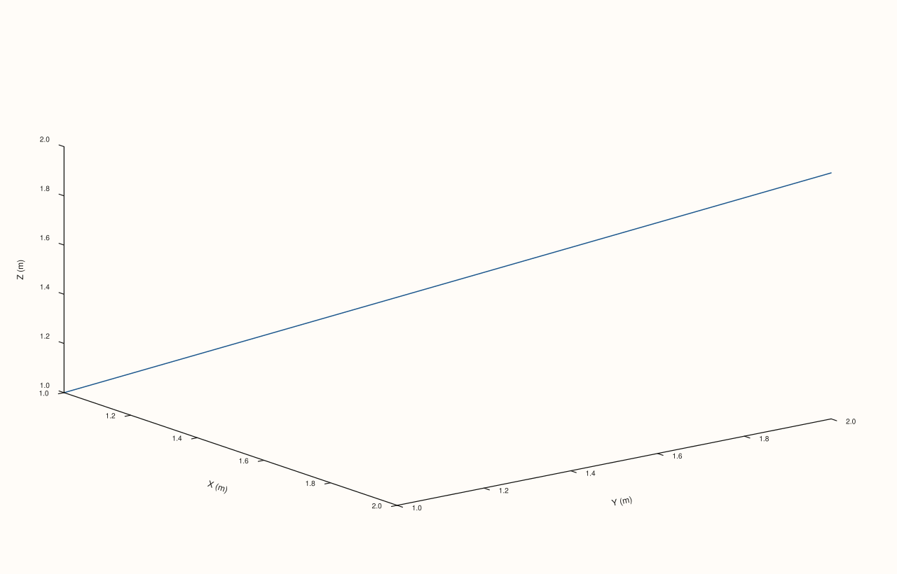

<!-- pluss-hand-authored -->

# Pane::z_label

[Back to Pane API Reference](../../pane_api_reference)

## Signature

```cpp
Pane& Pane::z_label(std::string label)
```

## What It Does

The z-axis counterpart of [`x_label()`](x_label.md)/[`y_label()`](y_label.md), meaningful
primarily on 3D (`Volumetric`) panes. Every detail carries over unchanged — no validation,
empty string clears it, read back through [`z_axis().label`](axis_accessors.md).

## Parameters

**label** (`std::string`)
    The z-axis label text. An empty string clears any existing label.

## Returns

`Pane&`
    A reference to the same pane, for chaining.

## Examples

Example 1. All three axis labels set together on a 3D pane.

```cpp
using namespace pluss::pl;

auto fig = studio("labels_3d");
auto& pane = fig.pane3();
pane.path3(std::vector<double>{1.0, 2.0}, std::vector<double>{1.0, 2.0}, std::vector<double>{1.0, 2.0});
pane.x_label("X (m)").y_label("Y (m)").z_label("Z (m)");
fig.show();

std::cout << pane.x_axis().label << ", " << pane.y_axis().label << ", " << pane.z_axis().label << "\n";
```

### Output

```text
X (m), Y (m), Z (m)
```



## Notes

See [`x_label()`](x_label.md)'s Notes — every detail applies identically here. Most useful
on 3D panes; on 2D panes the z-axis state exists but is inert.

## See Also

- [`Pane::x_label`](x_label.md) / [`Pane::y_label`](y_label.md): the x- and y-axis
  equivalents.
- [`Pane::z_axis`](axis_accessors.md): where this label is read back from.

<div class="pluss-inline-prev-next">
  <a class="prev-link" href="y_label.html">
    <span class="label">Previous</span>
    <span class="title">y_label</span>
  </a>
  <a class="next-link" href="grid.html">
    <span class="label">Next</span>
    <span class="title">grid</span>
  </a>
</div>
