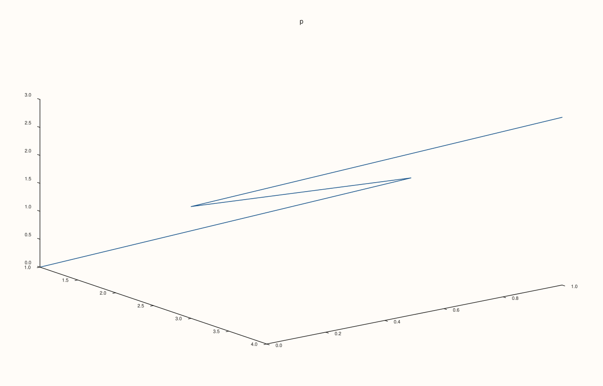
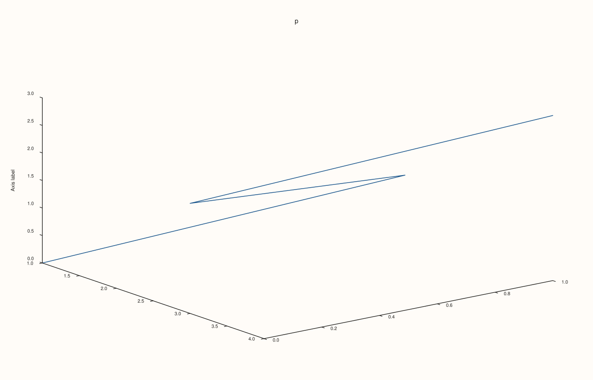

<!-- pluss-hand-authored -->

# Pane::z_label_gap

[Back to Pane API Reference](../../pane_api_reference)

## Signature

```cpp
Pane& Pane::z_label_gap(double points)
Pane& Pane::clear_z_label_gap() noexcept
```

## What It Does

Sets the gap, in drawing units, between the z axis (and its tick labels) and the axis label. The setting is stored in `z_axis().label_gap` as an optional value: empty until a gap is set, which means the renderer chooses a gap from the font size. `z_label_gap` stores an explicit gap and `clear_z_label_gap()` removes it, restoring the automatic choice, so a figure that sets and then clears a gap is exactly the figure that never set one.

The gap must be finite and not negative. Anything else (a negative number, infinity or NaN) is refused with `pluss::Error`, the stored value is left as it was, and zero is valid and puts the two elements as close as the renderer allows. The gap is read when the figure is rendered. It is per axis: the other axes keep their own.

## Parameters

**points** (`double`)
    The gap in drawing units. Finite and not negative.

## Returns

`Pane&`
    The same pane, for chaining.

## Examples

Example 1. Default, set, clear. A new pane has no override (`label_gap` is empty); the call stores the value and `clear_z_label_gap()` removes it again.

```cpp
auto fig = studio("z_label_gap_readback");
auto& pane = fig.pane3("p");
pane.path3(std::vector<double>{1, 2, 3, 4}, std::vector<double>{0, 1, 0, 1}, std::vector<double>{0, 1, 2, 3});
auto show = [&] { const auto& v = pane.z_axis().label_gap; std::cout << (v ? std::to_string(*v) : std::string("none")) << "\n"; };
std::cout << "new pane: "; show();
pane.z_label_gap(24.0);
std::cout << "after z_label_gap(24): "; show();
pane.clear_z_label_gap();
std::cout << "after clear_z_label_gap(): "; show();
fig.save_svg("figure.svg");
```

### Output

```text
new pane: none
after z_label_gap(24): 24.000000
after clear_z_label_gap(): none
```



Example 2. The effect. With a label set, a gap of 0, 14 and 60 gives three different figures; the saved figure uses 60, which pushes the z label well away from the axis.

```cpp
auto build = [&](double gap) {
  auto fig = studio("z_label_gap_effect");
  auto& pane = fig.pane3("p");
  pane.path3(std::vector<double>{1, 2, 3, 4}, std::vector<double>{0, 1, 0, 1}, std::vector<double>{0, 1, 2, 3});
  pane.z_label("Axis label");
  pane.z_label_gap(gap);
  return fig;
};
std::cout << "0 vs 14: " << (build(0.0).to_svg() != build(14.0).to_svg()) << ", 14 vs 60: " << (build(14.0).to_svg() != build(60.0).to_svg()) << "\n";
build(60.0).save_svg("figure.svg");
```

### Output

```text
0 vs 14: 1, 14 vs 60: 1
```



Example 3. Clearing restores the default exactly. After `clear_z_label_gap()` the figure equals the one that never set a gap.

```cpp
auto build = [&](bool set_then_clear) {
  auto fig = studio("z_label_gap_clear");
  auto& pane = fig.pane3("p");
  pane.path3(std::vector<double>{1, 2, 3, 4}, std::vector<double>{0, 1, 0, 1}, std::vector<double>{0, 1, 2, 3});
  pane.z_label("Axis label");
  if (set_then_clear) pane.z_label_gap(40.0).clear_z_label_gap();
  return fig.to_svg();
};
std::cout << "equal: " << (build(true) == build(false)) << "\n";
auto fig = studio("z_label_gap_clear_out");
auto& pane = fig.pane3("p");
pane.path3(std::vector<double>{1, 2, 3, 4}, std::vector<double>{0, 1, 0, 1}, std::vector<double>{0, 1, 2, 3});
pane.z_label("Axis label");
fig.save_svg("figure.svg");
```

### Output

```text
equal: 1
```


Example 4. Invalid gaps are refused and the stored value is kept. A negative number, infinity and NaN throw `pluss::Error`; zero is a valid gap.

```cpp
auto fig = studio("z_label_gap_invalid");
auto& pane = fig.pane3("p");
pane.path3(std::vector<double>{1, 2, 3, 4}, std::vector<double>{0, 1, 0, 1}, std::vector<double>{0, 1, 2, 3});
pane.z_label("Axis label");
pane.z_label_gap(10.0);
for (double bad : {-1.0, std::numeric_limits<double>::infinity(), std::numeric_limits<double>::quiet_NaN()}) {
  try {
    pane.z_label_gap(bad);
  } catch (const pluss::Error& e) {
    std::cout << bad << ": " << e.message() << "\n";
  }
}
pane.z_label_gap(0.0);
std::cout << "zero accepted: " << *pane.z_axis().label_gap << "\n";
pane.z_label_gap(10.0);
std::cout << "kept after errors: " << *pane.z_axis().label_gap << "\n";
fig.save_svg("figure.svg");
```

### Output

```text
-1: z_label_gap: spacing must be finite and non-negative
inf: z_label_gap: spacing must be finite and non-negative
nan: z_label_gap: spacing must be finite and non-negative
zero accepted: 0
kept after errors: 10
```


## Notes

- `z_label_gap` throws, so it is not `noexcept`; `clear_z_label_gap` never throws.
- The related gap for the other element is [`z_tick_label_gap`](z_tick_label_gap.md).

## See Also

- [`Pane::z_label`](z_label.md): the label the gap is measured to.
- [`Pane::z_tick_label_gap`](z_tick_label_gap.md): the other gap.
- [`Pane::x_label_gap`](x_label_gap.md): the same setting for the x axis.
- [`Pane::y_label_gap`](y_label_gap.md): the same setting for the y axis.

<div class="pluss-inline-prev-next">
  <a class="prev-link" href="z_label.html">
    <span class="label">Previous</span>
    <span class="title">z_label</span>
  </a>
  <a class="next-link" href="z_label_rotation.html">
    <span class="label">Next</span>
    <span class="title">z_label_rotation</span>
  </a>
</div>
