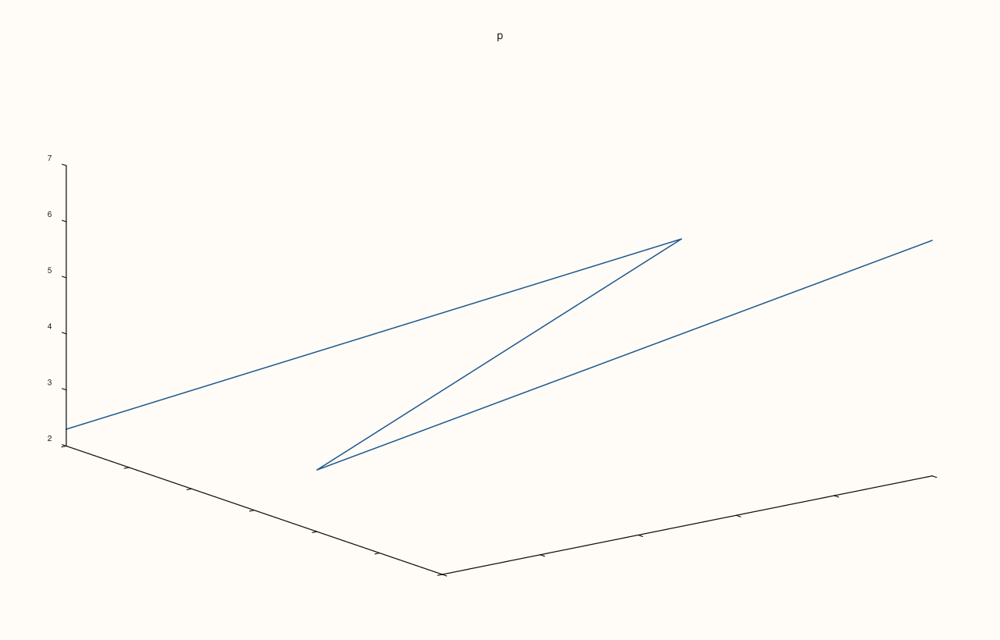
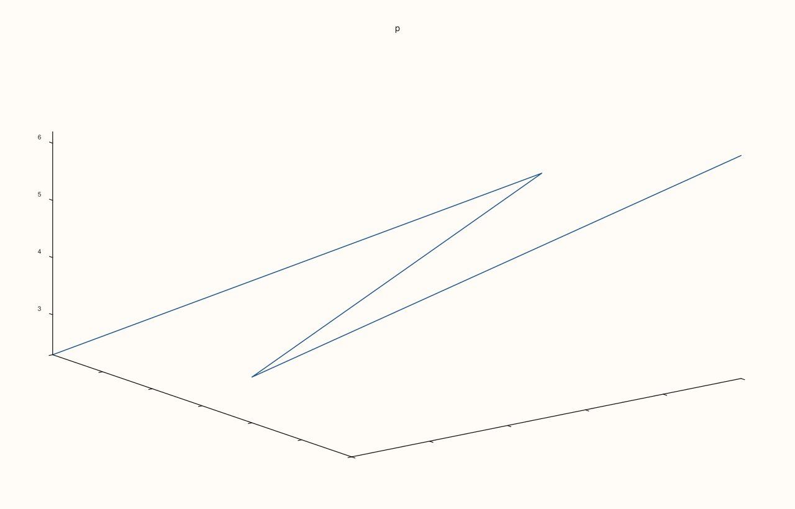
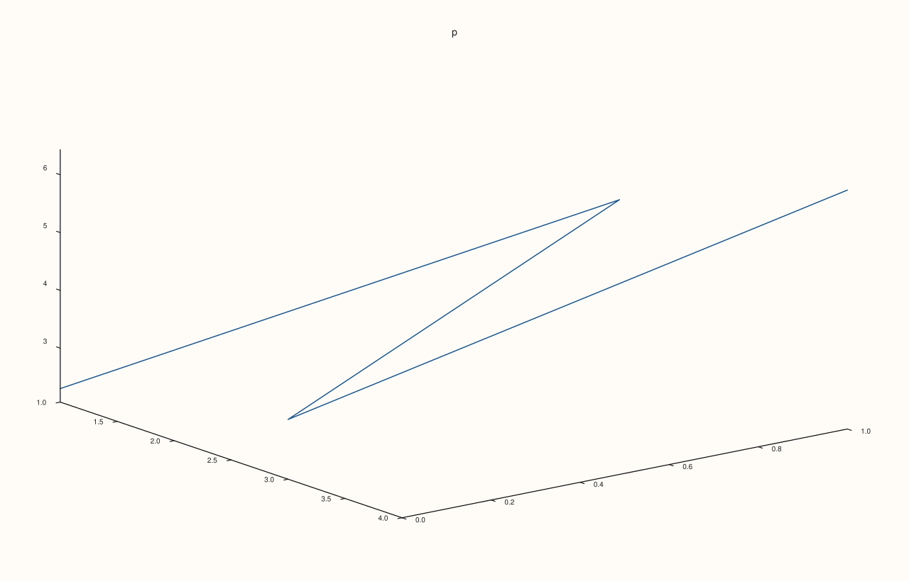

<!-- pluss-hand-authored -->

# Pane::z_limit_method

[Back to Pane API Reference](../../pane_api_reference)

## Signature

```cpp
Pane& Pane::z_limit_method(LimitMethod method) noexcept
```

## What It Does

Chooses how the z axis range is computed while it is fitted automatically, that is, while no range has been set with [`z_limits`](z_limits.md). `LimitMethod::TickAligned` (the default) widens the data range to round tick values so the axis starts and ends on clean numbers; `LimitMethod::Tight` uses the data range as it is, so the data touches the edges; `LimitMethod::Padded` adds a margin around the data so that no point lies on the edge. See [`LimitMethod`](../types/LimitMethod.md).

The method is stored in `z_axis().limit_method` and is kept when the axis is switched between manual and automatic, so [`auto_z`](auto_z.md) returns to the method that was chosen. With a manual range the method has no effect at all. The call never throws.

## Parameters

**method** (`LimitMethod`)
    `TickAligned`, `Tight` or `Padded`.

## Returns

`Pane&`
    The same pane, for chaining.

## Examples

Example 1. The default is `TickAligned` (0). `Tight` is 1 and `Padded` is 2; each call is read back, and the last call wins.

```cpp
auto fig = studio("z_method_readback");
auto& pane = fig.pane3("p");
pane.path3(std::vector<double>{1, 2, 3, 4}, std::vector<double>{0, 1, 0, 1}, std::vector<double>{0, 1, 2, 3});
std::cout << "new axis: " << static_cast<int>(pane.z_axis().limit_method) << "\n";
for (LimitMethod m : {LimitMethod::Tight, LimitMethod::Padded, LimitMethod::TickAligned}) {
  pane.z_limit_method(m);
  std::cout << "set " << static_cast<int>(m) << ", read " << static_cast<int>(pane.z_axis().limit_method) << "\n";
}
fig.save_svg("figure.svg");
```

### Output

```text
new axis: 0
set 1, read 1
set 2, read 2
set 0, read 0
```


Example 2. `TickAligned`, the default. The range is widened to round tick values, so the axis starts and ends on clean numbers; the ticks of the data 2.3 to 6.2 run from 2 to 7.

```cpp
auto fig = studio("z_method_aligned");
auto& pane = fig.pane3("p");
pane.path3(std::vector<double>{1, 2, 3, 4}, std::vector<double>{0, 1, 0, 1}, std::vector<double>{2.3, 4.7, 3.1, 6.2});
pane.x_tick_labels(false);
pane.y_tick_labels(false);
pane.z_limit_method(LimitMethod::TickAligned);
auto texts = [](const std::string& svg) {
  std::string out;
  for (std::size_t at = svg.find("<text"); at != std::string::npos; at = svg.find("<text", at + 1)) {
    const auto gt = svg.find('>', at);
    out += svg.substr(gt + 1, svg.find("</text>", gt) - gt - 1) + " ";
  }
  return out;
};
std::cout << texts(fig.to_svg()) << "\n";
fig.save_svg("figure.svg");
```

### Output

```text
p 2 3 4 5 6 7 
```



Example 3. `Tight`. The range hugs the data, so the data touches the edges of the plot area and the end ticks sit inside it.

```cpp
auto fig = studio("z_method_tight");
auto& pane = fig.pane3("p");
pane.path3(std::vector<double>{1, 2, 3, 4}, std::vector<double>{0, 1, 0, 1}, std::vector<double>{2.3, 4.7, 3.1, 6.2});
pane.x_tick_labels(false);
pane.y_tick_labels(false);
pane.z_limit_method(LimitMethod::Tight);
auto texts = [](const std::string& svg) {
  std::string out;
  for (std::size_t at = svg.find("<text"); at != std::string::npos; at = svg.find("<text", at + 1)) {
    const auto gt = svg.find('>', at);
    out += svg.substr(gt + 1, svg.find("</text>", gt) - gt - 1) + " ";
  }
  return out;
};
std::cout << texts(fig.to_svg()) << "\n";
fig.save_svg("figure.svg");
```

### Output

```text
p 3 4 5 6 
```



Example 4. `Padded`. A margin is added around the data, so no point sits on the edge; the three methods give three different figures.

```cpp
auto build = [&](LimitMethod method) {
  auto fig = studio("z_method_padded");
  auto& pane = fig.pane3("p");
  pane.path3(std::vector<double>{1, 2, 3, 4}, std::vector<double>{0, 1, 0, 1}, std::vector<double>{2.3, 4.7, 3.1, 6.2});
  pane.z_limit_method(method);
  return fig;
};
std::cout << "TickAligned vs Tight: " << (build(LimitMethod::TickAligned).to_svg() != build(LimitMethod::Tight).to_svg()) << ", Tight vs Padded: " << (build(LimitMethod::Tight).to_svg() != build(LimitMethod::Padded).to_svg()) << "\n";
build(LimitMethod::Padded).save_svg("figure.svg");
```

### Output

```text
TickAligned vs Tight: 1, Tight vs Padded: 1
```



Example 5. No effect with a manual range. Once `limits` sets a range the method is never consulted: the three methods give byte-identical figures.

```cpp
auto build = [&](LimitMethod method) {
  auto fig = studio("z_method_manual");
  auto& pane = fig.pane3("p");
  pane.path3(std::vector<double>{1, 2, 3, 4}, std::vector<double>{0, 1, 0, 1}, std::vector<double>{0, 1, 2, 3});
  pane.z_limits(Range1d{0.0, 10.0});
  pane.z_limit_method(method);
  return fig.to_svg();
};
std::cout << "all equal: " << (build(LimitMethod::TickAligned) == build(LimitMethod::Tight) && build(LimitMethod::Tight) == build(LimitMethod::Padded)) << "\n";
auto fig = studio("z_method_manual_out");
auto& pane = fig.pane3("p");
pane.path3(std::vector<double>{1, 2, 3, 4}, std::vector<double>{0, 1, 0, 1}, std::vector<double>{0, 1, 2, 3});
fig.save_svg("figure.svg");
```

### Output

```text
all equal: 1
```


## Notes

- `noexcept`. The method concerns the automatic range only; the displayed range of a manual axis is exactly the range that was set.

## See Also

- [`Pane::z_limits`](z_limits.md): a manual range, which overrides the method.
- [`Pane::auto_z`](auto_z.md): back to automatic fitting.
- [`LimitMethod`](../types/LimitMethod.md): the values.
- [`Pane::x_limit_method`](x_limit_method.md): the same setting for the x axis.
- [`Pane::y_limit_method`](y_limit_method.md): the same setting for the y axis.

<div class="pluss-inline-prev-next">
  <a class="prev-link" href="z_label_rotation.html">
    <span class="label">Previous</span>
    <span class="title">z_label_rotation</span>
  </a>
  <a class="next-link" href="z_limits.html">
    <span class="label">Next</span>
    <span class="title">z_limits</span>
  </a>
</div>
