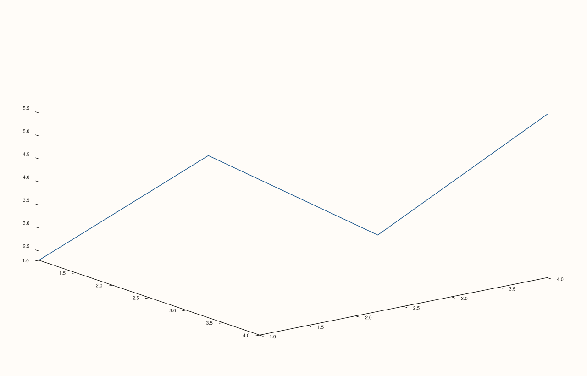
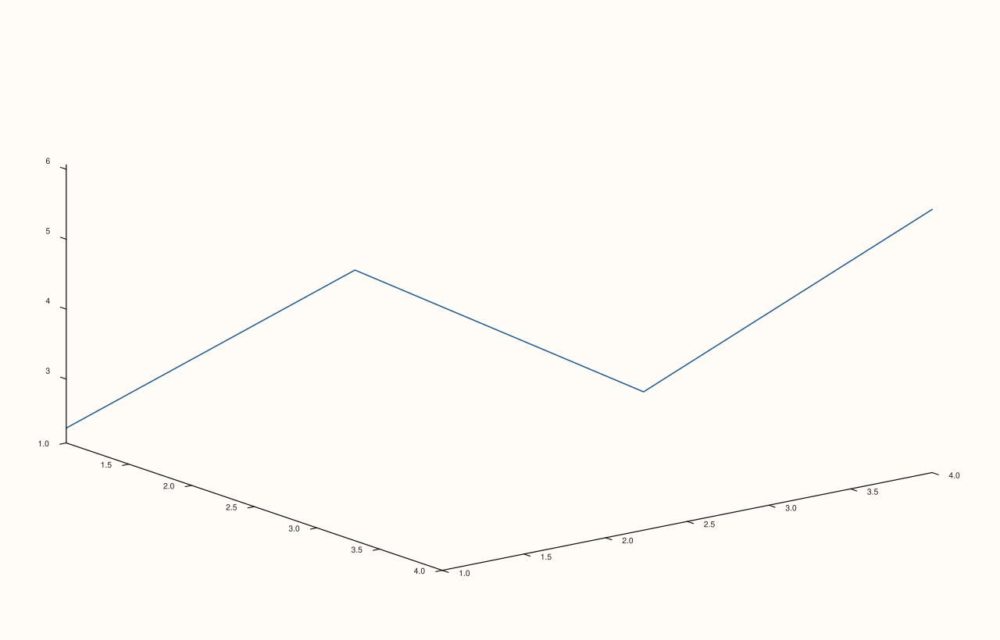

<!-- pluss-hand-authored -->

# Pane::z_limit_method

[Back to Pane API Reference](../../pane_api_reference)

## Signature

```cpp
Pane& Pane::z_limit_method(LimitMethod method) noexcept
```

## What It Does

The z-axis counterpart of [`x_limit_method()`](x_limit_method.md): chooses how the z-axis
range is computed during automatic fitting, meaningful primarily on 3D (`Volumetric`)
panes. Every behavioral detail carries over unchanged — see
[`x_limit_method()`](x_limit_method.md) for the shared mechanics, including its inertness
once [`z_limits()`](z_limits.md) sets an explicit range.

## Parameters

**method** (`LimitMethod`)
    `TickAligned` (default), `Tight`, or `Padded`.

## Returns

`Pane&`
    A reference to the same pane, for chaining.

## Examples

Example 1. `Tight` vs. `Padded` on a 3D `path3` trace's z-axis — verified via direct SVG
content comparison to genuinely differ for this data.

```cpp
using namespace pluss::pl;

const std::vector<double> x{1.0, 2.0, 3.0, 4.0};
const std::vector<double> y{1.0, 2.0, 3.0, 4.0};
const std::vector<double> z{2.3, 4.7, 3.1, 5.85};

auto fig1 = studio("z_limit_method_tight");
auto& pane1 = fig1.pane3();
pane1.path3(x, y, z);
pane1.z_limit_method(LimitMethod::Tight);
fig1.show();

auto fig2 = studio("z_limit_method_padded");
auto& pane2 = fig2.pane3();
pane2.path3(x, y, z);
pane2.z_limit_method(LimitMethod::Padded);
fig2.show();

std::cout << (fig1.to_svg() != fig2.to_svg()) << "\n";
```

### Output

```text
1
```





## Notes

See [`x_limit_method()`](x_limit_method.md)'s Notes — every detail applies identically
here. Most useful on 3D panes; on 2D panes the z-axis state exists but is inert.

## See Also

- [`Pane::x_limit_method`](x_limit_method.md): the x-axis equivalent, with the full
  worked-example set.
- [`Pane::y_limit_method`](y_limit_method.md) / [`Pane::color_limit_method`](color_limit_method.md):
  the y- and color-axis equivalents.
- [`Pane::z_limits`](z_limits.md): what makes this method inert once set explicitly.

<div class="pluss-inline-prev-next">
  <a class="prev-link" href="y_limit_method.html">
    <span class="label">Previous</span>
    <span class="title">y_limit_method</span>
  </a>
  <a class="next-link" href="color_limit_method.html">
    <span class="label">Next</span>
    <span class="title">color_limit_method</span>
  </a>
</div>
