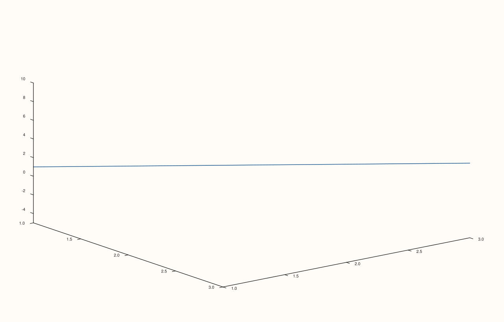
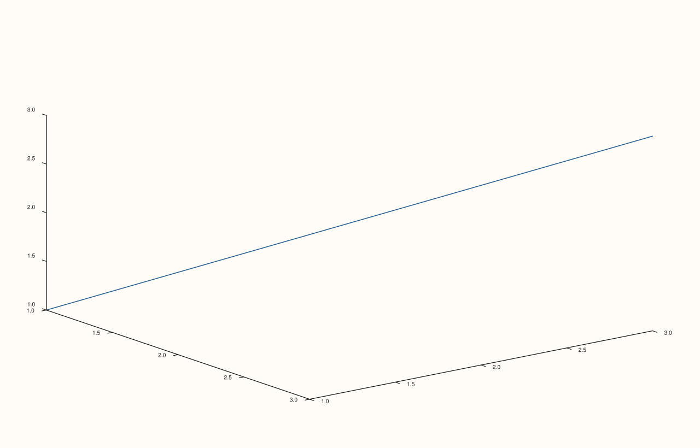

<!-- pluss-hand-authored -->

# Pane::z_limits

[Back to Pane API Reference](../../pane_api_reference)

## Signatures

```cpp
Pane& Pane::z_limits(Range1d limits)   // sets an explicit, manual range
Pane& Pane::auto_z() noexcept          // clears back to automatic fitting
```

## What It Does

The z-axis counterpart of [`x_limits()`](x_limits.md)/[`auto_x()`](x_limits.md), meaningful
primarily on 3D (`Volumetric`) panes. Every validation detail carries over unchanged, with
`"z_limits"` in place of `"x_limits"` in throw messages — see
[`x_limits()`](x_limits.md)'s page for the full set of range-validation failure examples.

## Parameters

**limits** (`Range1d`)
    The explicit `{low, high}` range to display.

## Returns

`Pane&`
    A reference to the same pane, for chaining.

## Examples

Example 1. An explicit z-range on a 3D `path3` trace.

```cpp
using namespace pluss::pl;

auto fig = studio("z_limits_manual");
auto& pane = fig.pane3();
pane.path3(std::vector<double>{1.0, 2.0, 3.0}, std::vector<double>{1.0, 2.0, 3.0}, std::vector<double>{1.0, 2.0, 3.0});
pane.z_limits(Range1d{-5.0, 10.0});
fig.show();

std::cout << (pane.z_axis().limit_mode == LimitMode::Manual) << "\n";
std::cout << pane.z_axis().limits->low << " " << pane.z_axis().limits->high << "\n";
```

### Output

```text
1
-5 10
```



Example 2. `auto_z()` clears it back to automatic fitting.

```cpp
using namespace pluss::pl;

auto fig = studio("z_limits_cleared");
auto& pane = fig.pane3();
pane.path3(std::vector<double>{1.0, 2.0, 3.0}, std::vector<double>{1.0, 2.0, 3.0}, std::vector<double>{1.0, 2.0, 3.0});
pane.z_limits(Range1d{-5.0, 10.0});
pane.auto_z();
fig.show();

std::cout << (pane.z_axis().limit_mode == LimitMode::AutoFit) << "\n";
```

### Output

```text
1
```



## Notes

See [`x_limits()`](x_limits.md)'s Notes — every detail applies identically here. Most
useful on 3D panes; on 2D panes the z-axis state exists but is inert.

## See Also

- [`Pane::x_limits`](x_limits.md) / [`Pane::y_limits`](y_limits.md): the x- and y-axis
  equivalents, with the full worked-example set for validation failures.
- [`Pane::scale_z`](scale_z.md): the other half of the log10 cross-validation.
- [`Pane::z_limit_method`](z_limit_method.md): governs automatic fitting only.

<div class="pluss-inline-prev-next">
  <a class="prev-link" href="y_limits.html">
    <span class="label">Previous</span>
    <span class="title">y_limits</span>
  </a>
  <a class="next-link" href="color_limits.html">
    <span class="label">Next</span>
    <span class="title">color_limits</span>
  </a>
</div>
