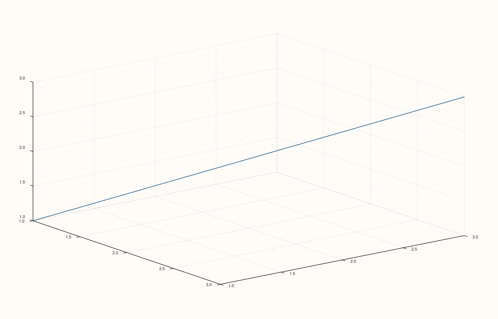

<!-- pluss-hand-authored -->

# Pane::z_minor_grid

[Back to Pane API Reference](../../pane_api_reference)

## Signature

```cpp
Pane& Pane::z_minor_grid(bool enable = true) noexcept
```

## What It Does

The z-axis counterpart of [`x_minor_grid()`](x_minor_grid.md)/
[`y_minor_grid()`](y_minor_grid.md), meaningful primarily on 3D (`Volumetric`) panes.
Every detail carries over unchanged, including the "turning one axis off doesn't
necessarily drop the aggregate" behavior — see
[`x_minor_grid()`](x_minor_grid.md)'s important callout and worked example.

## Parameters

**enable** (`bool`, default `true`)
    `true` to show minor gridlines on the z-axis, `false` to hide them.

## Returns

`Pane&`
    A reference to the same pane, for chaining.

## Examples

Example 1. Enabling minor gridlines on the z-axis of a 3D pane.

```cpp
using namespace pluss::pl;

auto fig = studio("z_minor_grid_check");
auto& pane = fig.pane3();
pane.path3(std::vector<double>{1.0, 2.0, 3.0}, std::vector<double>{1.0, 2.0, 3.0}, std::vector<double>{1.0, 2.0, 3.0});
pane.z_minor_grid(true);
fig.show();

std::cout << pane.z_axis().minor_grid << "\n";
std::cout << (pane.grid_style() == GridStyle::MajorMinor) << "\n";
```

### Output

```text
1
1
```



## Notes

See [`x_minor_grid()`](x_minor_grid.md)'s Notes — every detail applies identically here.
Most useful on 3D panes; on 2D panes the z-axis state exists but is inert.

## See Also

- [`Pane::x_minor_grid`](x_minor_grid.md) / [`Pane::y_minor_grid`](y_minor_grid.md): the
  x- and y-axis equivalents, with the full worked-example set.
- [`Pane::z_major_grid`](z_major_grid.md): the major-gridline counterpart for the z-axis.
- [`Pane::grid`](grid.md): the uniform, all-axes setter.

<div class="pluss-inline-prev-next">
  <a class="prev-link" href="y_minor_grid.html">
    <span class="label">Previous</span>
    <span class="title">y_minor_grid</span>
  </a>
  <a class="next-link" href="x_tick_format.html">
    <span class="label">Next</span>
    <span class="title">x_tick_format</span>
  </a>
</div>
