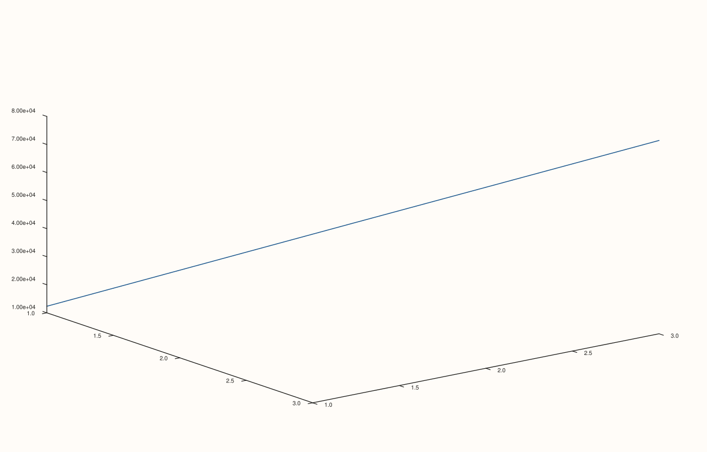

<!-- pluss-hand-authored -->

# Pane::z_tick_format

[Back to Pane API Reference](../../pane_api_reference)

## Signature

```cpp
Pane& Pane::z_tick_format(TickFormat format) noexcept
```

## What It Does

The z-axis counterpart of [`x_tick_format()`](x_tick_format.md)/
[`y_tick_format()`](y_tick_format.md), meaningful primarily on 3D (`Volumetric`) panes.
Every detail carries over unchanged, from the same eight `TickFormat` values — see
[`x_tick_format()`](x_tick_format.md) for the full worked-example set.

## Parameters

**format** (`TickFormat`)
    One of the eight formatting styles.

## Returns

`Pane&`
    A reference to the same pane, for chaining.

## Examples

Example 1. `TickFormat::Scientific` on the z-axis of a 3D `path3` trace.

```cpp
using namespace pluss::pl;

auto fig = studio("z_tick_format_scientific");
auto& pane = fig.pane3();
pane.path3(std::vector<double>{1.0, 2.0, 3.0}, std::vector<double>{1.0, 2.0, 3.0}, std::vector<double>{12345.0, 45678.0, 78901.0});
pane.z_tick_format(TickFormat::Scientific);
fig.show();

std::cout << (pane.z_axis().tick_format == TickFormat::Scientific) << "\n";
```

### Output

```text
1
```



## Notes

See [`x_tick_format()`](x_tick_format.md)'s Notes — every detail applies identically
here. Most useful on 3D panes; on 2D panes the z-axis state exists but is inert.

## See Also

- [`Pane::x_tick_format`](x_tick_format.md) / [`Pane::y_tick_format`](y_tick_format.md):
  the x- and y-axis equivalents, with the full worked-example set covering all eight
  `TickFormat` values.
- [`Pane::z_auto_tick_decimals`](z_auto_tick_decimals.md): fine-tunes `Auto`'s decimal
  precision specifically.

<div class="pluss-inline-prev-next">
  <a class="prev-link" href="y_tick_format.html">
    <span class="label">Previous</span>
    <span class="title">y_tick_format</span>
  </a>
  <a class="next-link" href="x_auto_tick_decimals.html">
    <span class="label">Next</span>
    <span class="title">x_auto_tick_decimals</span>
  </a>
</div>
