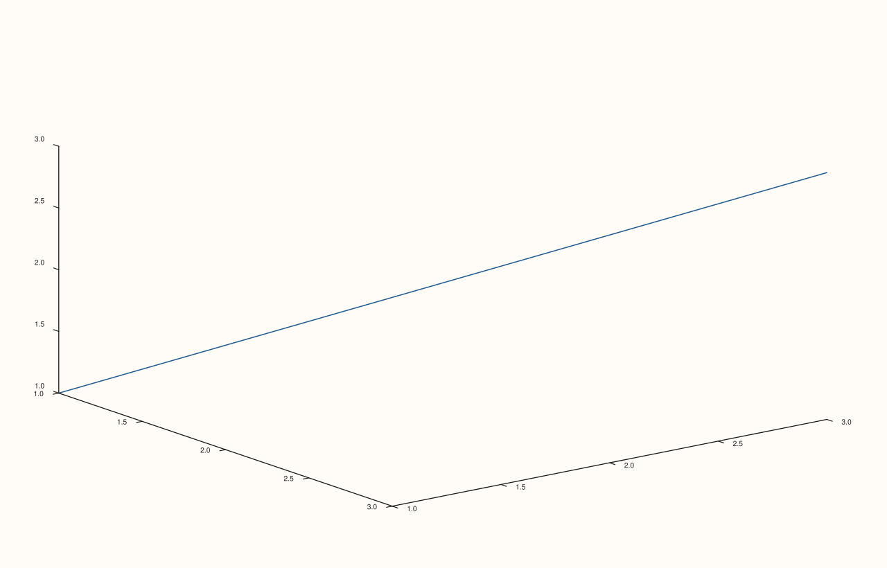

<!-- pluss-hand-authored -->

# Pane::z_tick_label_gap

[Back to Pane API Reference](../../pane_api_reference)

## Signatures

```cpp
Pane& Pane::z_tick_label_gap(double points)          // sets an explicit gap
Pane& Pane::clear_z_tick_label_gap() noexcept          // clears back to the default
```

## What It Does

The z-axis counterpart of [`x_tick_label_gap()`](x_tick_label_gap.md)/
[`y_tick_label_gap()`](y_tick_label_gap.md), meaningful primarily on 3D (`Volumetric`)
panes. Every validation detail carries over unchanged — see
[`x_tick_label_gap()`](x_tick_label_gap.md) for the full worked-example set.

## Parameters

**points** (`double`, setter only)
    The gap size in points. Must be finite and non-negative.

## Returns

`Pane&`
    A reference to the same pane, for chaining.

## Examples

Example 1. A wider gap on the z-axis of a 3D pane.

```cpp
using namespace pluss::pl;

auto fig = studio("z_tick_label_gap_wide");
auto& pane = fig.pane3();
pane.path3(std::vector<double>{1.0, 2.0, 3.0}, std::vector<double>{1.0, 2.0, 3.0}, std::vector<double>{1.0, 2.0, 3.0});
pane.z_tick_label_gap(15.0);
fig.show();

std::cout << *pane.z_axis().tick_label_gap << "\n";
```

### Output

```text
15
```



## Notes

See [`x_tick_label_gap()`](x_tick_label_gap.md)'s Notes — every detail applies identically
here. Most useful on 3D panes; on 2D panes the z-axis state exists but is inert.

## See Also

- [`Pane::x_tick_label_gap`](x_tick_label_gap.md) / [`Pane::y_tick_label_gap`](y_tick_label_gap.md):
  the x- and y-axis equivalents, with the full worked-example set.
- [`Pane::z_label_gap`](z_label_gap.md): spacing for the axis label, a related but
  independent control.

<div class="pluss-inline-prev-next">
  <a class="prev-link" href="y_tick_label_gap.html">
    <span class="label">Previous</span>
    <span class="title">y_tick_label_gap</span>
  </a>
  <a class="next-link" href="x_label_gap.html">
    <span class="label">Next</span>
    <span class="title">x_label_gap</span>
  </a>
</div>
