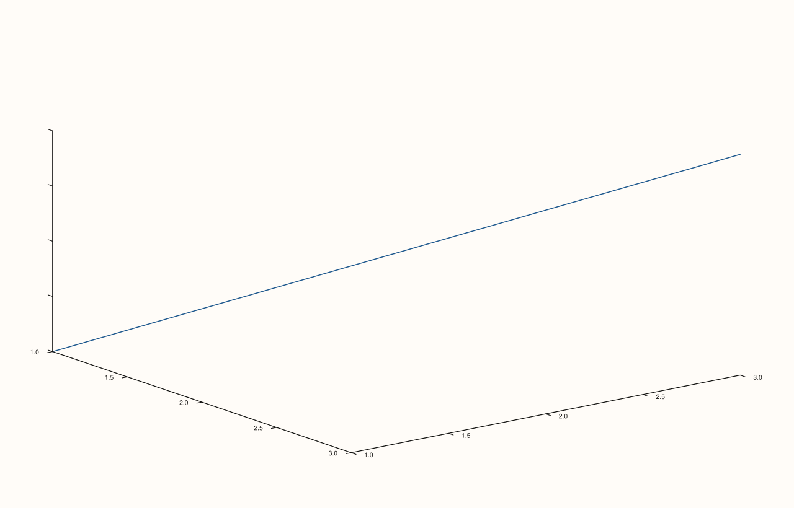

<!-- pluss-hand-authored -->

# Pane::z_tick_labels

[Back to Pane API Reference](../../pane_api_reference)

## Signature

```cpp
Pane& Pane::z_tick_labels(bool enable = true) noexcept
```

## What It Does

The z-axis counterpart of [`x_tick_labels()`](x_tick_labels.md)/
[`y_tick_labels()`](y_tick_labels.md), meaningful primarily on 3D (`Volumetric`) panes.
Every detail carries over unchanged — see [`x_tick_labels()`](x_tick_labels.md) for the
full explanation.

## Parameters

**enable** (`bool`, default `true`)
    `true` to show tick labels, `false` to hide them.

## Returns

`Pane&`
    A reference to the same pane, for chaining.

## Examples

Example 1. Hidden z-axis tick labels on a 3D pane.

```cpp
using namespace pluss::pl;

auto fig = studio("z_tick_labels_hidden");
auto& pane = fig.pane3();
pane.path3(std::vector<double>{1.0, 2.0, 3.0}, std::vector<double>{1.0, 2.0, 3.0}, std::vector<double>{1.0, 2.0, 3.0});
pane.z_tick_labels(false);
fig.show();

std::cout << pane.z_axis().tick_labels_visible << "\n";
```

### Output

```text
0
```



## Notes

See [`x_tick_labels()`](x_tick_labels.md)'s Notes — every detail applies identically here.
Most useful on 3D panes; on 2D panes the z-axis state exists but is inert.

## See Also

- [`Pane::x_tick_labels`](x_tick_labels.md) / [`Pane::y_tick_labels`](y_tick_labels.md):
  the x- and y-axis equivalents, with the full explanation.

<div class="pluss-inline-prev-next">
  <a class="prev-link" href="y_tick_labels.html">
    <span class="label">Previous</span>
    <span class="title">y_tick_labels</span>
  </a>
  <a class="next-link" href="y_label_centered.html">
    <span class="label">Next</span>
    <span class="title">y_label_centered</span>
  </a>
</div>
