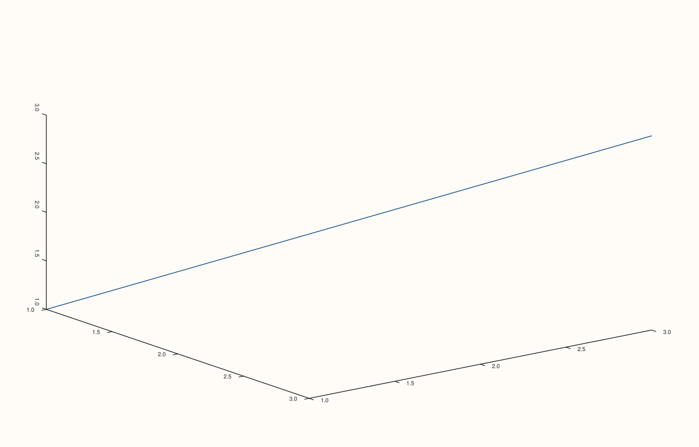

<!-- pluss-hand-authored -->

# Pane::z_tick_rotation

[Back to Pane API Reference](../../pane_api_reference)

## Signatures

```cpp
Pane& Pane::z_tick_rotation(double degrees)          // sets an explicit rotation
Pane& Pane::clear_z_tick_rotation() noexcept          // clears back to the default
```

## What It Does

The z-axis counterpart of [`x_tick_rotation()`](x_tick_rotation.md)/
[`y_tick_rotation()`](y_tick_rotation.md), meaningful primarily on 3D (`Volumetric`)
panes. Every detail carries over unchanged — see
[`x_tick_rotation()`](x_tick_rotation.md) for the full worked-example set.

## Parameters

**degrees** (`double`, setter only)
    The rotation angle in degrees. Must be finite.

## Returns

`Pane&`
    A reference to the same pane, for chaining.

## Examples

Example 1. A 90-degree rotation on the z-axis of a 3D pane.

```cpp
using namespace pluss::pl;

auto fig = studio("z_tick_rotation_90");
auto& pane = fig.pane3();
pane.path3(std::vector<double>{1.0, 2.0, 3.0}, std::vector<double>{1.0, 2.0, 3.0}, std::vector<double>{1.0, 2.0, 3.0});
pane.z_tick_rotation(90.0);
fig.show();

std::cout << *pane.z_axis().tick_rotation_deg << "\n";
```

### Output

```text
90
```



## Notes

See [`x_tick_rotation()`](x_tick_rotation.md)'s Notes — every detail applies identically
here. Most useful on 3D panes; on 2D panes the z-axis state exists but is inert.

## See Also

- [`Pane::x_tick_rotation`](x_tick_rotation.md) / [`Pane::y_tick_rotation`](y_tick_rotation.md):
  the x- and y-axis equivalents, with the full worked-example set.
- [`Pane::z_label_rotation`](z_label_rotation.md): rotates the axis *label*, not its ticks.

<div class="pluss-inline-prev-next">
  <a class="prev-link" href="y_tick_rotation.html">
    <span class="label">Previous</span>
    <span class="title">y_tick_rotation</span>
  </a>
  <a class="next-link" href="x_tick_label_gap.html">
    <span class="label">Next</span>
    <span class="title">x_tick_label_gap</span>
  </a>
</div>
