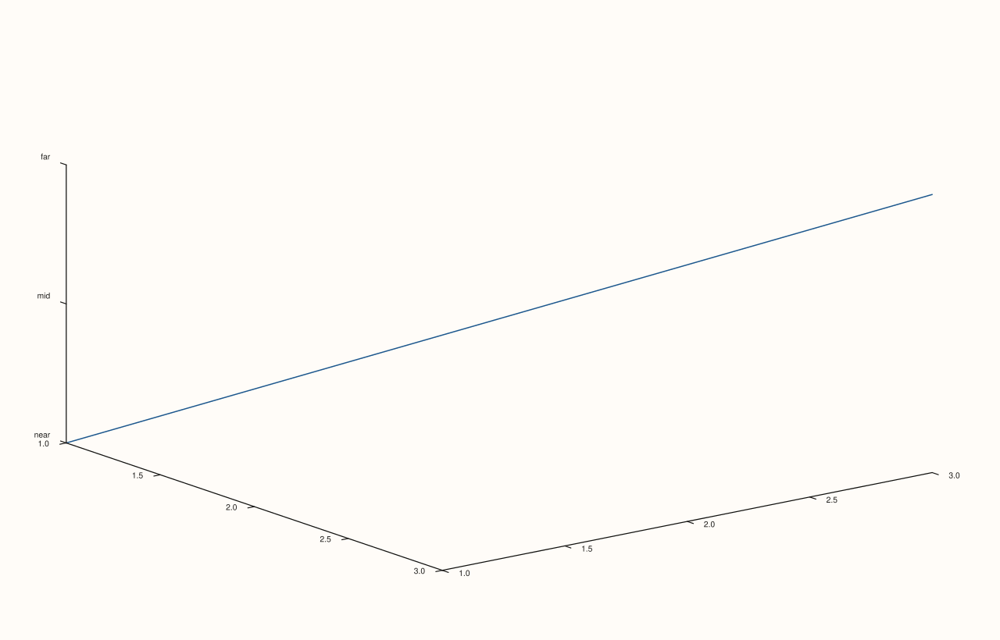

<!-- pluss-hand-authored -->

# Pane::z_ticks

[Back to Pane API Reference](../../pane_api_reference)

## Signatures

```cpp
Pane& z_ticks(Series positions, pluss::msharp::RangeView::Of<std::string_view> labels)
Pane& z_ticks(Series positions, std::initializer_list<std::string_view> labels)

template <class Positions>
Pane& z_ticks(Positions&& positions, pluss::msharp::RangeView::Of<std::string_view> labels)
  requires(!std::same_as<std::remove_cvref_t<Positions>, Series>)

template <class Positions>
Pane& z_ticks(Positions&& positions, std::initializer_list<std::string_view> labels)
  requires(!std::same_as<std::remove_cvref_t<Positions>, Series>)

Pane& clear_z_ticks() noexcept
```

## What It Does

The z-axis counterpart of [`x_ticks()`](x_ticks.md)/[`y_ticks()`](y_ticks.md), meaningful
primarily on 3D (`Volumetric`) panes. Every validation detail carries over unchanged — see
[`x_ticks()`](x_ticks.md) for the full worked-example set.

## Parameters

**positions** (`Series` or series-convertible)
    The tick positions, in data coordinates. Must be non-empty.

**labels** (`RangeView::Of<std::string_view>` or `std::initializer_list<std::string_view>`)
    The label text for each position. Must match `positions`'s count.

## Returns

`Pane&`
    A reference to the same pane, for chaining.

## Examples

Example 1. Explicit z-axis ticks on a 3D pane.

```cpp
using namespace pluss::pl;

auto fig = studio("z_ticks_explicit");
auto& pane = fig.pane3();
pane.path3(std::vector<double>{1.0, 2.0, 3.0}, std::vector<double>{1.0, 2.0, 3.0}, std::vector<double>{1.0, 2.0, 3.0});
pane.z_ticks(std::vector<double>{1.0, 2.0, 3.0}, std::initializer_list<std::string_view>{"near", "mid", "far"});
fig.show();

std::cout << pane.z_axis().ticks->labels.size() << "\n";
```

### Output

```text
3
```



## Notes

See [`x_ticks()`](x_ticks.md)'s Notes — every detail applies identically here. Most useful
on 3D panes; on 2D panes the z-axis state exists but is inert.

## See Also

- [`Pane::x_ticks`](x_ticks.md) / [`Pane::y_ticks`](y_ticks.md): the x- and y-axis
  equivalents, with the full worked-example set.
- [`Pane::z_categories`](z_categories.md): a convenience wrapper built on top of this
  method.

<div class="pluss-inline-prev-next">
  <a class="prev-link" href="y_ticks.html">
    <span class="label">Previous</span>
    <span class="title">y_ticks</span>
  </a>
  <a class="next-link" href="x_categories.html">
    <span class="label">Next</span>
    <span class="title">x_categories</span>
  </a>
</div>
