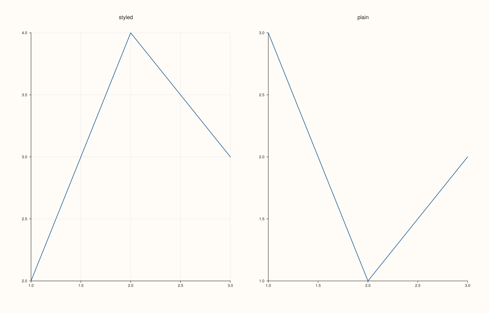
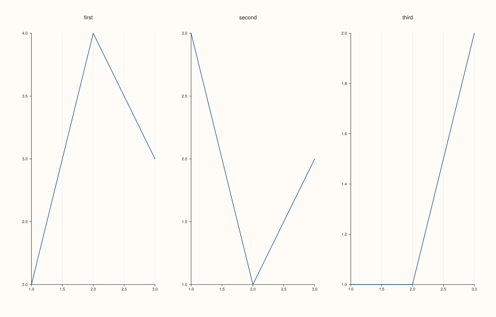

<!-- pluss-hand-authored -->

# Studio::clear_pane_style_defaults

[Back to Studio API Reference](../../studio_api_reference)

## Signature

```cpp
Studio& Studio::clear_pane_style_defaults() noexcept
```

## What It Does

Switches off the defaults set by [`pane_style_defaults`](pane_style_defaults.md): panes created afterwards start with the figure's own theme and the ordinary pane settings again. Panes that already exist are not touched, whether they were created with the defaults or not. Calling it when no defaults are set does nothing, it never throws, and the defaults can be set again later. The figure's [`context_scales`](context_scales.md) are separate and unaffected.

## Parameters

*(none)*

## Returns

`Studio&`
    The same figure, for chaining.

## Examples

Example 1. New panes stop taking the defaults. The first pane is created with the defaults and has the grid; after clearing, the next pane is a plain pane, and the first keeps its grid.

```cpp
Pane look(PaneKind::Planar, Theme::paper(), "look");
look.x_major_grid(true).y_major_grid(true);
auto fig = studio("clear_defaults_after");
fig.mosaic(1, 2);
fig.pane_style_defaults(look);
fig.pane2("styled").trend(std::vector<double>{1, 2, 3}, std::vector<double>{2, 4, 3});
fig.clear_pane_style_defaults();
fig.pane2("plain").trend(std::vector<double>{1, 2, 3}, std::vector<double>{3, 1, 2});
std::cout << "styled keeps its grid: " << fig.panes()[0].x_axis().major_grid << ", plain has none: " << !fig.panes()[1].x_axis().major_grid << "\n";
fig.save_svg("figure.svg");
```

### Output

```text
styled keeps its grid: 1, plain has none: 1
```



Example 2. Nothing to clear is not an error. On a figure with no defaults the call changes nothing, and the figure is the same as without it.

```cpp
auto build = [](bool clear) {
  auto fig = studio("clear_defaults_nothing");
  if (clear) fig.clear_pane_style_defaults();
  fig.pane2("p").trend(std::vector<double>{1, 2, 3}, std::vector<double>{2, 4, 3});
  return fig.to_svg();
};
std::cout << "same figure: " << (build(true) == build(false)) << "\n";
auto fig = studio("clear_defaults_nothing_out");
fig.pane2("p").trend(std::vector<double>{1, 2, 3}, std::vector<double>{2, 4, 3});
fig.save_svg("figure.svg");
```

### Output

```text
same figure: 1
```


Example 3. The defaults can be set again. After clearing, a new call to `pane_style_defaults` switches them back on for the panes created after it.

```cpp
Pane look(PaneKind::Planar, Theme::paper(), "look");
look.x_major_grid(true);
auto fig = studio("clear_defaults_again");
fig.mosaic(1, 3);
fig.pane_style_defaults(look);
fig.pane2("first").trend(std::vector<double>{1, 2, 3}, std::vector<double>{2, 4, 3});
fig.clear_pane_style_defaults();
fig.pane2("second").trend(std::vector<double>{1, 2, 3}, std::vector<double>{3, 1, 2});
fig.pane_style_defaults(look);
fig.pane2("third").trend(std::vector<double>{1, 2, 3}, std::vector<double>{1, 1, 2});
std::cout << "grid on each: " << fig.panes()[0].x_axis().major_grid << fig.panes()[1].x_axis().major_grid << fig.panes()[2].x_axis().major_grid << "\n";
fig.save_svg("figure.svg");
```

### Output

```text
grid on each: 101
```



## Notes

- `noexcept`. Existing panes keep their style; to change a pane, change the pane.

## See Also

- [`Studio::pane_style_defaults`](pane_style_defaults.md): sets the defaults.
- [`Studio::context_scales`](context_scales.md): font-scale defaults, cleared by calling it again.

<div class="pluss-inline-prev-next">
  <a class="next-link" href="clear_row_title.html">
    <span class="label">Next</span>
    <span class="title">clear_row_title</span>
  </a>
</div>
