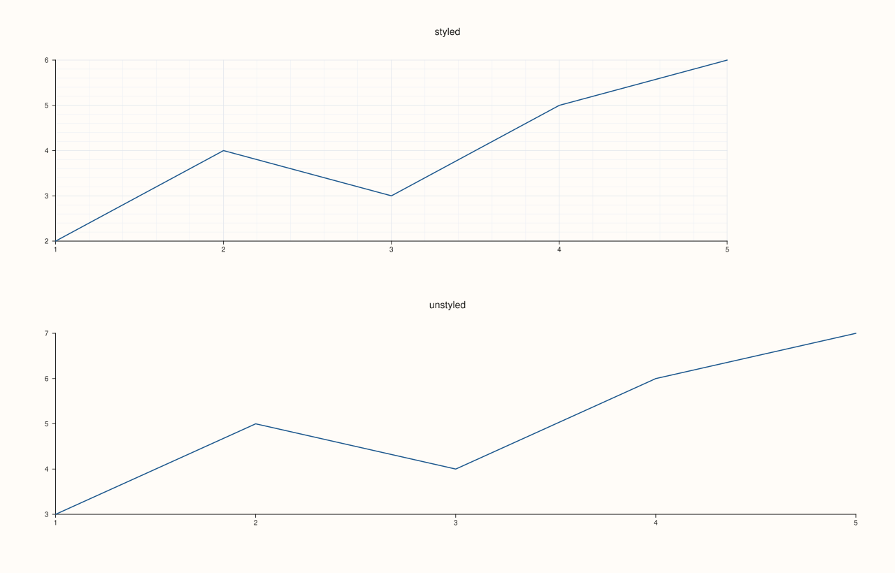

<!-- pluss-hand-authored -->

# Studio::clear_pane_style_defaults

[Back to Studio API Reference](../../studio_api_reference)

## Signature

```cpp
Studio& Studio::clear_pane_style_defaults() noexcept
```

## What It Does

Turns off [`pane_style_defaults()`](pane_style_defaults.md)'s captured settings for any
panes created from this point onward — subsequent [`pane2()`](pane2.md)/
[`pane3()`](pane3.md) calls fall back to each pane's own ordinary constructor defaults
(`GridStyle::None`, `KeyPlace::None`, `axes_visible = true`, ...) instead of whatever
template was last applied.

```{important} Only affects panes created afterward, same as the defaults it clears
Panes created *before* `clear_pane_style_defaults()` keep whichever style they were given
at their own creation time — clearing the default doesn't retroactively strip anything
already applied, mirroring `pane_style_defaults()`'s own "creation-time-only" semantics.
```

## Parameters

*(none)*

## Returns

`Studio&`
    A reference to the same figure, for chaining.

## Examples

Example 1. A styled pane, then `clear_pane_style_defaults()`, then a plain one — on the
same figure.

```cpp
using namespace pluss::pl;

Pane style_template(PaneKind::Planar, Theme::paper());
style_template.grid(GridStyle::MajorMinor).legend(KeyPlace::OutsideEast);

auto fig = studio("style_defaults_cleared");
fig.pane_style_defaults(style_template);

auto& styled = fig.pane2("styled");
flash::lineplot(styled, std::vector<double>{1.0, 2.0, 3.0, 4.0, 5.0}, std::vector<double>{2.0, 4.0, 3.0, 5.0, 6.0});

fig.clear_pane_style_defaults();

auto& unstyled = fig.pane2("unstyled");
flash::lineplot(unstyled, std::vector<double>{1.0, 2.0, 3.0, 4.0, 5.0}, std::vector<double>{3.0, 5.0, 4.0, 6.0, 7.0});
fig.show();

std::cout << static_cast<int>(styled.grid_style()) << " " << static_cast<int>(unstyled.grid_style()) << "\n";
```

`styled` (created while the default was active) keeps `GridStyle::MajorMinor` (`2`);
`unstyled` (created after clearing) falls back to `GridStyle::None` (`0`).

### Output

```text
2 0
```



## Notes

- `noexcept`.
- Only affects panes created after the call — panes already created keep their style, same
  timing rule as `pane_style_defaults()` itself.
- Calling this when no defaults were ever set is harmless — it's a no-op in that case.

## See Also

- [`Studio::pane_style_defaults`](pane_style_defaults.md): sets the defaults this clears.

<div class="pluss-inline-prev-next">
  <a class="prev-link" href="pane_style_defaults.html">
    <span class="label">Previous</span>
    <span class="title">pane_style_defaults</span>
  </a>
  <a class="next-link" href="legend.html">
    <span class="label">Next</span>
    <span class="title">legend</span>
  </a>
</div>
