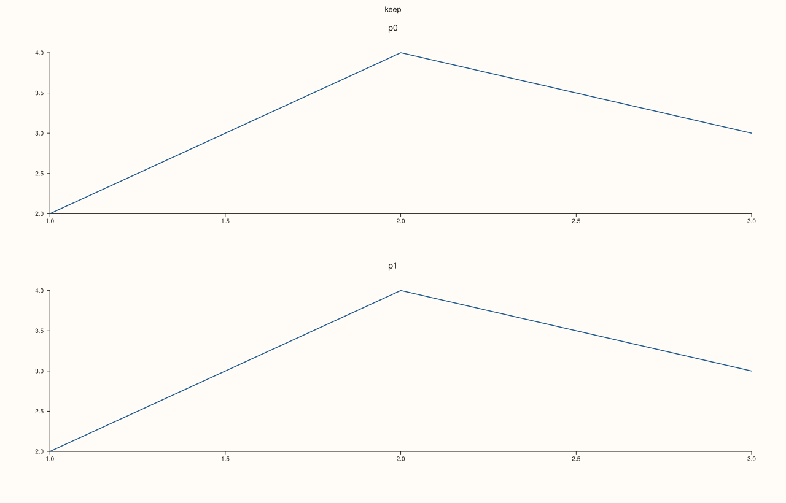
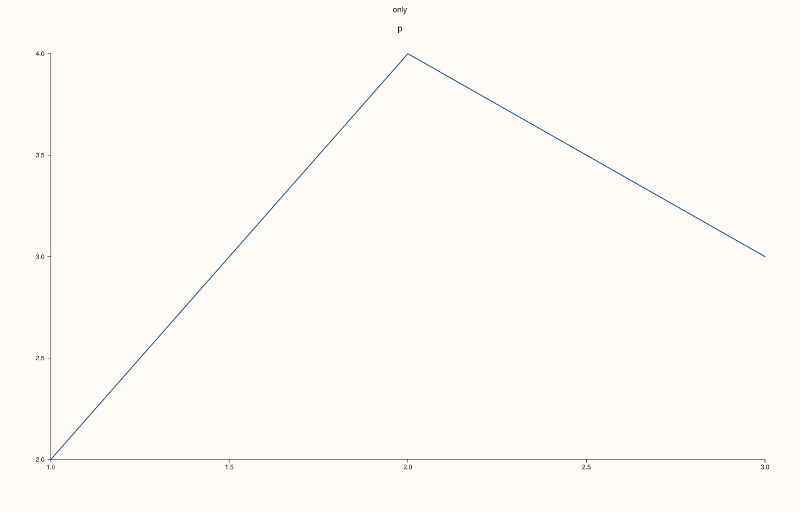

<!-- pluss-hand-authored -->

# Studio::clear_row_title

[Back to Studio API Reference](../../studio_api_reference)

## Signature

```cpp
Studio& Studio::clear_row_title(std::int64_t row) noexcept
```

## What It Does

Removes the title of one row of the [`mosaic`](mosaic.md): the entry is deleted from [`row_titles`](row_titles.md) and the title is no longer drawn. The other rows keep their titles. Clearing a row that has no title does nothing, and so does a negative row or a row the grid does not have; the call never throws, which is why it takes a row without the check that [`row_title`](row_title.md) makes.

The figure afterwards is exactly the figure that never set a title for that row.

## Parameters

**row** (`std::int64_t`)
    The row whose title is removed. A row without a title is ignored.

## Returns

`Studio&`
    The same figure, for chaining.

## Examples

Example 1. Removing one title. Row 1 is cleared, row 0 keeps its title, and the figure equals one that only ever set row 0.

```cpp
auto build = [](bool set_second_then_clear) {
  auto fig = studio("clear_row_title_one");
  fig.mosaic(2, 1);
  fig.row_title(0, "keep");
  if (set_second_then_clear) fig.row_title(1, "temporary").clear_row_title(1);
  for (int i = 0; i < 2; ++i) fig.pane2("p" + std::to_string(i)).trend(std::vector<double>{1, 2, 3}, std::vector<double>{2, 4, 3});
  return fig;
};
auto cleared = build(true), never = build(false);
std::cout << "entries left: " << cleared.row_titles().size() << " (row 0: " << cleared.row_titles().at(0) << ")\n";
std::cout << "equals the figure that never set it: " << (cleared.to_svg() == never.to_svg()) << "\n";
cleared.save_svg("figure.svg");
```

### Output

```text
entries left: 1 (row 0: keep)
equals the figure that never set it: 1
```



Example 2. Nothing to clear is not an error. A row without a title, a negative row and a huge row are all ignored, and the stored titles do not change.

```cpp
auto fig = studio("clear_row_title_none");
fig.mosaic(1, 1);
fig.row_title(0, "only");
fig.clear_row_title(3).clear_row_title(-5).clear_row_title(1000000);
std::cout << "entries: " << fig.row_titles().size() << ", row 0: " << fig.row_titles().at(0) << "\n";
fig.pane2("p").trend(std::vector<double>{1, 2, 3}, std::vector<double>{2, 4, 3});
fig.save_svg("figure.svg");
```

### Output

```text
entries: 1, row 0: only
```



Example 3. A cleared row can be set again. Clearing frees the row, and a later `row_title` stores a new title as if it were the first.

```cpp
auto fig = studio("clear_row_title_again");
fig.mosaic(1, 1);
fig.row_title(0, "old").clear_row_title(0);
std::cout << "after clearing: " << fig.row_titles().size() << "\n";
fig.row_title(0, "new");
std::cout << "after setting again: " << fig.row_titles().at(0) << "\n";
fig.pane2("p").trend(std::vector<double>{1, 2, 3}, std::vector<double>{2, 4, 3});
fig.save_svg("figure.svg");
```

### Output

```text
after clearing: 0
after setting again: new
```


## Notes

- `noexcept`. To remove every title at once use [`clear_row_titles`](clear_row_titles.md).
- To keep the entry but draw nothing, set an empty text with [`row_title`](row_title.md).

## See Also

- [`Studio::row_title`](row_title.md): stores a title.
- [`Studio::clear_row_titles`](clear_row_titles.md): removes all.
- [`Studio::row_titles`](row_titles.md): the stored titles.

<div class="pluss-inline-prev-next">
  <a class="prev-link" href="clear_pane_style_defaults.html">
    <span class="label">Previous</span>
    <span class="title">clear_pane_style_defaults</span>
  </a>
  <a class="next-link" href="clear_row_titles.html">
    <span class="label">Next</span>
    <span class="title">clear_row_titles</span>
  </a>
</div>
