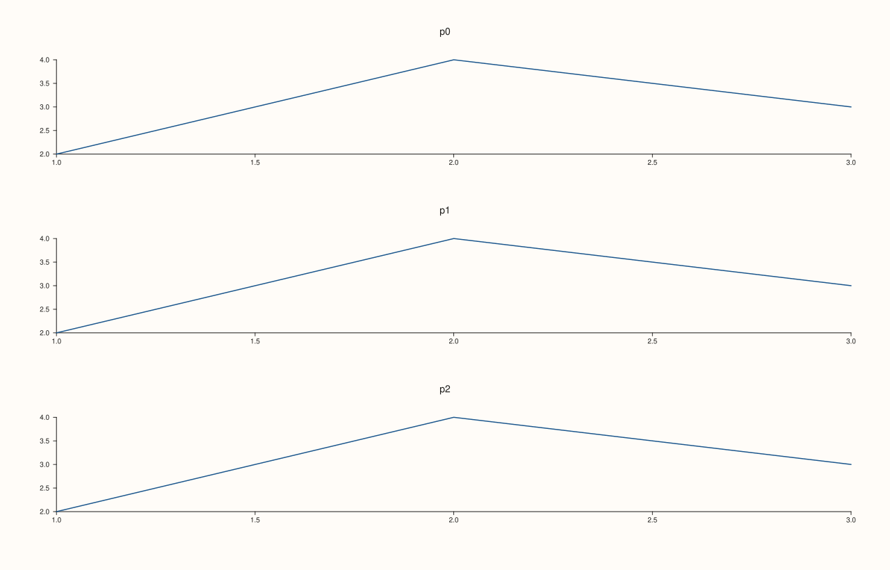
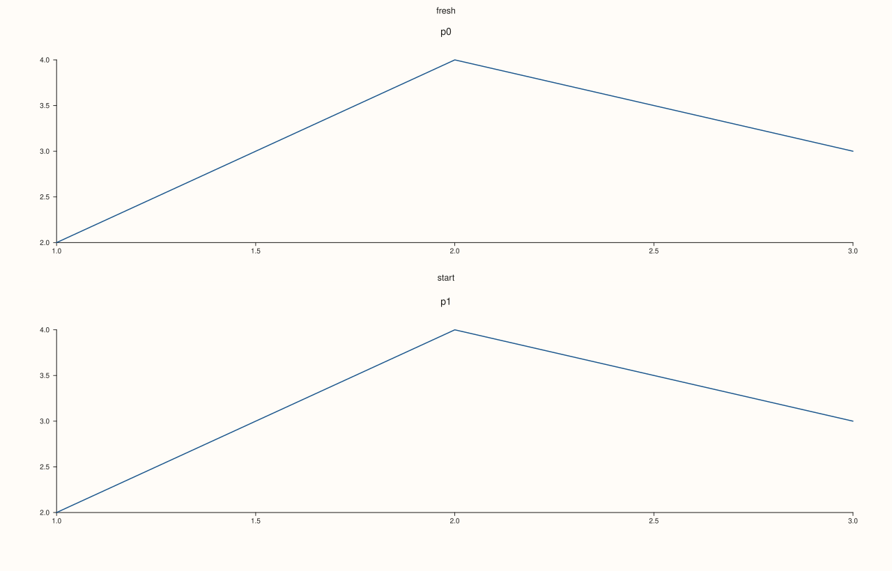
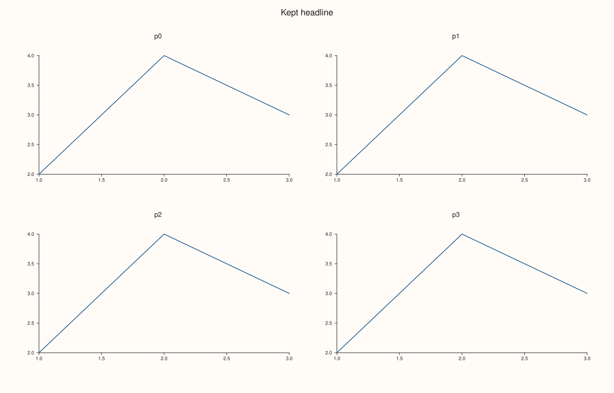

<!-- pluss-hand-authored -->

# Studio::clear_row_titles

[Back to Studio API Reference](../../studio_api_reference)

## Signature

```cpp
Studio& Studio::clear_row_titles() noexcept
```

## What It Does

Removes every row title at once: [`row_titles`](row_titles.md) becomes empty and nothing is drawn for any row. On a figure with no titles it does nothing. It never throws, and the grid, the panes and every other setting are untouched, so the figure afterwards is exactly the figure that never set a title.

## Parameters

*(none)*

## Returns

`Studio&`
    The same figure, for chaining.

## Examples

Example 1. Removing all titles. Three titles are set, `clear_row_titles` empties the map, and the figure equals the one that never set any.

```cpp
auto build = [](bool titled) {
  auto fig = studio("clear_row_titles_all");
  fig.mosaic(3, 1);
  if (titled) fig.row_title(0, "a").row_title(1, "b").row_title(2, "c").clear_row_titles();
  for (int i = 0; i < 3; ++i) fig.pane2("p" + std::to_string(i)).trend(std::vector<double>{1, 2, 3}, std::vector<double>{2, 4, 3});
  return fig;
};
auto cleared = build(true), never = build(false);
std::cout << "entries: " << cleared.row_titles().size() << ", equals the untitled figure: " << (cleared.to_svg() == never.to_svg()) << "\n";
cleared.save_svg("figure.svg");
```

### Output

```text
entries: 0, equals the untitled figure: 1
```



Example 2. On an untitled figure it does nothing. The call is harmless and can be used to reset a figure before titling it again.

```cpp
auto fig = studio("clear_row_titles_none");
fig.clear_row_titles();
std::cout << "entries: " << fig.row_titles().size() << "\n";
fig.mosaic(2, 1);
fig.row_title(0, "fresh").row_title(1, "start");
std::cout << "after titling again: " << fig.row_titles().size() << "\n";
for (int i = 0; i < 2; ++i) fig.pane2("p" + std::to_string(i)).trend(std::vector<double>{1, 2, 3}, std::vector<double>{2, 4, 3});
fig.save_svg("figure.svg");
```

### Output

```text
entries: 0
after titling again: 2
```



Example 3. Only the titles go. The grid, the panes and the headline are unchanged, so the figure keeps its layout.

```cpp
auto fig = studio("clear_row_titles_rest");
fig.headline("Kept headline");
fig.mosaic(2, 2);
fig.row_title(0, "top").row_title(1, "bottom");
for (int i = 0; i < 4; ++i) fig.pane2("p" + std::to_string(i)).trend(std::vector<double>{1, 2, 3}, std::vector<double>{2, 4, 3});
fig.clear_row_titles();
std::cout << "grid: " << fig.mosaic_layout().rows << " x " << fig.mosaic_layout().cols << ", panes: " << fig.pane_count() << ", headline: " << fig.headline_text() << "\n";
fig.save_svg("figure.svg");
```

### Output

```text
grid: 2 x 2, panes: 4, headline: Kept headline
```



## Notes

- `noexcept`. To remove one row's title use [`clear_row_title`](clear_row_title.md).

## See Also

- [`Studio::clear_row_title`](clear_row_title.md): removes one.
- [`Studio::row_title`](row_title.md): stores a title.
- [`Studio::row_titles`](row_titles.md): the stored titles.

<div class="pluss-inline-prev-next">
  <a class="prev-link" href="clear_row_title.html">
    <span class="label">Previous</span>
    <span class="title">clear_row_title</span>
  </a>
  <a class="next-link" href="context_scales.html">
    <span class="label">Next</span>
    <span class="title">context_scales</span>
  </a>
</div>
