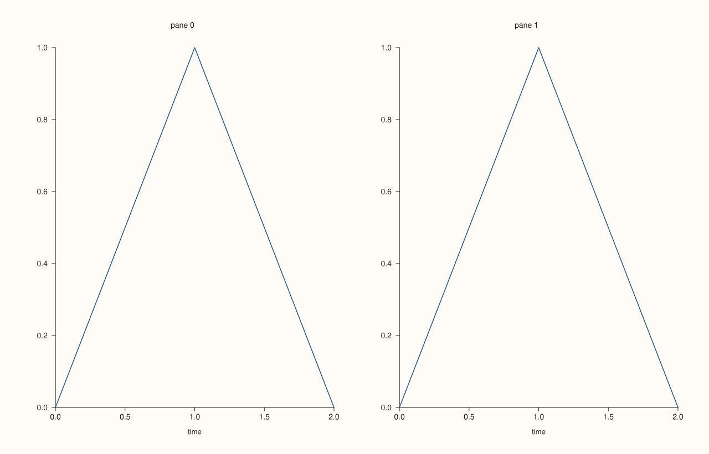
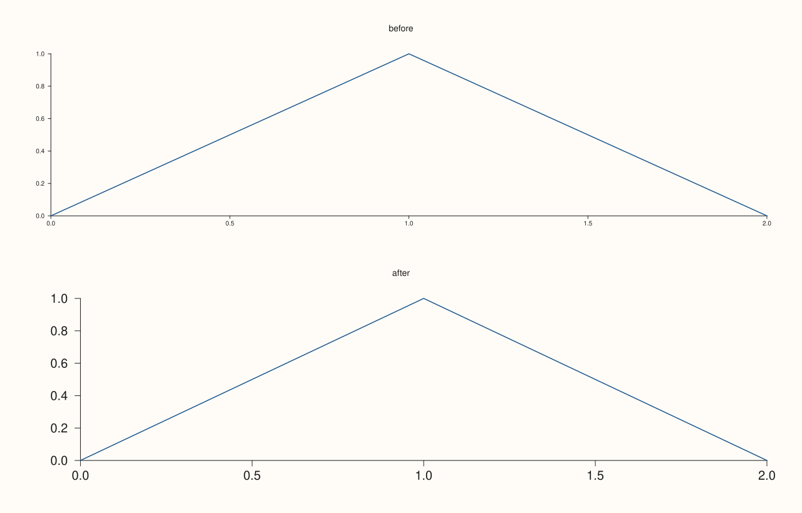
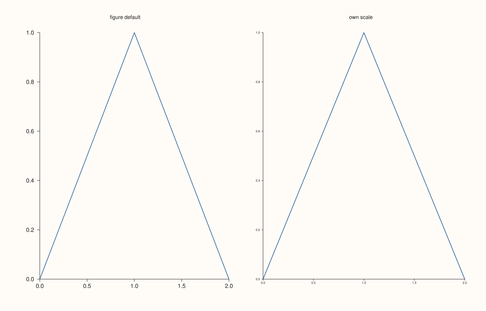
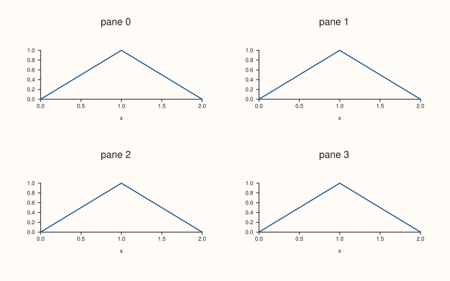

<!-- pluss-hand-authored -->

# Studio::context_scales

[Back to Studio API Reference](../../studio_api_reference)

## Signature

```cpp
Studio& Studio::context_scales(double tick_font_scale, double axis_label_font_scale)
```

## What It Does

Sets the scales of text that panes **made afterwards** start with: the factor on the tick label size and the factor on the axis label size, 1 being the default size of each. It is the one call that makes all the text of a figure larger or smaller, as for a poster, a slide or a small thumbnail, without setting [`Pane::tick_font_scale`](../pane/tick_font_scale.md) and [`axis_label_font_scale`](../pane/axis_label_font_scale.md) pane by pane.

Like [`theme`](theme.md), it is a default that [`pane2`](pane2.md) and [`pane3`](pane3.md) copy into the new pane when they make it. Panes that already exist keep what they have, so call `context_scales` before the first pane. A pane's own calls still change it afterwards. The layout follows the text: larger labels get the room they need, so they are not cut off.

Both scales must be finite and positive, or the call throws and nothing changes.

## Parameters

**tick_font_scale** (`double`)
    The factor on the tick label size for new panes. Finite and positive.

**axis_label_font_scale** (`double`)
    The factor on the axis label size for new panes. Finite and positive.

## Returns

`Studio&`
    The same figure, for chaining.

## Examples

Example 1. A new figure's panes start at 1 for both, which is the default size of tick and axis label texts.

```cpp
auto fig = studio("scales_default");
auto& pane = fig.pane2("p");
pane.trend(std::vector<double>{0, 1, 2}, std::vector<double>{0, 1, 0});
pane.x_label("time");
auto size_of = [](const std::string& svg, const std::string& text) {
  const auto hit = svg.find(">" + text + "<");
  if (hit == std::string::npos) return std::string("absent");
  const auto open = svg.rfind("<text", hit);
  const auto k = svg.find("font-size=\"", open) + 11;
  return svg.substr(k, svg.find('"', k) - k);
};
const std::string svg = fig.to_svg();
std::cout << "figure: " << fig.default_tick_font_scale() << " / " << fig.default_axis_label_font_scale() << "; pane: " << pane.tick_font_scale() << " / " << pane.axis_label_font_scale() << "\n";
std::cout << "tick size " << size_of(svg, "1.0") << ", axis label size " << size_of(svg, "time") << "\n";
fig.save_svg("figure.svg");
```

### Output

```text
figure: 1 / 1; pane: 1 / 1
tick size 10.0000, axis label size 11.0000
```


Example 2. Setting the scales before the panes are made: every pane takes them. With 1.4 and 1.2 the tick labels and axis labels are larger in both panes of the figure.

```cpp
auto fig = studio("scales_larger");
fig.context_scales(1.4, 1.2);
fig.mosaic(1, 2);
for (int i = 0; i < 2; ++i) {
  auto& pane = fig.pane2("pane " + std::to_string(i));
  pane.trend(std::vector<double>{0, 1, 2}, std::vector<double>{0, 1, 0});
  pane.x_label("time");
}
auto size_of = [](const std::string& svg, const std::string& text) {
  const auto hit = svg.find(">" + text + "<");
  if (hit == std::string::npos) return std::string("absent");
  const auto open = svg.rfind("<text", hit);
  const auto k = svg.find("font-size=\"", open) + 11;
  return svg.substr(k, svg.find('"', k) - k);
};
const std::string svg = fig.to_svg();
std::cout << "tick size " << size_of(svg, "1.0") << ", axis label size " << size_of(svg, "time") << "\n";
std::cout << "panes: " << fig.panes()[0].tick_font_scale() << ", " << fig.panes()[1].tick_font_scale() << "\n";
fig.save_svg("figure.svg");
```

### Output

```text
tick size 14.0000, axis label size 13.2000
panes: 1.4, 1.4
```



Example 3. Only panes made afterwards are affected. The first pane was made before the call and keeps 1, the second takes 2.

```cpp
auto fig = studio("scales_after");
auto& before = fig.pane2("before");
before.trend(std::vector<double>{0, 1, 2}, std::vector<double>{0, 1, 0});
fig.context_scales(2.0, 2.0);
auto& after = fig.pane2("after");
after.trend(std::vector<double>{0, 1, 2}, std::vector<double>{0, 1, 0});
std::cout << "before: " << before.tick_font_scale() << ", after: " << after.tick_font_scale() << "\n";
fig.save_svg("figure.svg");
```

### Output

```text
before: 1, after: 2
```



Example 4. A pane's own call is made on the pane and wins for it. The figure's scales set the starting point; `Pane::tick_font_scale` then changes one pane.

```cpp
auto fig = studio("scales_pane_wins");
fig.context_scales(1.5, 1.5);
fig.mosaic(1, 2);
auto& plain = fig.pane2("figure default");
plain.trend(std::vector<double>{0, 1, 2}, std::vector<double>{0, 1, 0});
auto& own = fig.pane2("own scale");
own.trend(std::vector<double>{0, 1, 2}, std::vector<double>{0, 1, 0});
own.tick_font_scale(0.8);
std::cout << "plain: " << plain.tick_font_scale() << ", own: " << own.tick_font_scale() << "\n";
fig.save_svg("figure.svg");
```

### Output

```text
plain: 1.5, own: 0.8
```



Example 5. Scales below 1 make text smaller, to fit a small canvas with many panes.

```cpp
auto fig = studio("scales_smaller");
fig.size(640.0, 400.0);
fig.context_scales(0.8, 0.8);
fig.mosaic(2, 2);
for (int i = 0; i < 4; ++i) {
  auto& pane = fig.pane2("pane " + std::to_string(i));
  pane.trend(std::vector<double>{0, 1, 2}, std::vector<double>{0, 1, 0});
  pane.x_label("x");
}
fig.save_svg("figure.svg");
```



Example 6. Each scale must be finite and positive. A bad value is refused with a message that names it, and the figure's scales are not changed.

```cpp
auto fig = studio("scales_errors");
auto report = [&](const char* what, auto&& call) {
  try {
    call();
  } catch (const pluss::Error& e) {
    std::cout << what << ": " << e.message() << "\n";
  }
};
report("tick zero", [&] { fig.context_scales(0.0, 1.0); });
report("tick negative", [&] { fig.context_scales(-1.0, 1.0); });
report("tick NaN", [&] { fig.context_scales(std::numeric_limits<double>::quiet_NaN(), 1.0); });
report("label zero", [&] { fig.context_scales(1.0, 0.0); });
report("label infinite", [&] { fig.context_scales(1.0, std::numeric_limits<double>::infinity()); });
std::cout << "unchanged: " << fig.default_tick_font_scale() << " / " << fig.default_axis_label_font_scale() << "\n";
fig.pane2("p").trend(std::vector<double>{0, 1, 2}, std::vector<double>{0, 1, 0});
fig.save_svg("figure.svg");
```

### Output

```text
tick zero: context_scales: tick_font_scale must be finite and positive
tick negative: context_scales: tick_font_scale must be finite and positive
tick NaN: context_scales: tick_font_scale must be finite and positive
label zero: context_scales: axis_label_font_scale must be finite and positive
label infinite: context_scales: axis_label_font_scale must be finite and positive
unchanged: 1 / 1
```


## Notes

- Read the defaults back with `default_tick_font_scale()` and `default_axis_label_font_scale()`.
- The titles, the headline and the legends are not scaled by this call.

## See Also

- [`Pane::tick_font_scale`](../pane/tick_font_scale.md), [`Pane::axis_label_font_scale`](../pane/axis_label_font_scale.md): the scales of one pane.
- [`Studio::theme`](theme.md): the other default panes copy when they are made.
- [`Studio::pane2`](pane2.md): makes a pane.

<div class="pluss-inline-prev-next">
  <a class="prev-link" href="clear_row_titles.html">
    <span class="label">Previous</span>
    <span class="title">clear_row_titles</span>
  </a>
  <a class="next-link" href="extent.html">
    <span class="label">Next</span>
    <span class="title">extent</span>
  </a>
</div>
