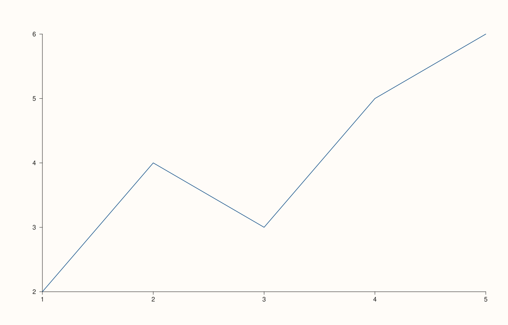

<!-- pluss-hand-authored -->

# Studio::context_scales

[Back to Studio API Reference](../../studio_api_reference)

## Signature

```cpp
Studio& Studio::context_scales(double tick_font_scale, double axis_label_font_scale)
```

## What It Does

Sets the default tick-label and axis-label font scale multipliers new panes are created
with — a figure-wide way to make every subsequently-added pane's text larger or smaller at
once, without touching each pane's own font settings individually.

```{important} Only affects panes created afterward — the same rule as theme()
Exactly like [`theme()`](theme.md), `context_scales()` only changes a default that
[`pane2()`](pane2.md)/[`pane3()`](pane3.md) read **at the moment a pane is created**
(internally, each new pane's own `tick_font_scale`/`axis_label_font_scale` are set from
this default as part of `pane2()`/`pane3()`'s own setup). Calling `context_scales()`
*after* a pane already exists has **no effect** on that pane at all — not even a partial
one. Call it before adding any panes for it to do anything. See Examples 2 and 3.
```

## Parameters

**tick_font_scale** (`double`)
    Multiplier applied to tick-label font size for panes created after this call. Must be
    finite and strictly positive, or the call throws
    `"context_scales: tick_font_scale must be finite and positive"` — this covers zero,
    negative values, `NaN`, and `±Infinity` alike, all with the same message. See
    Examples 4–6.

**axis_label_font_scale** (`double`)
    Multiplier applied to axis-label font size for panes created after this call. Same
    finite-and-positive requirement, throwing
    `"context_scales: axis_label_font_scale must be finite and positive"` on violation. See
    Examples 7–8.

## Returns

`Studio&`
    A reference to the same figure, for chaining.

## Examples

Example 1. The implicit default (`1.0`/`1.0`), never explicitly set.

```cpp
using namespace pluss::pl;

auto fig = studio("scales_default");
auto& pane = fig.pane2();
flash::lineplot(pane, std::vector<double>{1.0, 2.0, 3.0, 4.0, 5.0}, std::vector<double>{2.0, 4.0, 3.0, 5.0, 6.0});
fig.show();
```


Example 2. Calling `context_scales()` **before** `pane2()`: the enlarged fonts genuinely
change the rendered output.

```cpp
using namespace pluss::pl;

auto fig = studio("scales_large");
fig.context_scales(1.6, 1.4);

auto& pane = fig.pane2();
flash::lineplot(pane, std::vector<double>{1.0, 2.0, 3.0, 4.0, 5.0}, std::vector<double>{2.0, 4.0, 3.0, 5.0, 6.0});
fig.show();
```

The rendered SVG is a genuinely different size from Example 1's — the enlarged tick/axis
label fonts are really drawn, not just recorded as unused settings.



Example 3. Calling `context_scales()` **after** `pane2()`: no effect at all — byte-identical
to Example 1's default output.

```cpp
using namespace pluss::pl;

auto fig = studio("scales_too_late");
auto& pane = fig.pane2();
flash::lineplot(pane, std::vector<double>{1.0, 2.0, 3.0, 4.0, 5.0}, std::vector<double>{2.0, 4.0, 3.0, 5.0, 6.0});
fig.context_scales(1.6, 1.4);
fig.show();
```

`pane` was already created (and already read the old `1.0`/`1.0` default) before
`context_scales()` ran, so this call has no visible effect whatsoever on this figure.


Example 4. `tick_font_scale = 0.0` throws.

```cpp
using namespace pluss::pl;

auto fig = studio("bad_zero_tick");
try {
  fig.context_scales(0.0, 1.0);
} catch (const std::exception& e) {
  std::cout << e.what();
}
```

### Output

```text
context_scales: tick_font_scale must be finite and positive
```

Example 5. A negative `tick_font_scale` throws with the identical message.

```cpp
using namespace pluss::pl;

auto fig = studio("bad_negative_tick");
try {
  fig.context_scales(-1.0, 1.0);
} catch (const std::exception& e) {
  std::cout << e.what();
}
```

### Output

```text
context_scales: tick_font_scale must be finite and positive
```

Example 6. A `NaN` `tick_font_scale` throws with the same message too — `NaN` fails the
positivity comparison the same way zero and negative values do.

```cpp
using namespace pluss::pl;

auto fig = studio("bad_nan_tick");
try {
  fig.context_scales(std::numeric_limits<double>::quiet_NaN(), 1.0);
} catch (const std::exception& e) {
  std::cout << e.what();
}
```

### Output

```text
context_scales: tick_font_scale must be finite and positive
```

Example 7. `axis_label_font_scale = 0.0` throws its own, separate message.

```cpp
using namespace pluss::pl;

auto fig = studio("bad_zero_axis");
try {
  fig.context_scales(1.0, 0.0);
} catch (const std::exception& e) {
  std::cout << e.what();
}
```

### Output

```text
context_scales: axis_label_font_scale must be finite and positive
```

Example 8. `+Infinity` for `axis_label_font_scale` throws the same way.

```cpp
using namespace pluss::pl;

auto fig = studio("bad_inf_axis");
try {
  fig.context_scales(1.0, std::numeric_limits<double>::infinity());
} catch (const std::exception& e) {
  std::cout << e.what();
}
```

### Output

```text
context_scales: axis_label_font_scale must be finite and positive
```

## Notes

- Only affects panes created after the call — see the important callout above and
  Examples 2–3.
- `tick_font_scale` is validated (and fails) independently of `axis_label_font_scale`: an
  invalid `tick_font_scale` throws before `axis_label_font_scale` is even checked.
- Zero, negative, `NaN`, and `±Infinity` all trigger the exact same throw message for a
  given parameter — the check is a single `finite && > 0` test, not separate messages per
  failure kind.
- Returns `*this` by reference — chains with any other mutator.

## See Also

- [`Studio::theme`](theme.md): the same "only affects panes created afterward" rule,
  for color instead of font scale.
- [`Studio::pane_style_defaults`](pane_style_defaults.md): a third figure-wide default with
  the identical creation-time-only semantics, for axis/grid/legend style.
- [`Studio::pane2`](pane2.md) / [`pane3`](pane3.md): where these defaults actually get
  read and applied.

<div class="pluss-inline-prev-next">
  <a class="prev-link" href="headline.html">
    <span class="label">Previous</span>
    <span class="title">headline</span>
  </a>
  <a class="next-link" href="headline_text.html">
    <span class="label">Next</span>
    <span class="title">headline_text</span>
  </a>
</div>
