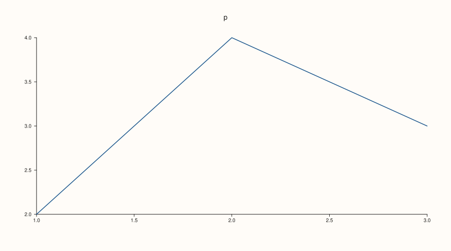
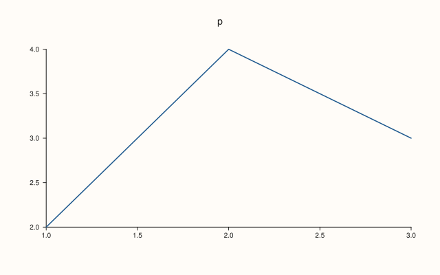
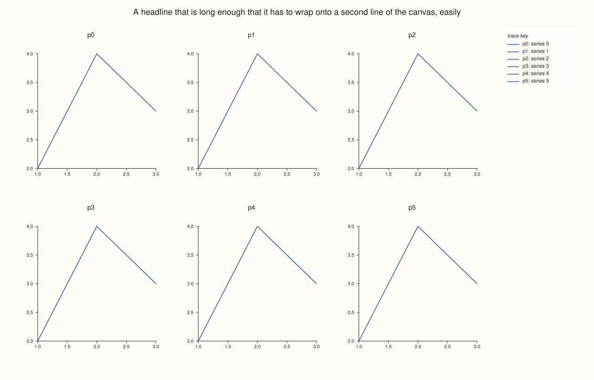
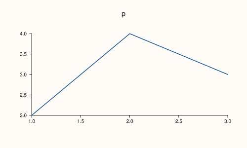

<!-- pluss-hand-authored -->

# Studio::extent

[Back to Studio API Reference](../../studio_api_reference)

## Signature

```cpp
const Extent2d& Studio::extent() const noexcept
```

## What It Does

Returns the figure's size as an `Extent2d`, a pair of `width` and `height` in drawing units: 1280 by 820 for a new figure, and whatever [`size`](size.md) last set. It is the size of the whole canvas, the one written to the `width`, `height` and `viewBox` of the SVG, the page size of the PDF, and the number that [`save_png`](save_png.md) scales by `dpi / 96`.

It is the setting, not a measurement of the content: the extent does not grow to fit a long headline, a wide legend or many panes (those are laid out inside it). The reference is to the figure's own field, so it shows a later `size` call and should be copied when a fixed value is needed.

## Parameters

*(none)*

## Returns

`const Extent2d&`
    The figure's `width` and `height`.

## Examples

Example 1. The default and a change. A new figure is 1280 by 820, and each `size` call is reflected.

```cpp
auto fig = studio("extent_default");
std::cout << "new figure: " << fig.extent().width << " x " << fig.extent().height << "\n";
fig.size(900.0, 500.0);
std::cout << "after size: " << fig.extent().width << " x " << fig.extent().height << "\n";
fig.pane2("p").trend(std::vector<double>{1, 2, 3}, std::vector<double>{2, 4, 3});
fig.save_svg("figure.svg");
```

### Output

```text
new figure: 1280 x 820
after size: 900 x 500
```



Example 2. It is the size of the output. The SVG header carries the extent, and the PNG is the extent times `dpi / 96` pixels.

```cpp
auto fig = studio("extent_output");
fig.size(640.0, 400.0);
fig.pane2("p").trend(std::vector<double>{1, 2, 3}, std::vector<double>{2, 4, 3});
const std::string svg = fig.to_svg();
const auto at = svg.find("<svg");
std::cout << svg.substr(svg.find("width=", at), 40) << "\n";
std::cout << "extent: " << fig.extent().width << " x " << fig.extent().height << ", at 192 dpi: " << fig.extent().width * 2 << " x " << fig.extent().height * 2 << " pixels\n";
fig.save_svg("figure.svg");
```

### Output

```text
width="640.0000" height="400.0000" viewB
extent: 640 x 400, at 192 dpi: 1280 x 800 pixels
```



Example 3. A setting, not a measurement. Adding a long headline, a docked legend and many panes does not change the extent; the content is laid out inside it.

```cpp
auto fig = studio("extent_fixed");
fig.headline("A headline that is long enough that it has to wrap onto a second line of the canvas, easily");
fig.legend(KeyDock::East);
fig.mosaic(2, 3);
for (int i = 0; i < 6; ++i) {
  fig.pane2("p" + std::to_string(i)).trend(std::vector<double>{1, 2, 3}, std::vector<double>{2, 4, 3}).label("series " + std::to_string(i));
}
std::cout << "still " << fig.extent().width << " x " << fig.extent().height << "\n";
fig.save_svg("figure.svg");
```

### Output

```text
still 1280 x 820
```



Example 4. Copy when the value must stay. The reference follows the figure, so a copy taken before a `size` call keeps the old value.

```cpp
auto fig = studio("extent_copy");
const Extent2d before = fig.extent();
const Extent2d& live = fig.extent();
fig.size(500.0, 300.0);
std::cout << "copy: " << before.width << " x " << before.height << "\n";
std::cout << "reference: " << live.width << " x " << live.height << "\n";
fig.pane2("p").trend(std::vector<double>{1, 2, 3}, std::vector<double>{2, 4, 3});
fig.save_svg("figure.svg");
```

### Output

```text
copy: 1280 x 820
reference: 500 x 300
```



## Notes

- `noexcept`, and has no effect on the figure.
- Only [`size`](size.md) changes the extent; other settings never do.

## See Also

- [`Studio::size`](size.md): sets the extent.
- [`Studio::save_png`](save_png.md): the pixel size is the extent times `dpi / 96`.

<div class="pluss-inline-prev-next">
  <a class="prev-link" href="context_scales.html">
    <span class="label">Previous</span>
    <span class="title">context_scales</span>
  </a>
  <a class="next-link" href="headline.html">
    <span class="label">Next</span>
    <span class="title">headline</span>
  </a>
</div>
