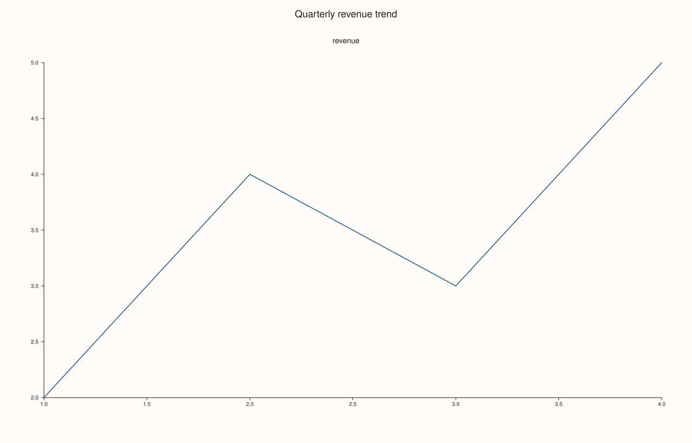
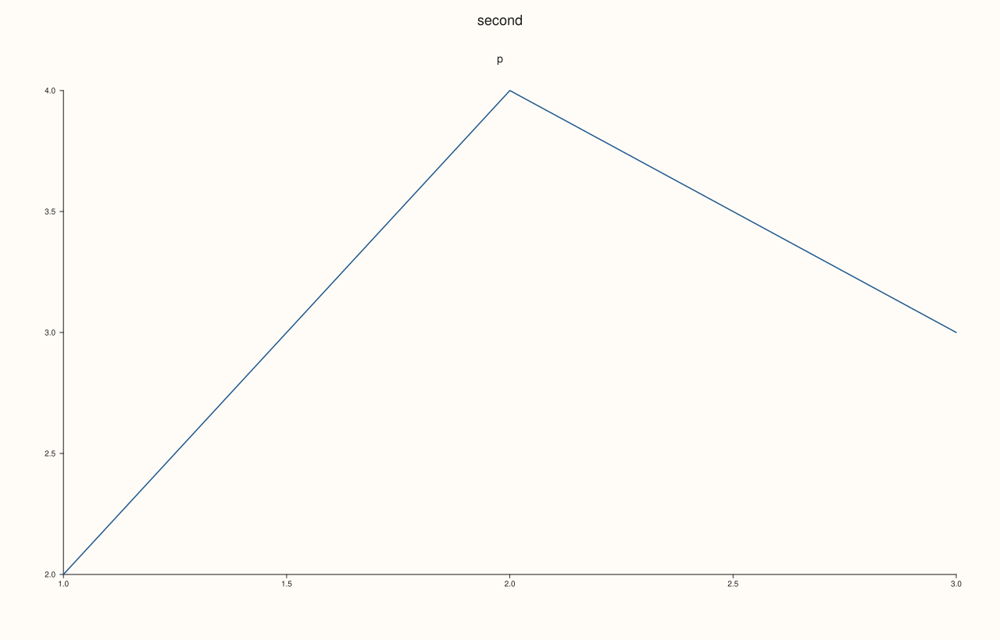
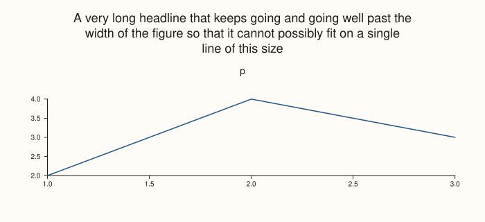
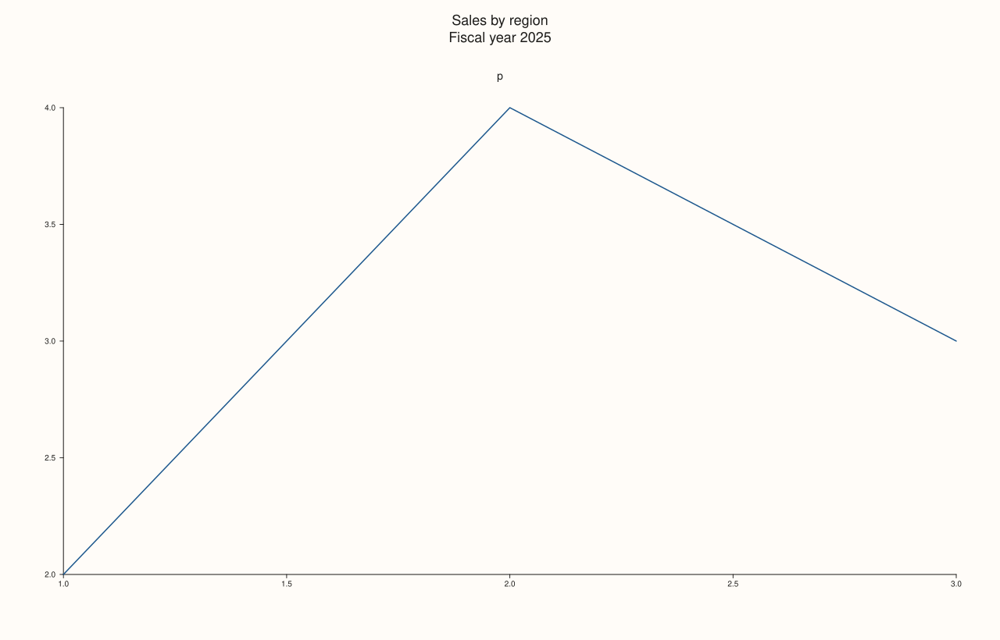
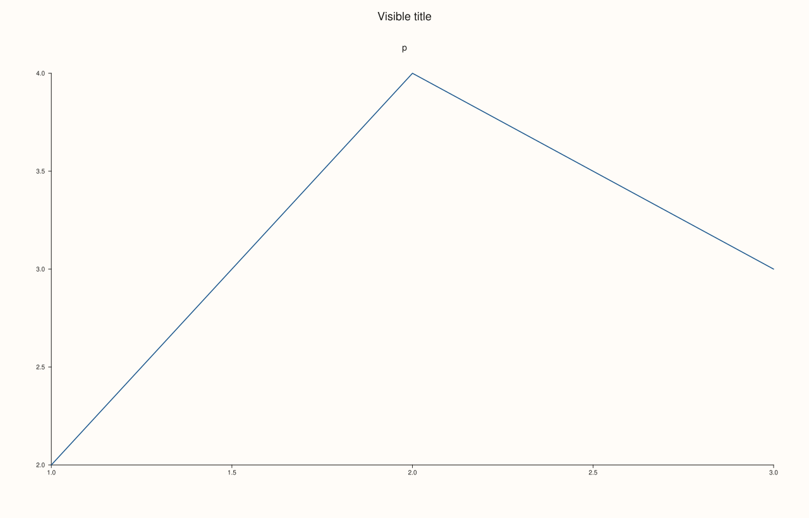

<!-- pluss-hand-authored -->

# Studio::headline

[Back to Studio API Reference](../../studio_api_reference)

## Signature

```cpp
Studio& Studio::headline(std::string text)
```

## What It Does

Sets the headline: one title for the whole figure, drawn centred above every pane at 18 points. It is the figure-level counterpart of a pane's own title (the argument of [`pane2`](pane2.md) and [`pane3`](pane3.md)), and unlike the figure's [`name`](name.md), which is never drawn, the headline is part of the picture. Calling `headline` again replaces the text; an empty string removes it.

The headline gets the room it needs. A line wider than the figure is wrapped at word boundaries, an explicit `\n` starts a new line, and the panes, the docked legend and the row titles are all pushed down by the extra height, so a long headline never overlaps anything and is never cut off at the edges. Every line is drawn; the figure makes room for as many as there are. A headline with nothing visible in it (empty, or only spaces and line breaks) is no headline: it draws nothing and takes no room. Math text between dollar signs is typeset, and a line that contains math is not wrapped.

The text is read when the figure is rendered, so `headline` can be called before or after the panes are added. [`headline_text`](headline_text.md) reads it back.

## Parameters

**text** (`std::string`)
    The headline. An empty string, or text that is only white space, removes the headline.

## Returns

`Studio&`
    The same figure, for chaining.

## Examples

Example 1. A headline on a single pane. The text is centred above the pane and the figure keeps its size.

```cpp
auto fig = studio("headline_basic");
fig.headline("Quarterly revenue trend");
fig.pane2("revenue").trend(std::vector<double>{1, 2, 3, 4}, std::vector<double>{2, 4, 3, 5});
std::cout << "stored: " << fig.headline_text() << "\n";
fig.save_svg("figure.svg");
```

### Output

```text
stored: Quarterly revenue trend
```



Example 2. Replacing and removing. A second call replaces the text, and an empty string removes it; the figure with the headline removed is exactly the figure that never had one.

```cpp
auto build = [](const char* first, const char* second) {
  auto fig = studio("headline_replace");
  if (first) fig.headline(first);
  if (second) fig.headline(second);
  fig.pane2("p").trend(std::vector<double>{1, 2, 3}, std::vector<double>{2, 4, 3});
  return fig;
};
auto replaced = build("first", "second");
std::cout << "after two calls: " << replaced.headline_text() << "\n";
std::cout << "empty string == never set: " << (build("first", "").to_svg() == build(nullptr, nullptr).to_svg()) << "\n";
std::cout << "only spaces == never set:  " << (build("  \n  ", nullptr).to_svg() == build(nullptr, nullptr).to_svg()) << "\n";
replaced.save_svg("figure.svg");
```

### Output

```text
after two calls: second
empty string == never set: 1
only spaces == never set:  1
```



Example 3. A long headline wraps. At 700 points wide the text is broken at word boundaries, centred line by line, and the pane moves down to make room; nothing is cut off.

```cpp
auto fig = studio("headline_wrap");
fig.size(700.0, 320.0);
fig.headline("A very long headline that keeps going and going well past the width of the figure so that it cannot possibly fit on a single line of this size");
fig.pane2("p").trend(std::vector<double>{1, 2, 3}, std::vector<double>{2, 4, 3});
const std::string svg = fig.to_svg();
std::cout << "whole text in one element: " << (svg.find(">A very long headline that keeps going and going well past the width of the figure so that it cannot possibly fit on a single line of this size<") != std::string::npos) << "\n";
std::cout << "the last words are drawn: " << (svg.find("of this size<") != std::string::npos) << "\n";
fig.save_svg("figure.svg");
```

### Output

```text
whole text in one element: 0
the last words are drawn: 1
```



Example 4. Explicit line breaks. A `\n` starts a new line, each line is its own text element, and the extra height pushes the pane down by the same amount a wrapped headline would.

```cpp
auto build = [](const char* headline) {
  auto fig = studio("headline_lines");
  fig.headline(headline);
  fig.pane2("p").trend(std::vector<double>{1, 2, 3}, std::vector<double>{2, 4, 3});
  return fig.to_svg();
};
const std::string two = build("Sales by region\nFiscal year 2025");
std::cout << "two separate lines: " << (two.find(">Sales by region<") != std::string::npos && two.find(">Fiscal year 2025<") != std::string::npos) << "\n";
std::cout << "one literal newline inside a text: " << (two.find("region\nFiscal") != std::string::npos) << "\n";
std::cout << "taller headline moves the pane: " << (build("one line") != two) << "\n";
auto fig = studio("headline_lines_out");
fig.headline("Sales by region\nFiscal year 2025");
fig.pane2("p").trend(std::vector<double>{1, 2, 3}, std::vector<double>{2, 4, 3});
fig.save_svg("figure.svg");
```

### Output

```text
two separate lines: 1
one literal newline inside a text: 0
taller headline moves the pane: 1
```



Example 5. Every line is drawn. Six explicit lines are all drawn and the pane moves down for each of them; a headline of only math is not wrapped, and one of only white space takes no room.

```cpp
auto lines_drawn = [](const std::string& headline) {
  auto fig = studio("headline_limits");
  fig.headline(headline);
  fig.pane2("p").trend(std::vector<double>{1, 2, 3}, std::vector<double>{2, 4, 3});
  const std::string svg = fig.to_svg();
  int n = 0;
  for (const char* word : {"one", "two", "three", "four", "five", "six"}) n += svg.find(std::string(">") + word + "<") != std::string::npos;
  return n;
};
std::cout << "six explicit lines, lines drawn: " << lines_drawn("one\ntwo\nthree\nfour\nfive\nsix") << "\n";
auto fig = studio("headline_math");
fig.headline("$\\mu + \\sigma$ per period");
fig.pane2("p").trend(std::vector<double>{1, 2, 3}, std::vector<double>{2, 4, 3});
fig.save_svg("figure.svg");
```

### Output

```text
six explicit lines, lines drawn: 6
```


Example 6. Independent of the name. `rename` changes only the figure's bookkeeping name, the headline is the only text drawn at the top, and the two can be chained.

```cpp
auto fig = studio("headline_name");
fig.rename("report").headline("Visible title");
fig.pane2("p").trend(std::vector<double>{1, 2, 3}, std::vector<double>{2, 4, 3});
const std::string svg = fig.to_svg();
std::cout << fig.name() + " / " + fig.headline_text() + ", name drawn: " + std::to_string(svg.find(">report<") != std::string::npos) << "\n";
fig.save_svg("figure.svg");
```

### Output

```text
report / Visible title, name drawn: 0
```



## Notes

- The headline takes room only when it draws something; the figure of a whitespace-only headline equals the figure with none.
- The headline is figure state read at render time, so its position in the call order does not matter.
- Pane titles are set with [`pane2`](pane2.md) and [`pane3`](pane3.md); a title for each row of a [`mosaic`](mosaic.md) is [`row_title`](row_title.md).

## See Also

- [`Studio::headline_text`](headline_text.md): reads the headline back.
- [`Studio::name`](name.md), [`rename`](rename.md): the name that is never drawn.
- [`Studio::row_title`](row_title.md): titles for rows of a mosaic.
- [`Studio::size`](size.md): the width the headline wraps to.

<div class="pluss-inline-prev-next">
  <a class="prev-link" href="extent.html">
    <span class="label">Previous</span>
    <span class="title">extent</span>
  </a>
  <a class="next-link" href="headline_text.html">
    <span class="label">Next</span>
    <span class="title">headline_text</span>
  </a>
</div>
