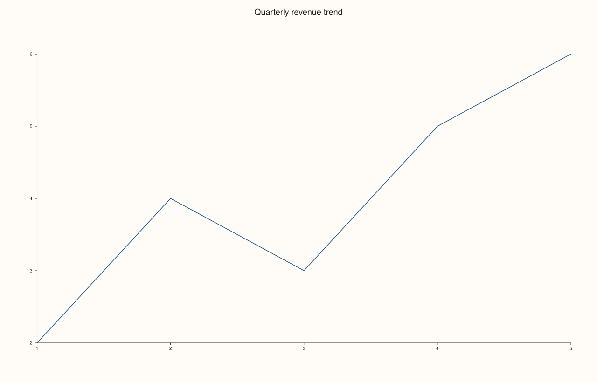

<!-- pluss-hand-authored -->

# Studio::headline

[Back to Studio API Reference](../../studio_api_reference)

## Signature

```cpp
Studio& Studio::headline(std::string text)
```

## What It Does

Sets the figure's headline — a title string that, unlike [`name()`](name.md), is actually
part of the rendered output. It's the figure-level counterpart to a pane's own title (the
`title` argument [`pane2()`](pane2.md)/[`pane3()`](pane3.md) take): one headline for the
whole `Studio`, sitting above every pane, versus one title per individual pane.

## Parameters

**text** (`std::string`)
    The headline text. An empty string (the default state — no `headline()` call at all)
    means no headline is drawn.

## Returns

`Studio&`
    A reference to the same figure, for chaining.

## Examples

Example 1. Setting a headline on a single-pane figure.

```cpp
using namespace pluss::pl;

auto fig = studio("revenue");
fig.headline("Quarterly revenue trend");

auto& pane = fig.pane2();
pane.trend(std::vector<double>{1.0, 2.0, 3.0, 4.0, 5.0}, std::vector<double>{2.0, 4.0, 3.0, 5.0, 6.0});
fig.show();

std::cout << fig.headline_text() << "\n";
```

### Output

```text
Quarterly revenue trend
```



Example 2. Chaining `headline()` after `rename()` — the two are independent fields, not
aliases of each other.

```cpp
using namespace pluss::pl;

auto fig = studio("chain");
fig.rename("chained").headline("Chained calls");

std::cout << fig.name() << " / " << fig.headline_text() << "\n";
```

### Output

```text
chained / Chained calls
```

## Notes

- Returns `*this` by reference — chains with any other mutator.
- Unlike [`name()`](name.md) (bookkeeping only), `headline()` text is drawn into the
  rendered figure.
- There is no `clear_headline()` — pass an empty string to `headline()` to remove it.

## See Also

- [`Studio::name`](name.md) / [`rename`](rename.md): the sibling bookkeeping-only name
  field — never rendered.
- [`Studio::headline_text`](headline_text.md): reads the current headline back.
- [`Studio::pane2`](pane2.md) / [`pane3`](pane3.md): per-pane titles, one level below the
  figure-wide headline.

<div class="pluss-inline-prev-next">
  <a class="prev-link" href="theme.html">
    <span class="label">Previous</span>
    <span class="title">theme</span>
  </a>
  <a class="next-link" href="context_scales.html">
    <span class="label">Next</span>
    <span class="title">context_scales</span>
  </a>
</div>
