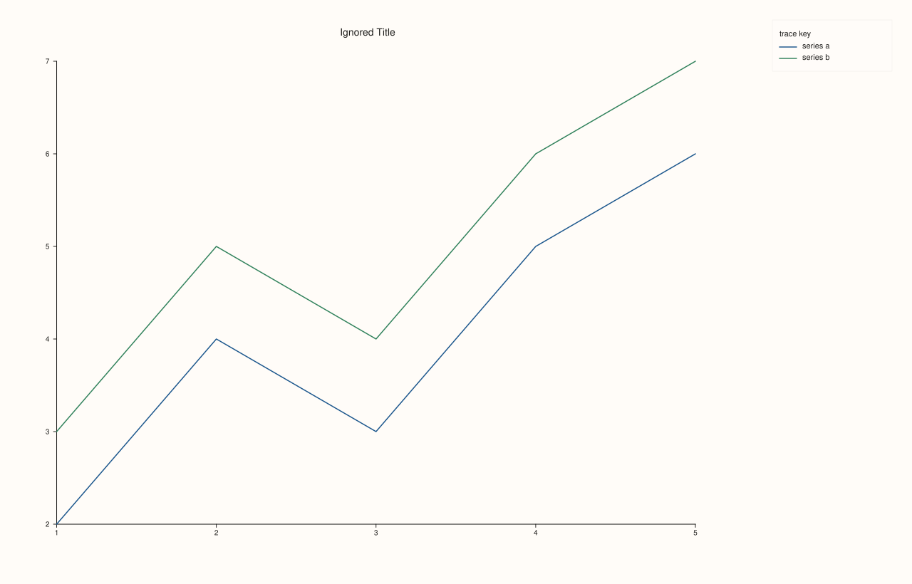

<!-- pluss-hand-authored -->

# Studio::legend

[Back to Studio API Reference](../../studio_api_reference)

## Signature

```cpp
Studio& Studio::legend(KeyDock dock) noexcept
```

## What It Does

Turns on (or off) a single, **figure-wide, consolidated legend** docked to one edge of the
whole `Studio` — as opposed to the per-`Pane` legend controlled by
[`Pane::legend(KeyPlace)`](../pane/legend.md), which draws its own key *inside* that one
pane. The two mechanisms are independent and can be mixed freely: a figure can have a
docked `Studio`-level legend, per-pane inset legends, both, or neither.

When a dock other than `KeyDock::None` is active, every render pass pools the labeled
traces from **every currently-visible pane** (via each trace's
[`label()`](../trace/label.md)) into one shared key, regardless of what each pane's own
`legend_place()` is set to. If more than one pane is visible in the figure, each pooled
entry is prefixed with its owning pane's title so entries from different panes stay
distinguishable; with only a single visible pane, no prefix is added since it would be
redundant. Traces with no label (the default) never appear in the legend at all, docked or
not.

```{note} KeyDock has three values
`KeyDock::None` (default — no docked legend), `KeyDock::East` (right edge), and
`KeyDock::South` (bottom edge). There is no `West` or `North`.
```

## Parameters

**dock** (`KeyDock`)
    Which edge to dock the consolidated legend to, or `KeyDock::None` to turn it off.

## Returns

`Studio&`
    A reference to the same figure, for chaining.

## Examples

Example 1. The default: no docked legend. Two panes, each with a labeled line, but nothing
figure-wide is drawn — each pane's own `legend_place()` (also `None` by default) governs
its own space.

```cpp
using namespace pluss::pl;

auto fig = studio("legend_none");
auto& pane_a = fig.pane2("A");
pane_a.trend(std::vector<double>{1.0, 2.0, 3.0, 4.0, 5.0}, std::vector<double>{2.0, 4.0, 3.0, 5.0, 6.0}).label("series a");
auto& pane_b = fig.pane2("B");
pane_b.trend(std::vector<double>{1.0, 2.0, 3.0, 4.0, 5.0}, std::vector<double>{3.0, 5.0, 4.0, 6.0, 7.0}).label("series b");
fig.mosaic(1, 2);
fig.show();
```


Example 2. `KeyDock::East` with two visible panes — one consolidated legend on the right
edge, pooling both panes' labeled traces. Because more than one pane is visible, each
entry is prefixed with its pane's title (`"Group A"`, `"Group B"`).

```cpp
using namespace pluss::pl;

auto fig = studio("legend_east");
fig.legend(KeyDock::East);
auto& pane_a = fig.pane2("Group A");
pane_a.trend(std::vector<double>{1.0, 2.0, 3.0, 4.0, 5.0}, std::vector<double>{2.0, 4.0, 3.0, 5.0, 6.0}).label("series a");
auto& pane_b = fig.pane2("Group B");
pane_b.trend(std::vector<double>{1.0, 2.0, 3.0, 4.0, 5.0}, std::vector<double>{3.0, 5.0, 4.0, 6.0, 7.0}).label("series b");
fig.mosaic(1, 2);
fig.show();

std::cout << static_cast<int>(fig.legend_dock()) << "\n";  // KeyDock::East == 1
```

### Output

```text
1
```


Example 3. `KeyDock::South` — same two-pane figure, legend docked to the bottom edge
instead of the right.

```cpp
using namespace pluss::pl;

auto fig = studio("legend_south");
fig.legend(KeyDock::South);
auto& pane_a = fig.pane2("Group A");
pane_a.trend(std::vector<double>{1.0, 2.0, 3.0, 4.0, 5.0}, std::vector<double>{2.0, 4.0, 3.0, 5.0, 6.0}).label("series a");
auto& pane_b = fig.pane2("Group B");
pane_b.trend(std::vector<double>{1.0, 2.0, 3.0, 4.0, 5.0}, std::vector<double>{3.0, 5.0, 4.0, 6.0, 7.0}).label("series b");
fig.mosaic(1, 2);
fig.show();
```


Example 4. `KeyDock::East` with only a **single** pane — both labeled traces are still
pooled into the docked legend, but with no pane-title prefix (there is nothing to
disambiguate against).

```cpp
using namespace pluss::pl;

auto fig = studio("legend_east_single");
fig.legend(KeyDock::East);
auto& pane = fig.pane2("Ignored Title");
pane.trend(std::vector<double>{1.0, 2.0, 3.0, 4.0, 5.0}, std::vector<double>{2.0, 4.0, 3.0, 5.0, 6.0}).label("series a");
pane.trend(std::vector<double>{1.0, 2.0, 3.0, 4.0, 5.0}, std::vector<double>{3.0, 5.0, 4.0, 6.0, 7.0}).label("series b");
fig.show();
```



## Notes

- `noexcept`.
- Independent of, and additive with, each `Pane`'s own `legend_place()` — a figure can show
  both a docked figure-wide legend and per-pane inset legends simultaneously.
- Pools **every visible pane's** labeled traces on every render, so adding/removing/hiding
  panes or (re)labeling traces after the fact is automatically reflected — nothing needs to
  be "refreshed."
- Traces without a `label()` never contribute an entry, whether the legend is docked or not.
- Pane-title prefixes appear only when more than one pane is visible in the figure at
  render time; hiding panes down to one (via [`Pane::hide()`](../pane/visible.md), or
  equivalently `Pane::visible(false)`) drops the prefix even if the figure was originally
  built with more.

## See Also

- [`Studio::legend_dock`](legend_dock.md): reads back the current dock setting.
- [`Studio::legend_frame`](legend_frame.md) / [`legend_shape`](legend_shape.md): the frame
  style and horizontal/vertical layout of the docked legend.
- [`Pane::legend`](../pane/legend.md): the independent, per-pane inset legend.
- [`Trace::label`](../trace/label.md): what makes a trace eligible to appear in any legend.

<div class="pluss-inline-prev-next">
  <a class="prev-link" href="clear_pane_style_defaults.html">
    <span class="label">Previous</span>
    <span class="title">clear_pane_style_defaults</span>
  </a>
  <a class="next-link" href="legend_dock.html">
    <span class="label">Next</span>
    <span class="title">legend_dock</span>
  </a>
</div>
