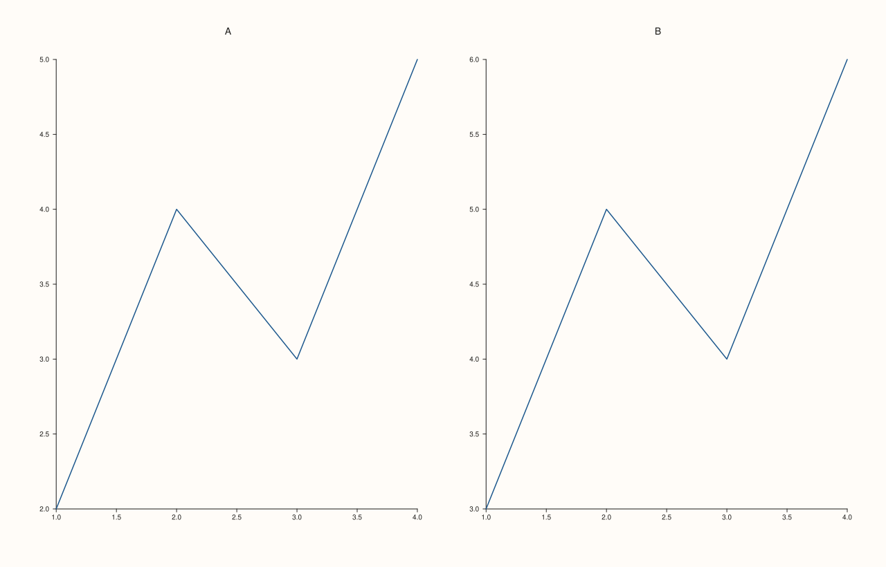
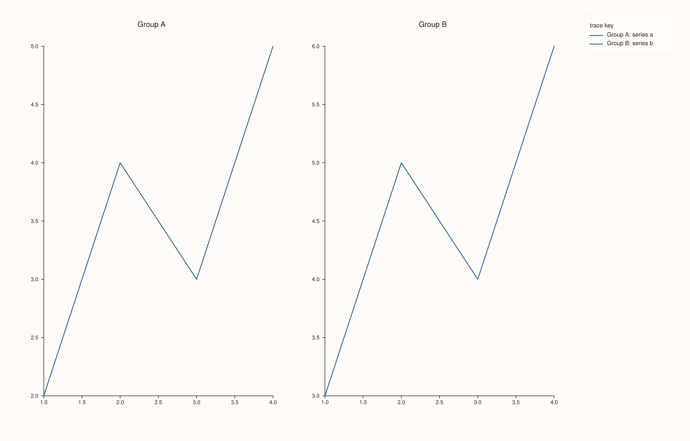
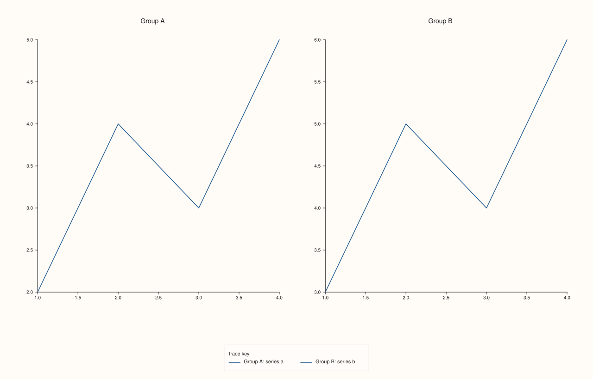
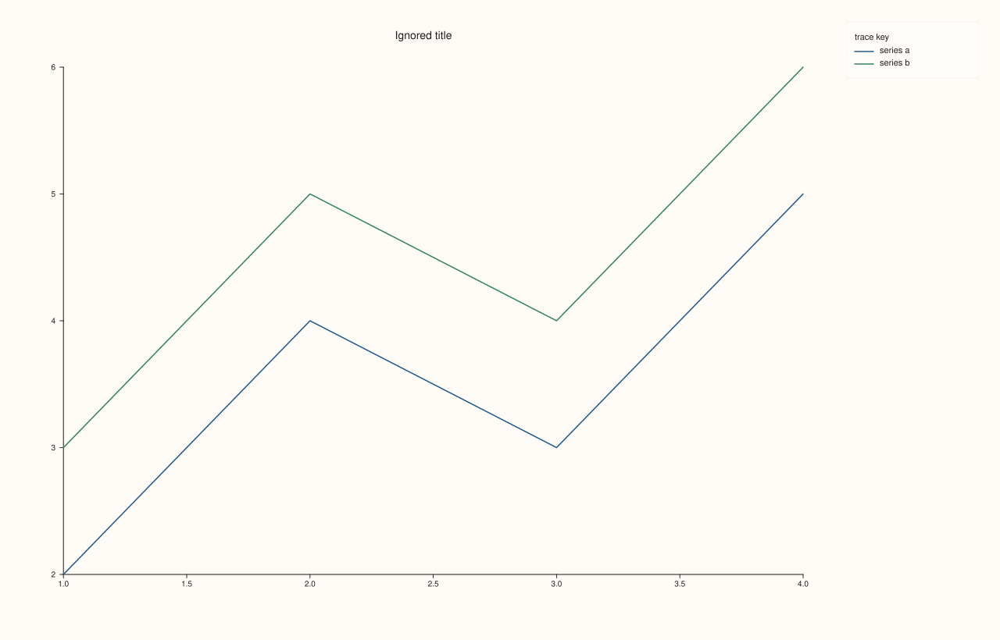
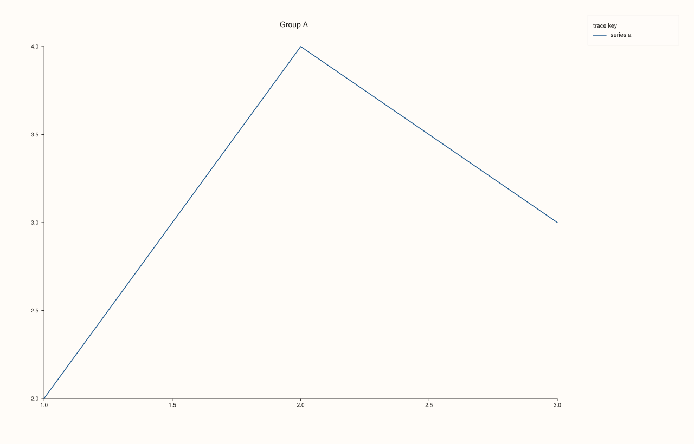
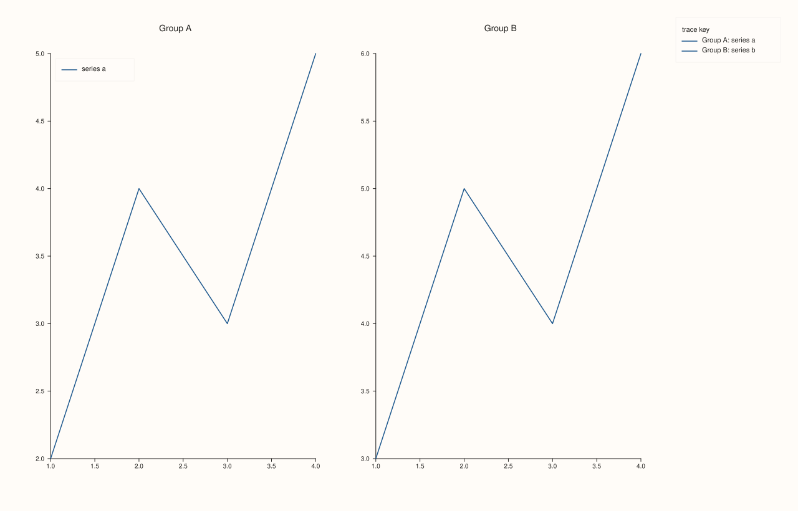
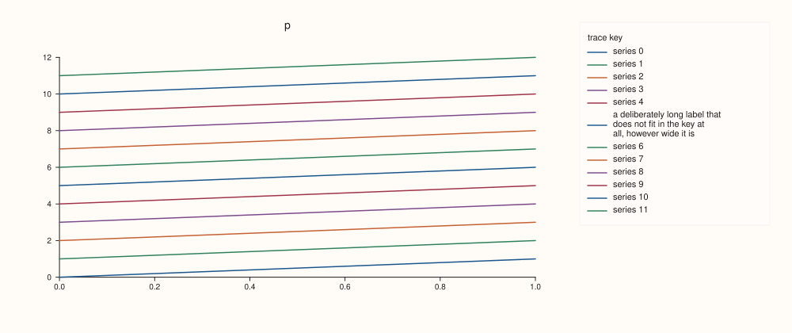

<!-- pluss-hand-authored -->

# Studio::legend

[Back to Studio API Reference](../../studio_api_reference)

## Signature

```cpp
Studio& Studio::legend(KeyDock dock) noexcept
```

## What It Does

Docks one **figure-wide legend** to an edge of the figure. When a dock is set, the labelled traces of every visible pane are gathered into a single key titled "trace key", drawn outside the panes at the east (right) or south (bottom) edge, and the panes shrink to make room. It is separate from the inset legend a pane draws inside its own plot ([`Pane::legend`](../pane/legend.md)); the two can be used together.

A trace appears in the legend only if it has a label ([`Trace::label`](../trace/label.md)) and is visible. With more than one visible pane each entry is prefixed with its pane's title (`"Group A: series a"`), so entries from different panes stay distinguishable; with one visible pane the prefix is left out. Hiding panes changes the prefix and the pooled entries the next time the figure is rendered; nothing needs refreshing.

The dock takes room only when it draws something. `KeyDock::East` and `KeyDock::South` on a figure with no labelled trace give exactly the figure of `KeyDock::None`. The key's frame and proportions are set by [`legend_frame`](legend_frame.md) and [`legend_shape`](legend_shape.md); a label too long for one line is wrapped, and the key as a whole is fitted to the height of the figure.

## Parameters

**dock** (`KeyDock`)
    `KeyDock::None` (the default) for no docked legend, `KeyDock::East` for the right edge, `KeyDock::South` for the bottom edge. See [`KeyDock`](../types/KeyDock.md).

## Returns

`Studio&`
    The same figure, for chaining.

## Examples

Example 1. The default. Two panes with labelled traces and no dock: nothing is gathered, and each pane's own legend (none by default) is all there is.

```cpp
auto fig = studio("legend_none");
fig.mosaic(1, 2);
fig.pane2("A").trend(std::vector<double>{1, 2, 3, 4}, std::vector<double>{2, 4, 3, 5}).label("series a");
fig.pane2("B").trend(std::vector<double>{1, 2, 3, 4}, std::vector<double>{3, 5, 4, 6}).label("series b");
std::cout << "dock: " << static_cast<int>(fig.legend_dock()) << " (None = 0)\n";
fig.save_svg("figure.svg");
```

### Output

```text
dock: 0 (None = 0)
```



Example 2. `KeyDock::East` with two panes. One key on the right edge gathers both panes' traces, each entry prefixed with its pane's title.

```cpp
auto fig = studio("legend_east");
fig.legend(KeyDock::East);
fig.mosaic(1, 2);
fig.pane2("Group A").trend(std::vector<double>{1, 2, 3, 4}, std::vector<double>{2, 4, 3, 5}).label("series a");
fig.pane2("Group B").trend(std::vector<double>{1, 2, 3, 4}, std::vector<double>{3, 5, 4, 6}).label("series b");
std::cout << "dock: " << static_cast<int>(fig.legend_dock()) << " (East = 1)\n";
fig.save_svg("figure.svg");
```

### Output

```text
dock: 1 (East = 1)
```



Example 3. `KeyDock::South`. The same figure with the key along the bottom edge; the panes lose height instead of width.

```cpp
auto fig = studio("legend_south");
fig.legend(KeyDock::South);
fig.mosaic(1, 2);
fig.pane2("Group A").trend(std::vector<double>{1, 2, 3, 4}, std::vector<double>{2, 4, 3, 5}).label("series a");
fig.pane2("Group B").trend(std::vector<double>{1, 2, 3, 4}, std::vector<double>{3, 5, 4, 6}).label("series b");
fig.save_svg("figure.svg");
```



Example 4. One pane, no prefix. With a single visible pane the entries are the trace labels as they are.

```cpp
auto fig = studio("legend_single");
fig.legend(KeyDock::East);
auto& pane = fig.pane2("Ignored title");
pane.trend(std::vector<double>{1, 2, 3, 4}, std::vector<double>{2, 4, 3, 5}).label("series a");
pane.trend(std::vector<double>{1, 2, 3, 4}, std::vector<double>{3, 5, 4, 6}).label("series b");
const std::string svg = fig.to_svg();
std::cout << "title used as a prefix: " << (svg.find("Ignored title: ") != std::string::npos) << "\n";
fig.save_svg("figure.svg");
```

### Output

```text
title used as a prefix: 0
```



Example 5. A dock with nothing to show takes no room. No trace has a label, so East and South give the same SVG as no dock at all. A hidden trace and an unlabelled one are treated alike.

```cpp
auto build = [](KeyDock dock, bool label) {
  auto fig = studio("legend_empty");
  fig.legend(dock);
  auto& pane = fig.pane2("p");
  auto& line = pane.trend(std::vector<double>{1, 2, 3}, std::vector<double>{2, 4, 3});
  if (label) line.label("series").hide();
  return fig.to_svg();
};
std::cout << "East, no label == None:      " << (build(KeyDock::East, false) == build(KeyDock::None, false)) << "\n";
std::cout << "South, no label == None:     " << (build(KeyDock::South, false) == build(KeyDock::None, false)) << "\n";
std::cout << "East, hidden trace == None:  " << (build(KeyDock::East, true) == build(KeyDock::None, true)) << "\n";
auto fig = studio("legend_empty_out");
fig.legend(KeyDock::East);
fig.pane2("p").trend(std::vector<double>{1, 2, 3}, std::vector<double>{2, 4, 3});
fig.save_svg("figure.svg");
```

### Output

```text
East, no label == None:      1
South, no label == None:     1
East, hidden trace == None:  1
```


Example 6. Hiding a pane. With two panes visible the entries carry their pane titles; hide one and the prefix goes, and its traces leave the key.

```cpp
auto build = [](bool hide_b) {
  auto fig = studio("legend_hidden");
  fig.legend(KeyDock::East);
  fig.mosaic(1, 2);
  fig.pane2("Group A").trend(std::vector<double>{1, 2, 3}, std::vector<double>{2, 4, 3}).label("series a");
  auto& b = fig.pane2("Group B");
  b.trend(std::vector<double>{1, 2, 3}, std::vector<double>{3, 5, 4}).label("series b");
  if (hide_b) b.hide();
  return fig.to_svg();
};
const std::string both = build(false), one = build(true);
std::cout << "both visible: prefix " << (both.find("Group A: series a") != std::string::npos)
          << ", series b listed " << (both.find("series b") != std::string::npos) << "\n";
std::cout << "B hidden:     prefix " << (one.find("Group A: series a") != std::string::npos)
          << ", series b listed " << (one.find("series b") != std::string::npos) << "\n";
auto fig = studio("legend_hidden_out");
fig.legend(KeyDock::East);
fig.pane2("Group A").trend(std::vector<double>{1, 2, 3}, std::vector<double>{2, 4, 3}).label("series a");
fig.save_svg("figure.svg");
```

### Output

```text
both visible: prefix 1, series b listed 1
B hidden:     prefix 0, series b listed 0
```



Example 7. A docked legend and a pane's own legend together. The first pane keeps an inset key in its north-west corner while the figure also docks one at the east edge.

```cpp
auto fig = studio("legend_both");
fig.legend(KeyDock::East);
fig.mosaic(1, 2);
auto& a = fig.pane2("Group A");
a.trend(std::vector<double>{1, 2, 3, 4}, std::vector<double>{2, 4, 3, 5}).label("series a");
a.legend(KeyPlace::NorthWest);
fig.pane2("Group B").trend(std::vector<double>{1, 2, 3, 4}, std::vector<double>{3, 5, 4, 6}).label("series b");
fig.save_svg("figure.svg");
```



Example 8. Many entries. Twelve labelled traces in one pane: the docked key fits itself to the height of the figure, and the label that is too long for one line wraps onto several.

```cpp
auto fig = studio("legend_many");
fig.size(1000.0, 420.0);
fig.legend(KeyDock::East);
auto& pane = fig.pane2("p");
for (int i = 0; i < 12; ++i) {
  pane.trend(std::vector<double>{0, 1}, std::vector<double>{double(i), double(i + 1)})
      .label(i == 5 ? "a deliberately long label that does not fit in the key at all, however wide it is" : "series " + std::to_string(i));
}
fig.save_svg("figure.svg");
```



## Notes

- The setter is `noexcept` and takes any `KeyDock`; there is no west or north dock.
- The dock is figure state, not pane state: it applies to every pane that exists when the figure is rendered, whenever `legend` is called.
- [`legend_dock`](legend_dock.md) reads the setting back. [`legend_frame`](legend_frame.md) and [`legend_shape`](legend_shape.md) style the key.

## See Also

- [`Studio::legend_dock`](legend_dock.md): reads the dock back.
- [`Studio::legend_frame`](legend_frame.md), [`legend_shape`](legend_shape.md): the frame and proportions of the key.
- [`Pane::legend`](../pane/legend.md): the inset legend of one pane.
- [`Trace::label`](../trace/label.md): the label that makes a trace appear in a legend.
- [`KeyDock`](../types/KeyDock.md): the values.

<div class="pluss-inline-prev-next">
  <a class="prev-link" href="headline_text.html">
    <span class="label">Previous</span>
    <span class="title">headline_text</span>
  </a>
  <a class="next-link" href="legend_dock.html">
    <span class="label">Next</span>
    <span class="title">legend_dock</span>
  </a>
</div>
