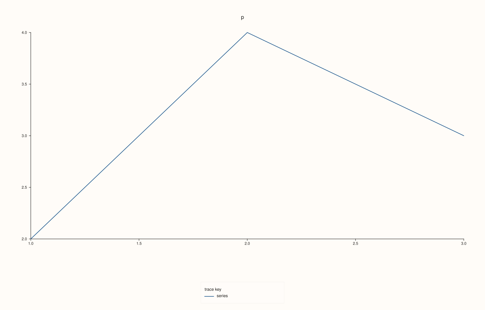

<!-- pluss-hand-authored -->

# Studio::legend_dock

[Back to Studio API Reference](../../studio_api_reference)

## Signature

```cpp
KeyDock Studio::legend_dock() const noexcept
```

## What It Does

Returns the figure's docked-legend setting: whatever [`legend(KeyDock)`](legend.md) last set, or `KeyDock::None` for a figure that never called it. It reads the setting, not the picture: a figure whose dock is `East` but has no labelled trace reports `East` even though nothing is drawn.

## Parameters

*(none)*

## Returns

`KeyDock`
    `None`, `East` or `South`.

## Examples

Example 1. The default and each setting. A new figure reports `None`; each call to `legend` is reported back, and the last call wins.

```cpp
auto name = [](KeyDock d) { return d == KeyDock::None ? "None" : d == KeyDock::East ? "East" : "South"; };
auto fig = studio("legend_dock_values");
std::cout << "new figure: " << name(fig.legend_dock()) << "\n";
fig.legend(KeyDock::East);
std::cout << "after East:  " << name(fig.legend_dock()) << "\n";
fig.legend(KeyDock::South);
std::cout << "after South: " << name(fig.legend_dock()) << "\n";
fig.legend(KeyDock::None);
std::cout << "after None:  " << name(fig.legend_dock()) << "\n";
fig.pane2("p").trend(std::vector<double>{1, 2, 3}, std::vector<double>{2, 4, 3}).label("series");
fig.save_svg("figure.svg");
```

### Output

```text
new figure: None
after East:  East
after South: South
after None:  None
```


Example 2. The setting is not the picture. With no labelled trace the dock is `East` and the figure is drawn exactly as with no dock; the getter still says `East`.

```cpp
auto fig = studio("legend_dock_setting");
fig.legend(KeyDock::East);
fig.pane2("p").trend(std::vector<double>{1, 2, 3}, std::vector<double>{2, 4, 3});
auto plain = studio("legend_dock_setting");
plain.pane2("p").trend(std::vector<double>{1, 2, 3}, std::vector<double>{2, 4, 3});
std::cout << "dock is East: " << (fig.legend_dock() == KeyDock::East) << "\n";
std::cout << "figure equals the one without a dock: " << (fig.to_svg() == plain.to_svg()) << "\n";
fig.save_svg("figure.svg");
```

### Output

```text
dock is East: 1
figure equals the one without a dock: 1
```


Example 3. Using the getter to decide something. A helper that adds a dock only when the figure has none, so it never overrides a choice the caller already made.

```cpp
auto ensure_dock = [](Studio& fig) {
  if (fig.legend_dock() == KeyDock::None) fig.legend(KeyDock::South);
};
auto chosen = studio("legend_dock_chosen");
chosen.legend(KeyDock::East);
ensure_dock(chosen);
auto fresh = studio("legend_dock_fresh");
ensure_dock(fresh);
std::cout << "caller's East kept: " << (chosen.legend_dock() == KeyDock::East) << "\n";
std::cout << "fresh figure got South: " << (fresh.legend_dock() == KeyDock::South) << "\n";
fresh.pane2("p").trend(std::vector<double>{1, 2, 3}, std::vector<double>{2, 4, 3}).label("series");
fresh.save_svg("figure.svg");
```

### Output

```text
caller's East kept: 1
fresh figure got South: 1
```



## Notes

- `noexcept`, and has no effect on the figure.
- The dock is the figure's; a pane's own legend position is read with [`Pane::legend_place`](../pane/legend_place.md).

## See Also

- [`Studio::legend`](legend.md): sets the dock and says what is drawn.
- [`Studio::legend_frame`](legend_frame.md), [`legend_shape`](legend_shape.md): the key's frame and proportions.
- [`KeyDock`](../types/KeyDock.md): the values.

<div class="pluss-inline-prev-next">
  <a class="prev-link" href="legend.html">
    <span class="label">Previous</span>
    <span class="title">legend</span>
  </a>
  <a class="next-link" href="legend_frame.html">
    <span class="label">Next</span>
    <span class="title">legend_frame</span>
  </a>
</div>
