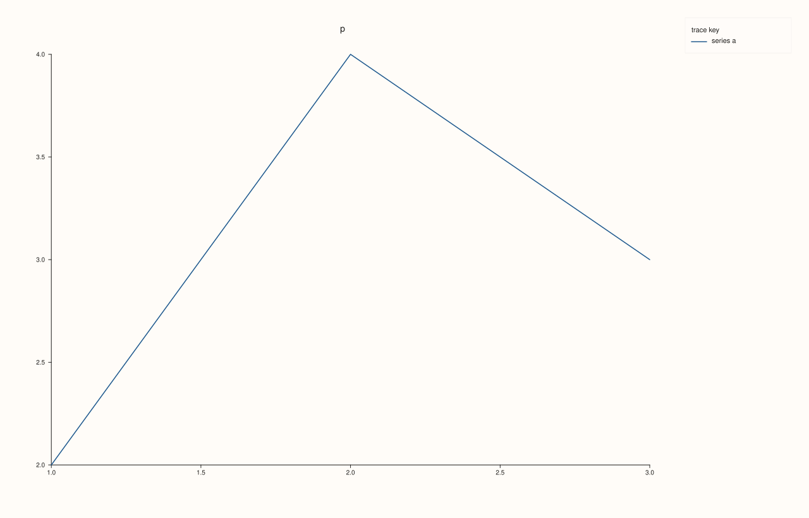
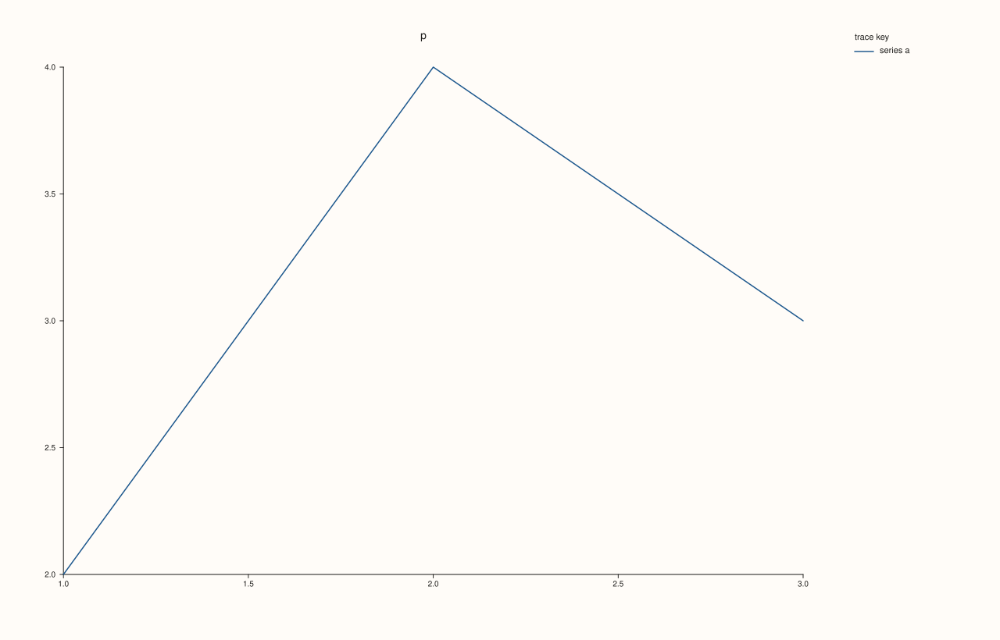
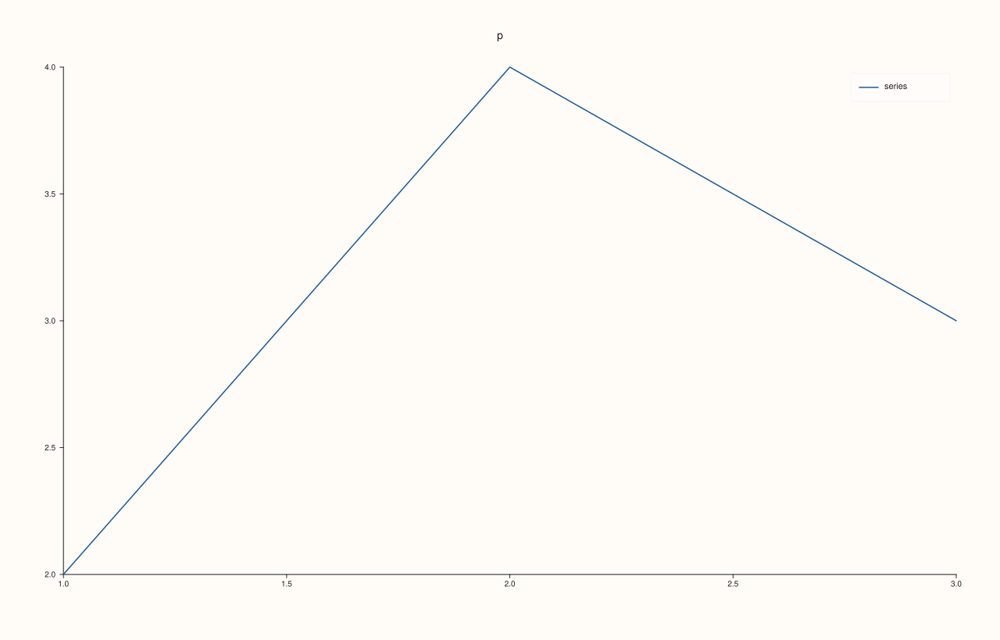

<!-- pluss-hand-authored -->

# Studio::legend_frame

[Back to Studio API Reference](../../studio_api_reference)

## Signature

```cpp
Studio& Studio::legend_frame(KeyFrame frame) noexcept
KeyFrame Studio::legend_frame() const noexcept
```

## What It Does

Sets, or reads, the frame of the docked legend ([`legend`](legend.md)): `KeyFrame::Framed` draws a bordered box, `KeyFrame::Soft` a light filled panel with no hard edge (the default), and `KeyFrame::None` only the entries, with no box at all. It styles the figure-level legend only; each pane's own inset legend has its own setting ([`Pane::legend_frame`](../pane/legend_frame.md)), and panes created afterwards take [`pane_style_defaults`](pane_style_defaults.md), not this value. The setting is read when the figure is rendered.

The setter takes any `KeyFrame` and never throws. With no docked legend ( `KeyDock::None`, or no labelled trace) the frame has no effect on the picture, although it is stored. The getter returns the stored value.

## Parameters

**frame** (`KeyFrame`, setter)
    `Framed`, `Soft` or `None`; see [`KeyFrame`](../types/KeyFrame.md).

## Returns

`Studio&` (setter)
    The same figure, for chaining.

`KeyFrame` (getter)
    The stored frame.

## Examples

Example 1. The default is `Soft`. A new figure reports `Soft`; each setting is read back, and the last call wins.

```cpp
auto name = [](KeyFrame f) { return f == KeyFrame::Framed ? "Framed" : f == KeyFrame::Soft ? "Soft" : "None"; };
auto fig = studio("legend_frame_default");
std::cout << "new figure: " << name(fig.legend_frame()) << "\n";
fig.legend_frame(KeyFrame::Framed);
std::cout << "after Framed: " << name(fig.legend_frame()) << "\n";
fig.legend_frame(KeyFrame::None);
std::cout << "after None: " << name(fig.legend_frame()) << "\n";
fig.pane2("p").trend(std::vector<double>{1, 2, 3}, std::vector<double>{2, 4, 3}).label("series");
fig.save_svg("figure.svg");
```

### Output

```text
new figure: Soft
after Framed: Framed
after None: None
```


Example 2. `Framed`. The docked legend is drawn in a bordered box.

```cpp
auto fig = studio("legend_frame_framed");
fig.legend(KeyDock::East).legend_frame(KeyFrame::Framed);
fig.pane2("p").trend(std::vector<double>{1, 2, 3}, std::vector<double>{2, 4, 3}).label("series a");
fig.save_svg("figure.svg");
```


Example 3. `Soft`, the default. A light filled panel with no hard edge.

```cpp
auto fig = studio("legend_frame_soft");
fig.legend(KeyDock::East).legend_frame(KeyFrame::Soft);
fig.pane2("p").trend(std::vector<double>{1, 2, 3}, std::vector<double>{2, 4, 3}).label("series a");
fig.save_svg("figure.svg");
```



Example 4. `None`. Only the entries are drawn, with no box; the three frames give three different figures.

```cpp
auto build = [](KeyFrame frame) {
  auto fig = studio("legend_frame_none");
  fig.legend(KeyDock::East).legend_frame(frame);
  fig.pane2("p").trend(std::vector<double>{1, 2, 3}, std::vector<double>{2, 4, 3}).label("series a");
  return fig;
};
std::cout << "Framed vs Soft: " << (build(KeyFrame::Framed).to_svg() != build(KeyFrame::Soft).to_svg()) << ", Soft vs None: " << (build(KeyFrame::Soft).to_svg() != build(KeyFrame::None).to_svg()) << "\n";
build(KeyFrame::None).save_svg("figure.svg");
```

### Output

```text
Framed vs Soft: 1, Soft vs None: 1
```



Example 5. No legend, no effect. With no docked legend the frame is stored but the figure is unchanged, and it does not touch a pane's own legend.

```cpp
auto build = [](bool set_frame) {
  auto fig = studio("legend_frame_nolegend");
  if (set_frame) fig.legend_frame(KeyFrame::Framed);
  auto& pane = fig.pane2("p");
  pane.trend(std::vector<double>{1, 2, 3}, std::vector<double>{2, 4, 3}).label("series");
  pane.legend(KeyPlace::NorthEast);
  return fig;
};
std::cout << "figure frame set, pane legend unchanged: " << (build(true).to_svg() == build(false).to_svg()) << "\n";
build(false).save_svg("figure.svg");
```

### Output

```text
figure frame set, pane legend unchanged: 1
```



## Notes

- The setter is `noexcept`; the getter has no effect on the figure.
- The frame is figure state read at render time, so it can be set before or after the legend and the panes.

## See Also

- [`Studio::legend`](legend.md): docks the legend.
- [`Studio::legend_shape`](legend_shape.md): the proportions of the key.
- [`Pane::legend_frame`](../pane/legend_frame.md): the inset legend of one pane.
- [`KeyFrame`](../types/KeyFrame.md): the values.

<div class="pluss-inline-prev-next">
  <a class="prev-link" href="legend_dock.html">
    <span class="label">Previous</span>
    <span class="title">legend_dock</span>
  </a>
  <a class="next-link" href="legend_shape.html">
    <span class="label">Next</span>
    <span class="title">legend_shape</span>
  </a>
</div>
