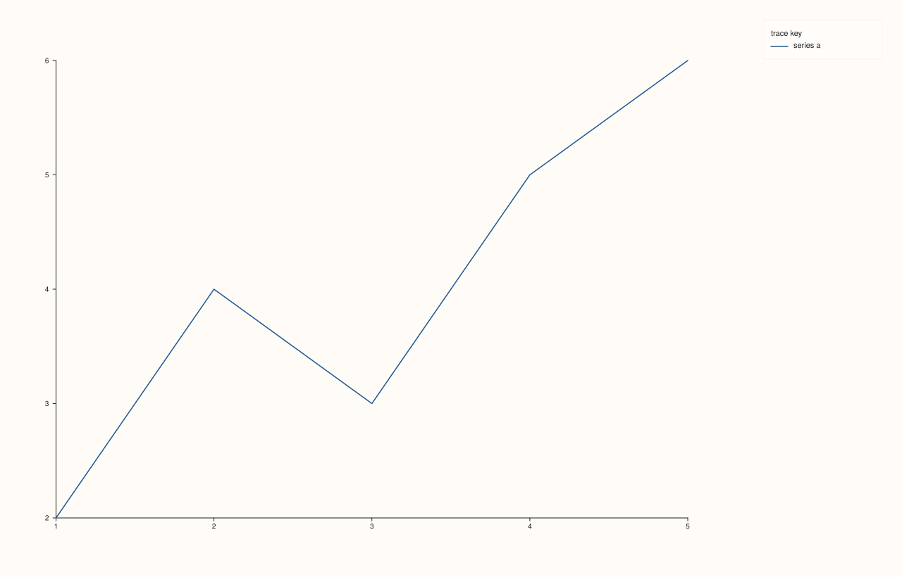
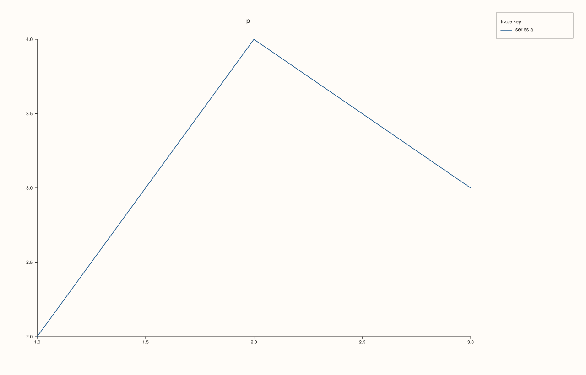
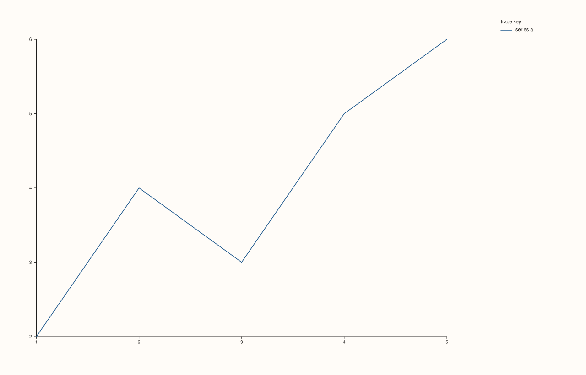

<!-- pluss-hand-authored -->

# Studio::legend_frame

[Back to Studio API Reference](../../studio_api_reference)

## Signatures

```cpp
Studio& Studio::legend_frame(KeyFrame frame) noexcept   // setter
KeyFrame Studio::legend_frame() const noexcept           // getter
```

## What It Does

Controls the border/background styling drawn around the figure-wide, docked legend enabled
by [`legend(KeyDock)`](legend.md). This is the `Studio`-level counterpart of
[`Pane::legend_frame`](../pane/legend_frame.md), which styles a *pane's own* inset legend
instead — the two are independent settings.

`KeyFrame` has three values:

- `KeyFrame::Framed` — a solid border and opaque background box around the legend.
- `KeyFrame::Soft` — a soft, low-contrast background with no hard border. **This is the
  constructor default.**
- `KeyFrame::None` — no background or border at all; just the swatches and labels floating
  over whatever is behind them.

Calling `legend_frame(frame)` with no argument names is the setter overload; calling
`legend_frame()` with no arguments is the getter overload that reads the current value
back. Both share the same name — C++ overload resolution picks the right one from the
argument count.

```{note} Has a visible effect only once a dock is active
`legend_frame()`'s styling only matters when [`legend(KeyDock)`](legend.md) has been set
to something other than `KeyDock::None` — otherwise there's no docked legend for it to
style. Setting it beforehand is harmless; it simply won't be visible until a dock is
turned on.
```

## Parameters

**frame** (`KeyFrame`, setter only)
    The frame style to apply: `Framed`, `Soft`, or `None`.

## Returns

**Setter:** `Studio&` — a reference to the same figure, for chaining.

**Getter:** `KeyFrame` — the current frame style.

## Examples

Example 1. The default (`Soft`) — no explicit `legend_frame()` call.

```cpp
using namespace pluss::pl;

auto fig = studio("legend_frame_soft");
fig.legend(KeyDock::East);
auto& pane = fig.pane2();
pane.trend(std::vector<double>{1.0, 2.0, 3.0, 4.0, 5.0}, std::vector<double>{2.0, 4.0, 3.0, 5.0, 6.0}).label("series a");
fig.show();

std::cout << static_cast<int>(fig.legend_frame()) << "\n";  // Soft == 1
```

### Output

```text
1
```



Example 2. `KeyFrame::Framed` — a solid border and background around the legend.

```cpp
using namespace pluss::pl;

auto fig = studio("legend_frame_framed");
fig.legend(KeyDock::East).legend_frame(KeyFrame::Framed);
auto& pane = fig.pane2();
pane.trend(std::vector<double>{1.0, 2.0, 3.0, 4.0, 5.0}, std::vector<double>{2.0, 4.0, 3.0, 5.0, 6.0}).label("series a");
fig.show();

std::cout << static_cast<int>(fig.legend_frame()) << "\n";  // Framed == 0
```

### Output

```text
0
```



Example 3. `KeyFrame::None` — no border or background at all.

```cpp
using namespace pluss::pl;

auto fig = studio("legend_frame_none");
fig.legend(KeyDock::East).legend_frame(KeyFrame::None);
auto& pane = fig.pane2();
pane.trend(std::vector<double>{1.0, 2.0, 3.0, 4.0, 5.0}, std::vector<double>{2.0, 4.0, 3.0, 5.0, 6.0}).label("series a");
fig.show();
```



## Notes

- Both overloads are `noexcept`.
- `KeyFrame::Framed` is `0`, `Soft` is `1`, `None` is `2` — note this is a *different*
  numeric ordering than `KeyDock` (`None == 0` there); don't assume `None == 0` holds
  across every enum in this header.
- The setter returns `Studio&`, so it chains naturally after `legend(KeyDock)`, e.g.
  `fig.legend(KeyDock::East).legend_frame(KeyFrame::Framed)`.
- Purely cosmetic — has no effect on which traces appear in the legend or its dock edge.

## See Also

- [`Studio::legend`](legend.md): turns the docked legend on and picks its edge.
- [`Studio::legend_shape`](legend_shape.md): controls horizontal vs. vertical layout of the
  same docked legend.
- [`Pane::legend_frame`](../pane/legend_frame.md): the equivalent setting for a pane's own
  inset legend.

<div class="pluss-inline-prev-next">
  <a class="prev-link" href="legend_dock.html">
    <span class="label">Previous</span>
    <span class="title">legend_dock</span>
  </a>
  <a class="next-link" href="legend_shape.html">
    <span class="label">Next</span>
    <span class="title">legend_shape</span>
  </a>
</div>
