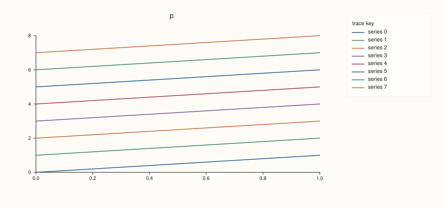
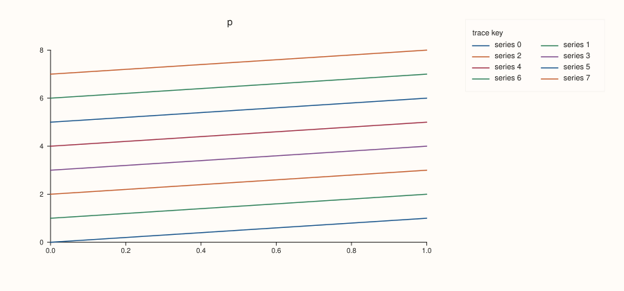
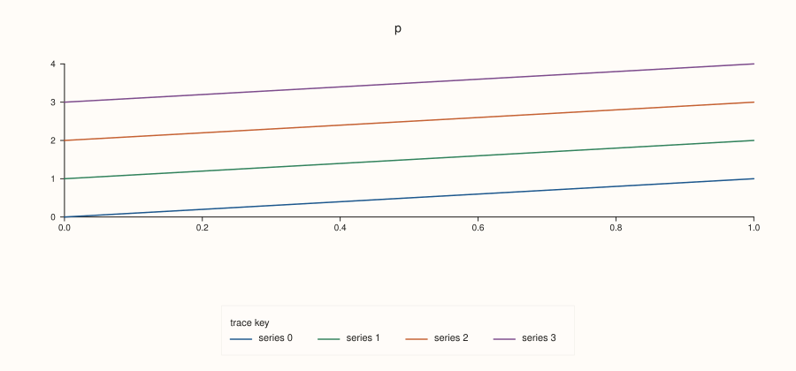
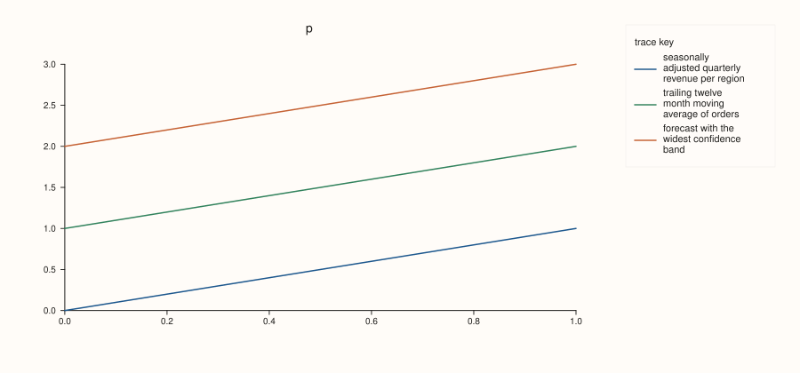

<!-- pluss-hand-authored -->

# Studio::legend_shape

[Back to Studio API Reference](../../studio_api_reference)

## Signature

```cpp
Studio& Studio::legend_shape(KeyShape shape) noexcept
KeyShape Studio::legend_shape() const noexcept
```

## What It Does

Sets, or reads, how the docked legend ([`legend`](legend.md)) arranges its entries. `KeyShape::Vertical` always stacks them in one column. `KeyShape::Horizontal` puts them side by side, in as many columns as fit in the width the dock allows and then on further lines, and falls back to a single column when the labels are too long for two columns to fit. `KeyShape::Auto`, the default, chooses by the dock: a row for the south dock, where a row sits naturally beneath a wide plot, and a column for the east dock.

So the shape matters only when there is room for more than one column. Short labels and several entries show it; labels too long to sit side by side give the same legend whatever the shape. The setting applies to the docked legend only: a pane's own inset legend has its own ([`Pane::legend_shape`](../pane/legend_shape.md)), and panes created afterwards take [`pane_style_defaults`](pane_style_defaults.md). The setter never throws, and with no docked legend the shape is stored and changes nothing.

## Parameters

**shape** (`KeyShape`, setter)
    `Auto`, `Horizontal` or `Vertical`; see [`KeyShape`](../types/KeyShape.md).

## Returns

`Studio&` (setter)
    The same figure, for chaining.

`KeyShape` (getter)
    The stored shape.

## Examples

Example 1. The default is `Auto`. A new figure reports `Auto`, each setting is read back, and the last call wins.

```cpp
auto name = [](KeyShape s) { return s == KeyShape::Auto ? "Auto" : s == KeyShape::Horizontal ? "Horizontal" : "Vertical"; };
auto fig = studio("legend_shape_default");
std::cout << "new figure: " << name(fig.legend_shape()) << "\n";
fig.legend_shape(KeyShape::Vertical);
std::cout << "after Vertical: " << name(fig.legend_shape()) << "\n";
fig.legend_shape(KeyShape::Horizontal);
std::cout << "after Horizontal: " << name(fig.legend_shape()) << "\n";
fig.pane2("p").trend(std::vector<double>{1, 2, 3}, std::vector<double>{2, 4, 3}).label("series");
fig.save_svg("figure.svg");
```

### Output

```text
new figure: Auto
after Vertical: Vertical
after Horizontal: Horizontal
```


Example 2. `Vertical` on the east dock: eight entries in one column, the narrowest key. This is also what `Auto` gives on the east dock.

```cpp
auto build = [](KeyShape shape) {
  auto fig = studio("legend_shape_east");
  fig.size(900.0, 420.0);
  fig.legend(KeyDock::East).legend_shape(shape);
  auto& pane = fig.pane2("p");
  for (int i = 0; i < 8; ++i) pane.trend(std::vector<double>{0, 1}, std::vector<double>{double(i), double(i + 1)}).label("series " + std::to_string(i));
  return fig;
};
std::cout << "east: Auto == Vertical: " << (build(KeyShape::Auto).to_svg() == build(KeyShape::Vertical).to_svg()) << ", Auto == Horizontal: " << (build(KeyShape::Auto).to_svg() == build(KeyShape::Horizontal).to_svg()) << "\n";
build(KeyShape::Vertical).save_svg("figure.svg");
```

### Output

```text
east: Auto == Vertical: 1, Auto == Horizontal: 0
```



Example 3. `Horizontal` on the same east dock: the eight entries share two columns, so the key is shorter and wider.

```cpp
auto fig = studio("legend_shape_east_horizontal");
fig.size(900.0, 420.0);
fig.legend(KeyDock::East).legend_shape(KeyShape::Horizontal);
auto& pane = fig.pane2("p");
for (int i = 0; i < 8; ++i) pane.trend(std::vector<double>{0, 1}, std::vector<double>{double(i), double(i + 1)}).label("series " + std::to_string(i));
fig.save_svg("figure.svg");
```



Example 4. The south dock. Here `Auto` is a row, so it equals `Horizontal` and differs from `Vertical`; the saved figure is the row beneath the plot.

```cpp
auto build = [](KeyShape shape) {
  auto fig = studio("legend_shape_south");
  fig.size(900.0, 420.0);
  fig.legend(KeyDock::South).legend_shape(shape);
  auto& pane = fig.pane2("p");
  for (int i = 0; i < 4; ++i) pane.trend(std::vector<double>{0, 1}, std::vector<double>{double(i), double(i + 1)}).label("series " + std::to_string(i));
  return fig;
};
std::cout << "south: Auto == Horizontal: " << (build(KeyShape::Auto).to_svg() == build(KeyShape::Horizontal).to_svg()) << ", Auto == Vertical: " << (build(KeyShape::Auto).to_svg() == build(KeyShape::Vertical).to_svg()) << "\n";
build(KeyShape::Auto).save_svg("figure.svg");
```

### Output

```text
south: Auto == Horizontal: 1, Auto == Vertical: 0
```



Example 5. Labels too long for two columns. The three labels do not fit side by side in the width the east dock allows, so `Horizontal` falls back to one column and gives the same figure as `Vertical`.

```cpp
auto build = [](KeyShape shape) {
  auto fig = studio("legend_shape_long");
  fig.size(900.0, 420.0);
  fig.legend(KeyDock::East).legend_shape(shape);
  auto& pane = fig.pane2("p");
  const char* labels[] = {"seasonally adjusted quarterly revenue per region", "trailing twelve month moving average of orders", "forecast with the widest confidence band"};
  for (int i = 0; i < 3; ++i) pane.trend(std::vector<double>{0, 1}, std::vector<double>{double(i), double(i + 1)}).label(labels[i]);
  return fig;
};
std::cout << "Horizontal == Vertical: " << (build(KeyShape::Horizontal).to_svg() == build(KeyShape::Vertical).to_svg()) << "\n";
build(KeyShape::Horizontal).save_svg("figure.svg");
```

### Output

```text
Horizontal == Vertical: 1
```



Example 6. No docked legend, no effect. The shape is stored but the figure is unchanged, and a pane's own legend is not touched.

```cpp
auto build = [](bool set_shape) {
  auto fig = studio("legend_shape_nolegend");
  if (set_shape) fig.legend_shape(KeyShape::Vertical);
  fig.pane2("p").trend(std::vector<double>{1, 2, 3}, std::vector<double>{2, 4, 3}).label("series");
  return fig.to_svg();
};
std::cout << "same figure: " << (build(true) == build(false)) << "\n";
auto fig = studio("legend_shape_nolegend_out");
fig.pane2("p").trend(std::vector<double>{1, 2, 3}, std::vector<double>{2, 4, 3});
fig.save_svg("figure.svg");
```

### Output

```text
same figure: 1
```


## Notes

- The setter is `noexcept`; the getter has no effect on the figure.
- The key is still fitted to the height of the figure: entries that do not fit are cut and replaced by a line saying how many more there are.

## See Also

- [`Studio::legend`](legend.md): docks the legend.
- [`Studio::legend_frame`](legend_frame.md): the frame of the key.
- [`Pane::legend_shape`](../pane/legend_shape.md): the inset legend of one pane.
- [`KeyShape`](../types/KeyShape.md): the values.

<div class="pluss-inline-prev-next">
  <a class="prev-link" href="legend_frame.html">
    <span class="label">Previous</span>
    <span class="title">legend_frame</span>
  </a>
  <a class="next-link" href="mosaic.html">
    <span class="label">Next</span>
    <span class="title">mosaic</span>
  </a>
</div>
