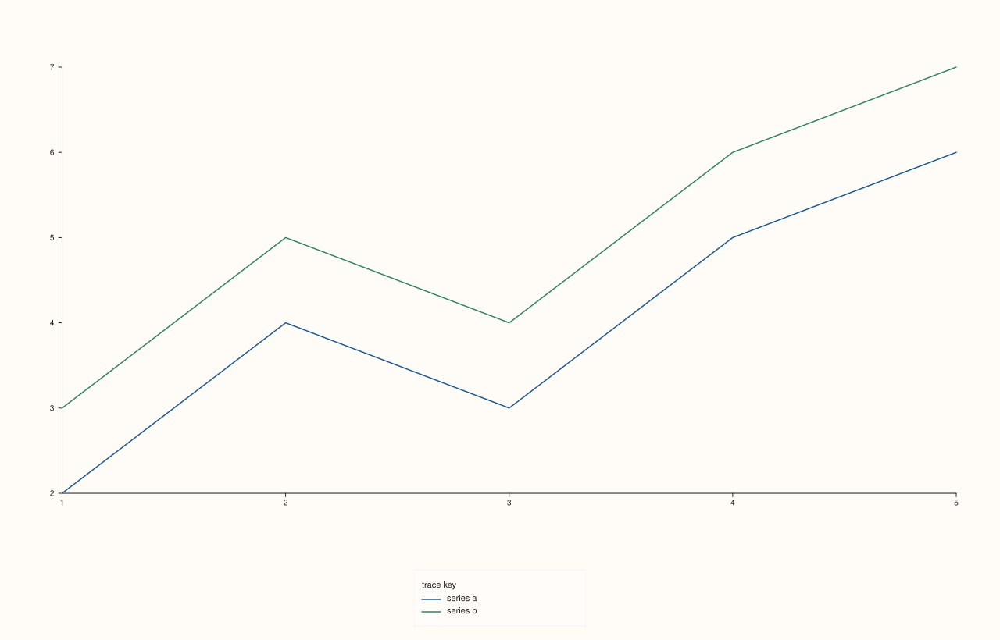

<!-- pluss-hand-authored -->

# Studio::legend_shape

[Back to Studio API Reference](../../studio_api_reference)

## Signatures

```cpp
Studio& Studio::legend_shape(KeyShape shape) noexcept   // setter
KeyShape Studio::legend_shape() const noexcept           // getter
```

## What It Does

Controls whether the entries in the figure-wide, docked legend (enabled by
[`legend(KeyDock)`](legend.md)) are laid out as a horizontal row or a vertical column.
This is the `Studio`-level counterpart of [`Pane::legend_shape`](../pane/legend_shape.md).

`KeyShape` has three values:

- `KeyShape::Auto` — picks a layout based on the dock edge: a horizontal row for
  `KeyDock::South`, a vertical column for `KeyDock::East`. **This is the constructor
  default**, and normally the right choice — it's what the examples below implicitly rely
  on until they override it.
- `KeyShape::Horizontal` — always lays entries out left-to-right in a row, regardless of
  dock edge.
- `KeyShape::Vertical` — always stacks entries top-to-bottom in a column, regardless of
  dock edge.

As with `legend_frame`, both the setter and getter share the name `legend_shape` —
overload resolution distinguishes them by argument count.

## Parameters

**shape** (`KeyShape`, setter only)
    The layout to apply: `Auto`, `Horizontal`, or `Vertical`.

## Returns

**Setter:** `Studio&` — a reference to the same figure, for chaining.

**Getter:** `KeyShape` — the current shape.

## Examples

Example 1. The default (`Auto`), docked `South` — auto-resolves to a horizontal row.

```cpp
using namespace pluss::pl;

auto fig = studio("legend_shape_auto");
fig.legend(KeyDock::South);
auto& pane = fig.pane2();
flash::lineplot(pane, std::vector<double>{1.0, 2.0, 3.0, 4.0, 5.0}, std::vector<double>{2.0, 4.0, 3.0, 5.0, 6.0}).label("series a");
flash::lineplot(pane, std::vector<double>{1.0, 2.0, 3.0, 4.0, 5.0}, std::vector<double>{3.0, 5.0, 4.0, 6.0, 7.0}).label("series b");
fig.show();

std::cout << static_cast<int>(fig.legend_shape()) << "\n";  // Auto == 0
```

### Output

```text
0
```


Example 2. `KeyShape::Horizontal`, forced explicitly (same layout as Example 1 in this
particular `South`-docked case, since `Auto` already resolves to horizontal there — the
override matters more when the dock is `East`).

```cpp
using namespace pluss::pl;

auto fig = studio("legend_shape_horizontal");
fig.legend(KeyDock::South).legend_shape(KeyShape::Horizontal);
auto& pane = fig.pane2();
flash::lineplot(pane, std::vector<double>{1.0, 2.0, 3.0, 4.0, 5.0}, std::vector<double>{2.0, 4.0, 3.0, 5.0, 6.0}).label("series a");
flash::lineplot(pane, std::vector<double>{1.0, 2.0, 3.0, 4.0, 5.0}, std::vector<double>{3.0, 5.0, 4.0, 6.0, 7.0}).label("series b");
fig.show();
```


Example 3. `KeyShape::Vertical`, forced on a `South`-docked legend — overrides `Auto`'s
usual horizontal choice for that edge, stacking entries in a column instead.

```cpp
using namespace pluss::pl;

auto fig = studio("legend_shape_vertical");
fig.legend(KeyDock::South).legend_shape(KeyShape::Vertical);
auto& pane = fig.pane2();
flash::lineplot(pane, std::vector<double>{1.0, 2.0, 3.0, 4.0, 5.0}, std::vector<double>{2.0, 4.0, 3.0, 5.0, 6.0}).label("series a");
flash::lineplot(pane, std::vector<double>{1.0, 2.0, 3.0, 4.0, 5.0}, std::vector<double>{3.0, 5.0, 4.0, 6.0, 7.0}).label("series b");
fig.show();
```



## Notes

- Both overloads are `noexcept`.
- `KeyShape::Auto` is `0`, `Horizontal` is `1`, `Vertical` is `2`.
- `Auto`'s edge-based resolution (`South` → horizontal, `East` → vertical) matches the
  layout most figures already want; reach for an explicit `Horizontal`/`Vertical` only to
  override that default.
- Purely a layout choice — doesn't affect which traces are pooled into the legend or its
  frame styling.

## See Also

- [`Studio::legend`](legend.md): turns the docked legend on and picks its edge.
- [`Studio::legend_frame`](legend_frame.md): controls the border/background of the same
  docked legend.
- [`Pane::legend_shape`](../pane/legend_shape.md): the equivalent setting for a pane's own
  inset legend.

<div class="pluss-inline-prev-next">
  <a class="prev-link" href="legend_frame.html">
    <span class="label">Previous</span>
    <span class="title">legend_frame</span>
  </a>
  <a class="next-link" href="x_caption.html">
    <span class="label">Next</span>
    <span class="title">x_caption</span>
  </a>
</div>
