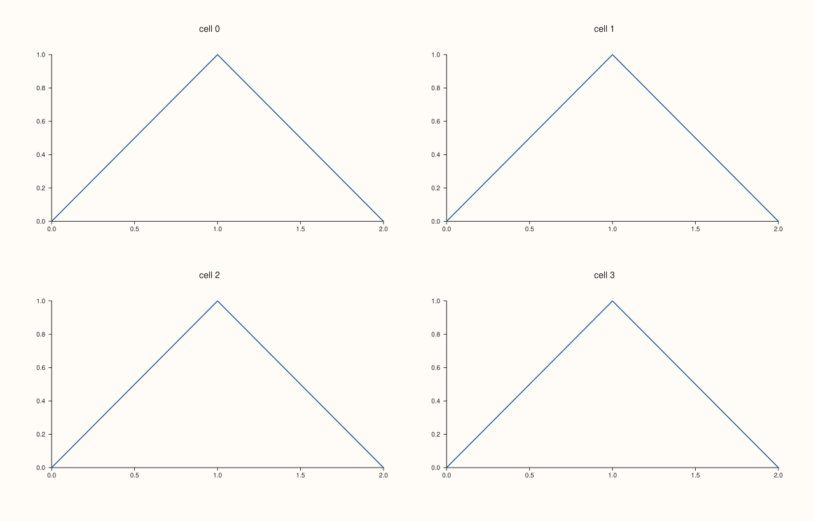
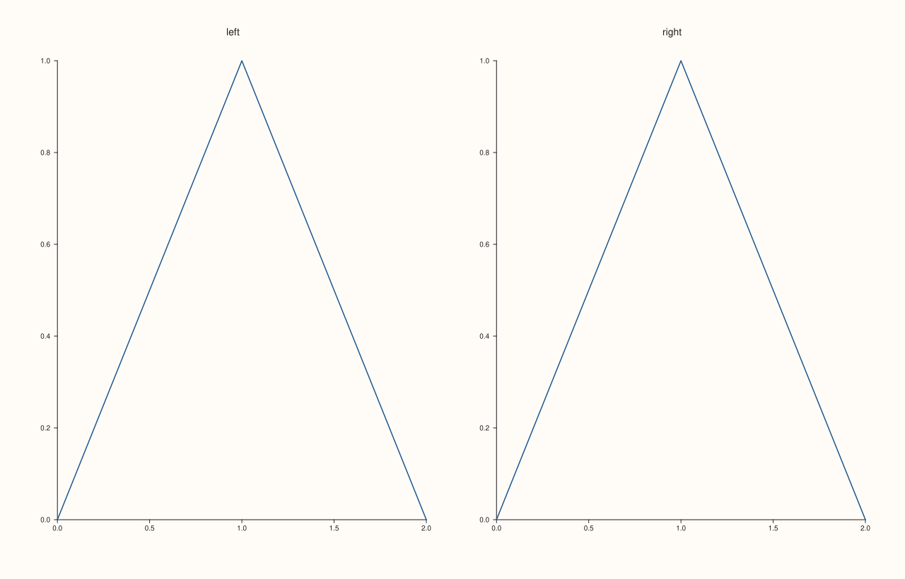
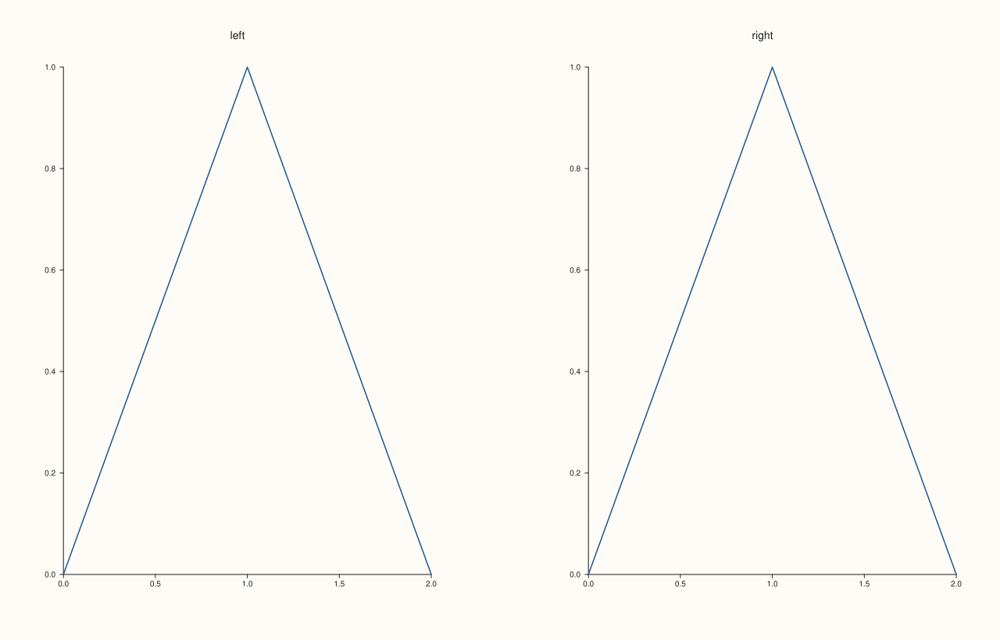
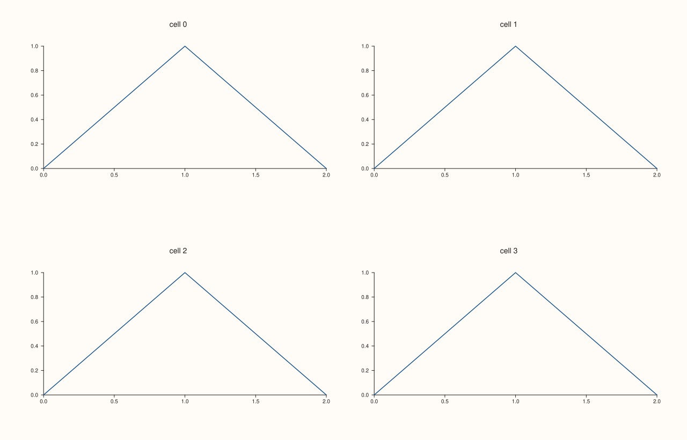
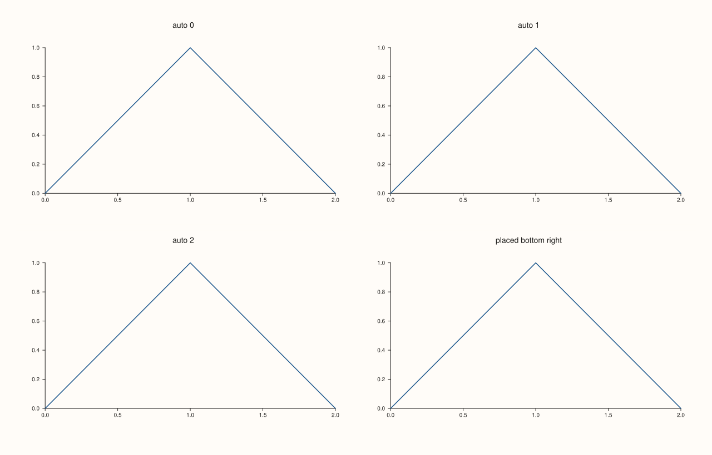
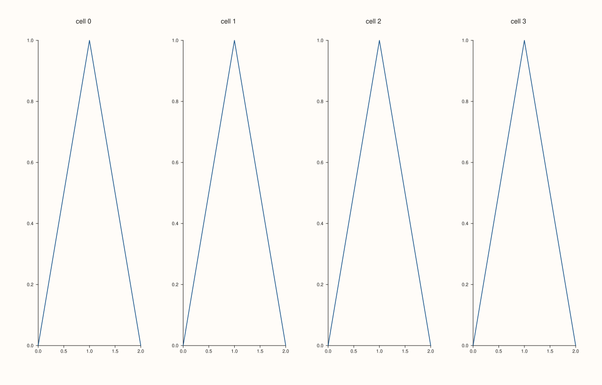
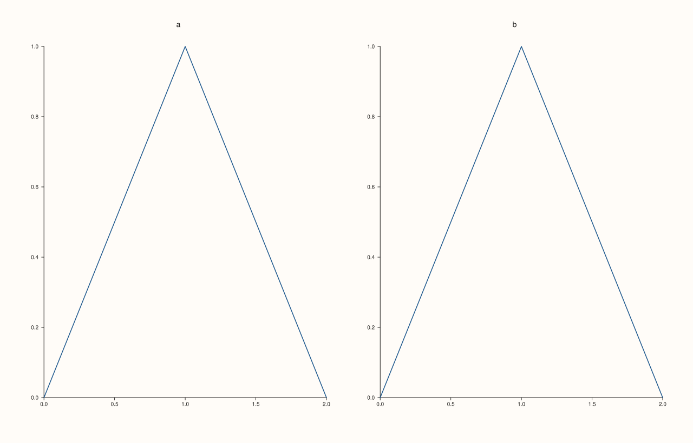
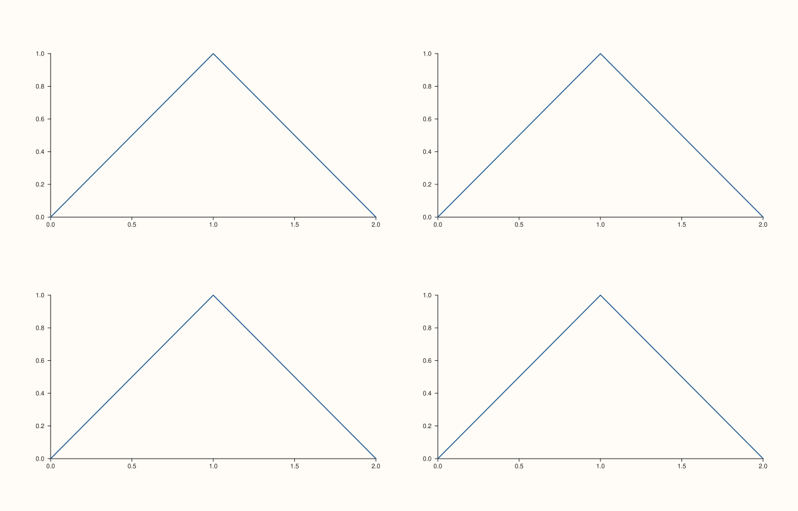
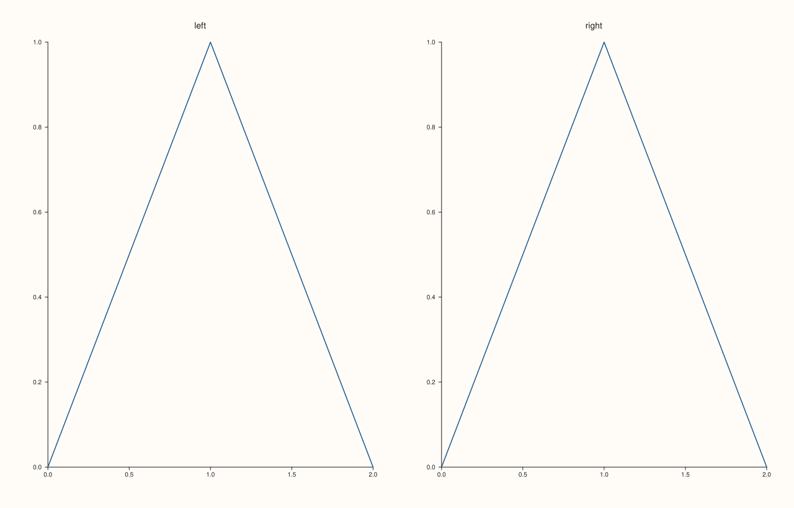

<!-- pluss-hand-authored -->

# Studio::mosaic

[Back to Studio API Reference](../../studio_api_reference)

## Signature

```cpp
Studio& Studio::mosaic(std::int64_t rows, std::int64_t cols, double gutter_x = auto_gutter, double gutter_y = auto_gutter)
```

## What It Does

Divides the figure into a grid of `rows` by `cols` equal cells, with a gutter between them, and lays the panes out in it. Without a `mosaic` call a figure has a single cell, which a single pane fills.

**Which cell a pane gets.** A pane made by [`pane2`](pane2.md) or [`pane3`](pane3.md) takes the next free cell, row by row from the top left, in the order the panes were added. A pane placed with [`Pane::place`](../pane/place.md) takes the cell (or block of cells) it asks for, and a pane made by [`subpane2`](subpane2.md) or [`subpane3`](subpane3.md) is laid out inside another pane. Placed panes claim their cells first; the others fill what is left.

**Gutters.** `gutter_x` is the gap between columns and `gutter_y` between rows. `auto_gutter`, the default, is a share of a cell, so the gaps follow the size of the figure. A number is a distance in drawing units, used as it is: 0 puts cells edge to edge. (In the compact layout, [`tight_layout`](tight_layout.md), both kinds are reduced.)

**Checks.** `rows` and `cols` must be positive, and each gutter `auto_gutter` or a finite non-negative number; otherwise the call throws at once and the previous grid is kept. Whether the panes fit the grid cannot be known here, since more may be added; that is checked when the figure is drawn, and the error says what went wrong (see Example 9).

## Parameters

**rows**, **cols** (`std::int64_t`)
    The number of rows and columns. Positive.

**gutter_x**, **gutter_y** (`double`, default `auto_gutter`)
    The gap between columns and between rows: `auto_gutter` for a share of a cell, or a distance. Finite and not negative.

## Returns

`Studio&`
    The same figure, for chaining.

## Examples

Example 1. Without a `mosaic()` call a figure has one grid cell, and a single pane fills the canvas. `mosaic_layout().active` is false.

```cpp
auto fig = studio("mosaic_single");
fig.pane2("p").trend(std::vector<double>{0, 1, 2}, std::vector<double>{0, 1, 0});
std::cout << "active: " << fig.mosaic_layout().active << "\n";
fig.save_svg("figure.svg");
```

### Output

```text
active: 0
```


Example 2. A 2x2 grid filled by four `pane2` calls. Each pane takes the next free cell, row by row, in the order it was added: the titles' positions show the order.

```cpp
auto fig = studio("mosaic_2x2");
fig.mosaic(2, 2);
for (int i = 0; i < 4; ++i) fig.pane2("cell " + std::to_string(i)).trend(std::vector<double>{0, 1, 2}, std::vector<double>{0, 1, 0});
const std::string svg = fig.to_svg();
auto at = [](const std::string& svg, const std::string& text) {
  const auto hit = svg.find(">" + text + "<");
  if (hit == std::string::npos) return std::string("absent");
  const auto open = svg.rfind("<text", hit);
  auto number = [&](const char* key) {
    const auto k = svg.find(std::string(key) + "=\"", open) + std::string(key).size() + 2;
    return std::stod(svg.substr(k, svg.find('"', k) - k));
  };
  return "(" + std::to_string(static_cast<int>(number("x"))) + ", " + std::to_string(static_cast<int>(number("y"))) + ")";
};
for (int i = 0; i < 4; ++i) std::cout << "cell " << i << " title at " << at(svg, "cell " + std::to_string(i)) << "\n";
std::cout << fig.mosaic_layout().rows << "x" << fig.mosaic_layout().cols << ", active " << fig.mosaic_layout().active << "\n";
fig.save_svg("figure.svg");
```

### Output

```text
cell 0 title at (329, 50)
cell 1 title at (950, 50)
cell 2 title at (329, 437)
cell 3 title at (950, 437)
2x2, active 1
```



Example 3. The gutter between cells. By default (`auto_gutter`) it is a share of a cell, so it grows and shrinks with the figure: in a figure twice as wide the gap is twice as wide.

```cpp
auto build = [&](double width) {
  auto fig = studio("mosaic_auto");
  fig.size(width, 600.0);
  fig.mosaic(1, 2);
  fig.pane2("left").trend(std::vector<double>{0, 1, 2}, std::vector<double>{0, 1, 0});
  fig.pane2("right").trend(std::vector<double>{0, 1, 2}, std::vector<double>{0, 1, 0});
  return fig.to_svg();
};
auto at = [](const std::string& svg, const std::string& text) {
  const auto hit = svg.find(">" + text + "<");
  if (hit == std::string::npos) return std::string("absent");
  const auto open = svg.rfind("<text", hit);
  auto number = [&](const char* key) {
    const auto k = svg.find(std::string(key) + "=\"", open) + std::string(key).size() + 2;
    return std::stod(svg.substr(k, svg.find('"', k) - k));
  };
  return "(" + std::to_string(static_cast<int>(number("x"))) + ", " + std::to_string(static_cast<int>(number("y"))) + ")";
};
for (double width : {800.0, 1600.0}) {
  const std::string svg = build(width);
  std::cout << "width " << width << ": left title " << at(svg, "left") << ", right title " << at(svg, "right") << "\n";
}
auto fig = studio("mosaic_auto_out");
fig.mosaic(1, 2);
fig.pane2("left").trend(std::vector<double>{0, 1, 2}, std::vector<double>{0, 1, 0});
fig.pane2("right").trend(std::vector<double>{0, 1, 2}, std::vector<double>{0, 1, 0});
fig.save_svg("figure.svg");
```

### Output

```text
width 800: left title (205, 42), right title (594, 42)
width 1600: left title (411, 42), right title (1188, 42)
```



Example 4. A number is a distance in drawing units. A gutter of 0 puts the cells side by side, and 120 leaves a wide gap: the right-hand pane moves with it.

```cpp
auto build = [&](double gutter) {
  auto fig = studio("mosaic_gutter");
  fig.mosaic(1, 2, gutter, gutter);
  fig.pane2("left").trend(std::vector<double>{0, 1, 2}, std::vector<double>{0, 1, 0});
  fig.pane2("right").trend(std::vector<double>{0, 1, 2}, std::vector<double>{0, 1, 0});
  return fig.to_svg();
};
auto at = [](const std::string& svg, const std::string& text) {
  const auto hit = svg.find(">" + text + "<");
  if (hit == std::string::npos) return std::string("absent");
  const auto open = svg.rfind("<text", hit);
  auto number = [&](const char* key) {
    const auto k = svg.find(std::string(key) + "=\"", open) + std::string(key).size() + 2;
    return std::stod(svg.substr(k, svg.find('"', k) - k));
  };
  return "(" + std::to_string(static_cast<int>(number("x"))) + ", " + std::to_string(static_cast<int>(number("y"))) + ")";
};
for (double gutter : {0.0, 40.0, 120.0}) std::cout << "gutter " << gutter << ": right title " << at(build(gutter), "right") << "\n";
auto fig = studio("mosaic_gutter_out");
fig.mosaic(1, 2, 120.0, 120.0);
fig.pane2("left").trend(std::vector<double>{0, 1, 2}, std::vector<double>{0, 1, 0});
fig.pane2("right").trend(std::vector<double>{0, 1, 2}, std::vector<double>{0, 1, 0});
fig.save_svg("figure.svg");
```

### Output

```text
gutter 0: right title (946, 50)
gutter 40: right title (956, 50)
gutter 120: right title (976, 50)
```



Example 5. The two gutters are independent: here the columns are close and the rows far apart.

```cpp
auto fig = studio("mosaic_gutters_xy");
fig.mosaic(2, 2, 8.0, 80.0);
for (int i = 0; i < 4; ++i) fig.pane2("cell " + std::to_string(i)).trend(std::vector<double>{0, 1, 2}, std::vector<double>{0, 1, 0});
fig.save_svg("figure.svg");
```



Example 6. Panes placed by [`Pane::place`](../pane/place.md) take their cells first, and the other panes fill the cells that are left, still row by row. The first pane added is placed at the bottom right; the next three take the three cells that are free.

```cpp
auto fig = studio("mosaic_claimed");
fig.mosaic(2, 2);
auto& corner = fig.pane2("placed bottom right");
corner.trend(std::vector<double>{0, 1, 2}, std::vector<double>{0, 1, 0});
corner.place(1, 1);
for (int i = 0; i < 3; ++i) fig.pane2("auto " + std::to_string(i)).trend(std::vector<double>{0, 1, 2}, std::vector<double>{0, 1, 0});
const std::string svg = fig.to_svg();
auto at = [](const std::string& svg, const std::string& text) {
  const auto hit = svg.find(">" + text + "<");
  if (hit == std::string::npos) return std::string("absent");
  const auto open = svg.rfind("<text", hit);
  auto number = [&](const char* key) {
    const auto k = svg.find(std::string(key) + "=\"", open) + std::string(key).size() + 2;
    return std::stod(svg.substr(k, svg.find('"', k) - k));
  };
  return "(" + std::to_string(static_cast<int>(number("x"))) + ", " + std::to_string(static_cast<int>(number("y"))) + ")";
};
std::cout << "placed: " << at(svg, "placed bottom right") << "\n";
for (int i = 0; i < 3; ++i) std::cout << "auto " << i << ": " << at(svg, "auto " + std::to_string(i)) << "\n";
fig.save_svg("figure.svg");
```

### Output

```text
placed: (950, 437)
auto 0: (329, 50)
auto 1: (950, 50)
auto 2: (329, 437)
```



Example 7. Calling `mosaic` again replaces the grid: the later call decides how the panes are laid out.

```cpp
auto fig = studio("mosaic_replace");
fig.mosaic(2, 2).mosaic(1, 4);
for (int i = 0; i < 4; ++i) fig.pane2("cell " + std::to_string(i)).trend(std::vector<double>{0, 1, 2}, std::vector<double>{0, 1, 0});
std::cout << fig.mosaic_layout().rows << "x" << fig.mosaic_layout().cols << "\n";
fig.save_svg("figure.svg");
```

### Output

```text
1x4
```



Example 8. A grid needs at least one row and one column, and a gutter is `auto_gutter` or a finite, non-negative distance. Anything else is refused at once and the previous grid is kept.

```cpp
auto fig = studio("mosaic_errors");
fig.mosaic(1, 2);
auto report = [&](const char* what, auto&& call) {
  try {
    call();
  } catch (const pluss::Error& e) {
    std::cout << what << ": " << e.message() << "\n";
  }
};
report("zero rows", [&] { fig.mosaic(0, 2); });
report("negative columns", [&] { fig.mosaic(2, -1); });
report("negative gutter", [&] { fig.mosaic(2, 2, -5.0, 10.0); });
report("NaN gutter", [&] { fig.mosaic(2, 2, 10.0, std::numeric_limits<double>::quiet_NaN()); });
std::cout << "grid kept: " << fig.mosaic_layout().rows << "x" << fig.mosaic_layout().cols << "\n";
fig.pane2("a").trend(std::vector<double>{0, 1, 2}, std::vector<double>{0, 1, 0});
fig.pane2("b").trend(std::vector<double>{0, 1, 2}, std::vector<double>{0, 1, 0});
fig.save_svg("figure.svg");
```

### Output

```text
zero rows: mosaic: rows and cols must be positive
negative columns: mosaic: rows and cols must be positive
negative gutter: mosaic: gutters must be auto_gutter or finite and non-negative
NaN gutter: mosaic: gutters must be auto_gutter or finite and non-negative
grid kept: 1x2
```



Example 9. `mosaic` cannot know how many panes will come, so too many panes is found when the figure is drawn: five panes for four cells.

```cpp
auto fig = studio("mosaic_overflow");
fig.mosaic(2, 2);
for (int i = 0; i < 5; ++i) fig.pane2().trend(std::vector<double>{0, 1, 2}, std::vector<double>{0, 1, 0});
std::cout << "panes added: " << fig.pane_count() << "\n";
try {
  fig.to_svg();
} catch (const pluss::Error& e) {
  std::cout << e.message() << "\n";
}
auto ok = studio("mosaic_overflow_out");
ok.mosaic(2, 2);
for (int i = 0; i < 4; ++i) ok.pane2().trend(std::vector<double>{0, 1, 2}, std::vector<double>{0, 1, 0});
ok.save_svg("figure.svg");
```

### Output

```text
panes added: 5
mosaic has no free cells left for pane placement
```



Example 10. With the compact layout ([`tight_layout`](tight_layout.md)) the gutters are smaller too: both kinds of gutter go to 62% of their size (a given distance is not reduced below 6).

```cpp
auto build = [&](bool tight) {
  auto fig = studio("mosaic_tight");
  fig.mosaic(1, 2, 60.0, 60.0);
  if (tight) fig.tight_layout();
  fig.pane2("left").trend(std::vector<double>{0, 1, 2}, std::vector<double>{0, 1, 0});
  fig.pane2("right").trend(std::vector<double>{0, 1, 2}, std::vector<double>{0, 1, 0});
  return fig.to_svg();
};
auto at = [](const std::string& svg, const std::string& text) {
  const auto hit = svg.find(">" + text + "<");
  if (hit == std::string::npos) return std::string("absent");
  const auto open = svg.rfind("<text", hit);
  auto number = [&](const char* key) {
    const auto k = svg.find(std::string(key) + "=\"", open) + std::string(key).size() + 2;
    return std::stod(svg.substr(k, svg.find('"', k) - k));
  };
  return "(" + std::to_string(static_cast<int>(number("x"))) + ", " + std::to_string(static_cast<int>(number("y"))) + ")";
};
std::cout << "relaxed: right title " << at(build(false), "right") << ", tight: " << at(build(true), "right") << "\n";
auto fig = studio("mosaic_tight_out");
fig.mosaic(1, 2, 60.0, 60.0).tight_layout();
fig.pane2("left").trend(std::vector<double>{0, 1, 2}, std::vector<double>{0, 1, 0});
fig.pane2("right").trend(std::vector<double>{0, 1, 2}, std::vector<double>{0, 1, 0});
fig.save_svg("figure.svg");
```

### Output

```text
relaxed: right title (961, 50), tight: (957, 46)
```



## Notes

- Calling `mosaic` again replaces the grid; the panes keep the order they were added in.
- [`mosaic_layout`](mosaic_layout.md) reads the grid back.
- Overflow and overlapping placed panes are reported when the figure is drawn, by `to_svg`, `show` or a save.

## See Also

- [`Studio::mosaic_layout`](mosaic_layout.md): read the grid back.
- [`Pane::place`](../pane/place.md): put a pane in a chosen cell or block.
- [`Studio::subpane2`](subpane2.md), [`subpane3`](subpane3.md): a grid inside a pane.
- [`Studio::tight_layout`](tight_layout.md): the compact layout.
- [`Studio::size`](size.md): the canvas the grid divides.

<div class="pluss-inline-prev-next">
  <a class="prev-link" href="legend_shape.html">
    <span class="label">Previous</span>
    <span class="title">legend_shape</span>
  </a>
  <a class="next-link" href="mosaic_layout.html">
    <span class="label">Next</span>
    <span class="title">mosaic_layout</span>
  </a>
</div>
