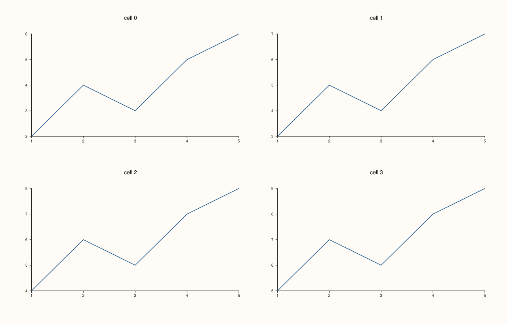
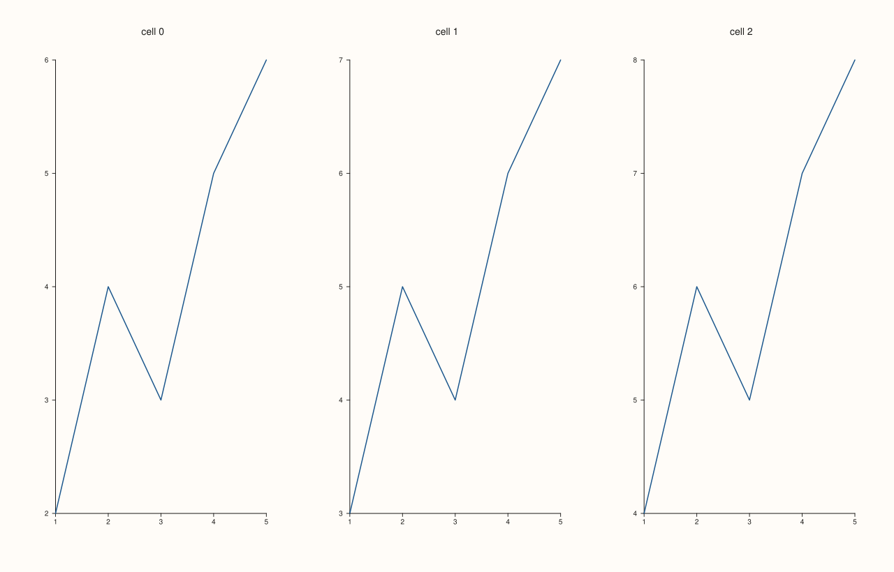

<!-- pluss-hand-authored -->

# Studio::mosaic

[Back to Studio API Reference](../../studio_api_reference)

## Signature

```cpp
Studio& Studio::mosaic(std::int64_t rows, std::int64_t cols, double gutter_x = 18.0, double gutter_y = 18.0)
```

## What It Does

Declares a fixed `rows` × `cols` grid the figure's panes are laid out into, dividing the
canvas ([`size()`](size.md)'s `width`/`height`) into equal cells separated by `gutter_x`/
`gutter_y` spacing. Without a `mosaic()` call, a figure with more than one pane still
renders — but only if every pane was given an **explicit** slot via
[`subpane2()`](subpane2.md)/[`subpane3()`](subpane3.md); [`pane2()`](pane2.md)/
[`pane3()`](pane3.md) panes with no explicit placement have nowhere defined to go without a
mosaic grid to auto-flow into.

```{important} Auto-flow order: row-major, in pane-creation order, skipping claimed cells
Every pane added via a plain `pane2()`/`pane3()` call (no explicit row/col) is placed into
the **next open cell**, scanned row-major (row 0 left-to-right, then row 1, and so on) —
in other words, cells are filled in exactly the order panes were added to the figure.
Panes placed via [`subpane2()`](subpane2.md)/[`subpane3()`](subpane3.md) with an explicit
slot claim their cell(s) first; auto-flowing panes skip past any cell an explicit-slot pane
already occupies. See Example 2.
```

```{important} mosaic() itself never throws for overflow — rendering does
`mosaic()` only validates its own two arguments (`rows`/`cols` must be positive,
`gutter_x`/`gutter_y` must be finite and non-negative) — it has no way to know in advance
how many panes will eventually be added. Adding more panes than the grid has cells for is
entirely legal at `pane2()`/`pane3()` call time; the overflow is only detected the first
time the figure is actually rendered ([`to_svg()`](to_svg.md), [`show()`](show.md), a save
method, ...), where it throws `"mosaic has no free cells left for pane placement"`. See
Example 6.
```

## Parameters

**rows** (`std::int64_t`)
    Number of grid rows. Must be strictly positive, or the call throws
    `"mosaic: rows and cols must be positive"` immediately. See Example 4.

**cols** (`std::int64_t`)
    Number of grid columns. Same positivity requirement, same throw message (shared with
    `rows` — there's no way to tell from the message alone which of the two was the
    offending argument).

**gutter_x** (`double`, default `18.0`)
    Horizontal spacing between adjacent columns.

**gutter_y** (`double`, default `18.0`)
    Vertical spacing between adjacent rows. Both gutters must be finite and non-negative, or
    the call throws `"mosaic: gutters must be finite and non-negative"` — again a single
    shared message regardless of which gutter (or both) failed. See Example 5.

## Returns

`Studio&`
    A reference to the same figure, for chaining.

## Examples

Example 1. A single-pane figure, with no `mosaic()` call at all — the pane simply fills the
entire canvas, and [`mosaic_layout().active`](mosaic_layout.md) reports `false`.

```cpp
using namespace pluss::pl;

auto fig = studio("mosaic_single");
auto& pane = fig.pane2();
flash::lineplot(pane, std::vector<double>{1.0, 2.0, 3.0, 4.0, 5.0}, std::vector<double>{2.0, 4.0, 3.0, 5.0, 6.0});
fig.show();

std::cout << fig.mosaic_layout().active << "\n";
```

### Output

```text
0
```


Example 2. A 2×2 grid, filled by four plain `pane2()` calls in a row — auto-flow places
them at `(0,0)`, `(0,1)`, `(1,0)`, `(1,1)` in that order, purely from call order.

```cpp
using namespace pluss::pl;

auto fig = studio("mosaic_2x2");
fig.mosaic(2, 2);

for (int i = 0; i < 4; ++i) {
  auto& pane = fig.pane2("cell " + std::to_string(i));
  std::vector<double> x{1.0, 2.0, 3.0, 4.0, 5.0};
  std::vector<double> y{static_cast<double>(i) + 2.0, static_cast<double>(i) + 4.0,
                         static_cast<double>(i) + 3.0, static_cast<double>(i) + 5.0,
                         static_cast<double>(i) + 6.0};
  flash::lineplot(pane, x, y);
}
fig.show();

std::cout << fig.mosaic_layout().rows << "x" << fig.mosaic_layout().cols << "\n";
```

### Output

```text
2x2
```



Example 3. A 1×3 grid with custom, wider gutters.

```cpp
using namespace pluss::pl;

auto fig = studio("mosaic_1x3_gutter");
fig.mosaic(1, 3, 40.0, 40.0);

for (int i = 0; i < 3; ++i) {
  auto& pane = fig.pane2("cell " + std::to_string(i));
  std::vector<double> x{1.0, 2.0, 3.0, 4.0, 5.0};
  std::vector<double> y{static_cast<double>(i) + 2.0, static_cast<double>(i) + 4.0,
                         static_cast<double>(i) + 3.0, static_cast<double>(i) + 5.0,
                         static_cast<double>(i) + 6.0};
  flash::lineplot(pane, x, y);
}
fig.show();
```



Example 4. `rows = 0` throws immediately, before any panes are involved.

```cpp
using namespace pluss::pl;

auto fig = studio("bad_rows");
try {
  fig.mosaic(0, 2);
} catch (const std::exception& e) {
  std::cout << e.what();
}
```

### Output

```text
mosaic: rows and cols must be positive
```

Example 5. A negative gutter throws immediately too.

```cpp
using namespace pluss::pl;

auto fig = studio("bad_gutter");
try {
  fig.mosaic(2, 2, -5.0, 10.0);
} catch (const std::exception& e) {
  std::cout << e.what();
}
```

### Output

```text
mosaic: gutters must be finite and non-negative
```

Example 6. Overflow: `mosaic(2, 2)` declares four cells, but five panes are added.
`mosaic()` and every `pane2()` call succeed without complaint — the overflow is only caught
when the figure is actually rendered.

```cpp
using namespace pluss::pl;

auto fig = studio("overflow");
fig.mosaic(2, 2);
for (int i = 0; i < 5; ++i) {
  auto& pane = fig.pane2();
  std::vector<double> x{1.0, 2.0, 3.0};
  std::vector<double> y{1.0, 2.0, 3.0};
  flash::lineplot(pane, x, y);
}

try {
  auto svg = fig.to_svg();
} catch (const std::exception& e) {
  std::cout << e.what();
}
```

### Output

```text
mosaic has no free cells left for pane placement
```

## Notes

- `rows`/`cols` must be positive; `gutter_x`/`gutter_y` must be finite and non-negative —
  both checks run, and throw, immediately inside `mosaic()` itself.
- Auto-flow placement (plain `pane2()`/`pane3()`, no explicit slot) fills cells row-major,
  in the order panes were added — see the important callout above.
- Cell-count overflow is a render-time error, not a `mosaic()`/`pane2()`-time one — see the
  second important callout and Example 6.
- `subpane2()`/`subpane3()` panes with an explicit slot are placed first; auto-flowing
  panes skip past any cell they've already claimed.

## See Also

- [`Studio::mosaic_layout`](mosaic_layout.md): reads the current mosaic configuration back.
- [`Studio::subpane2`](subpane2.md) / [`subpane3`](subpane3.md): claim an explicit cell
  (or a multi-cell span) instead of relying on auto-flow.
- [`Studio::pane2`](pane2.md) / [`pane3`](pane3.md): the plain, auto-flowing pane-creation
  calls this method's grid governs.

<div class="pluss-inline-prev-next">
  <a class="prev-link" href="extent.html">
    <span class="label">Previous</span>
    <span class="title">extent</span>
  </a>
  <a class="next-link" href="mosaic_layout.html">
    <span class="label">Next</span>
    <span class="title">mosaic_layout</span>
  </a>
</div>
