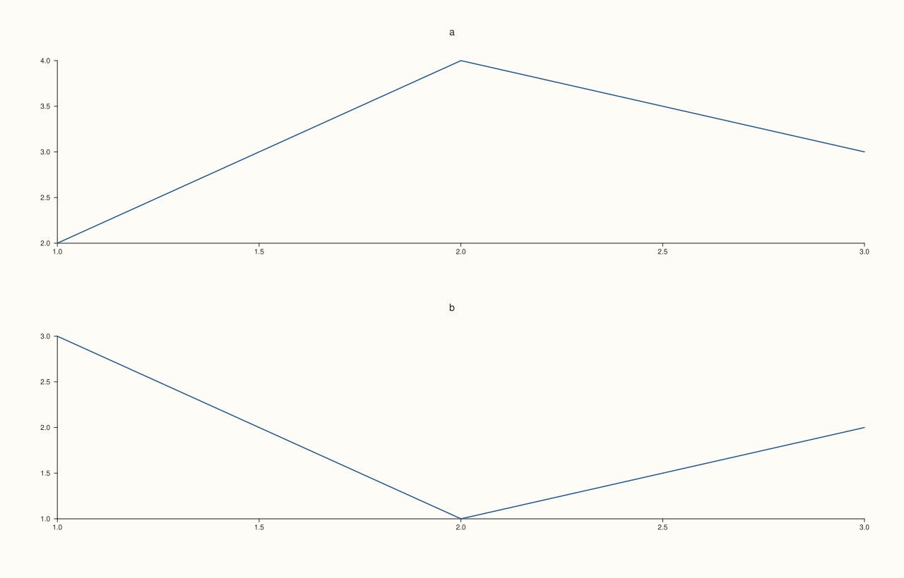
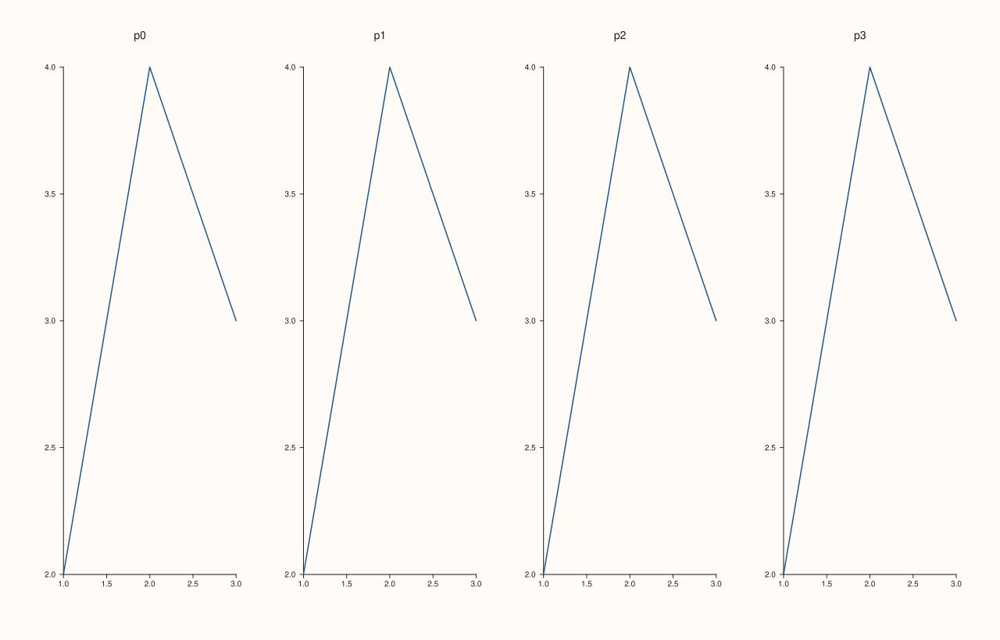
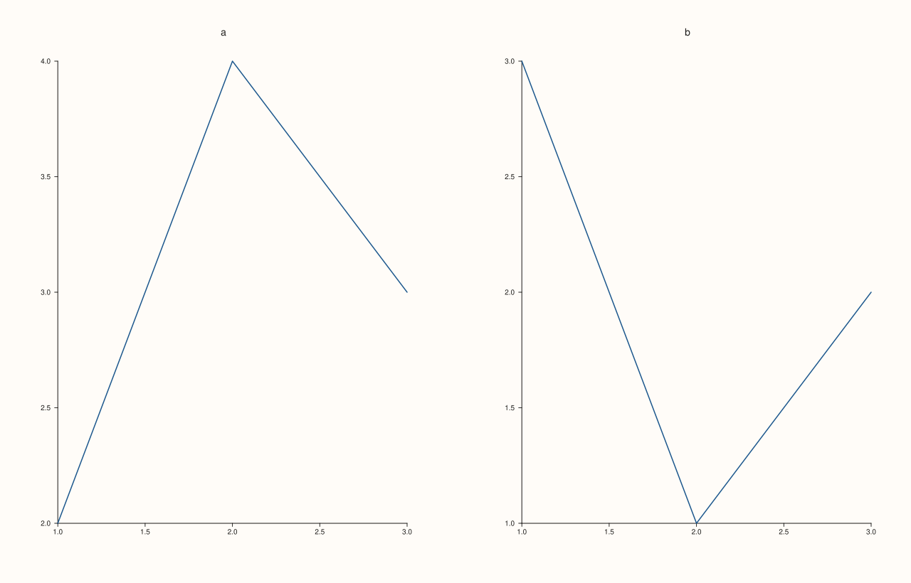
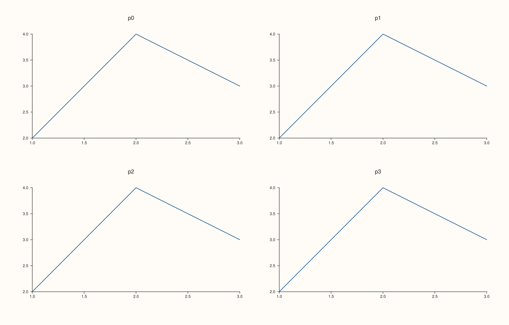

<!-- pluss-hand-authored -->

# Studio::mosaic_layout

[Back to Studio API Reference](../../studio_api_reference)

## Signature

```cpp
const MosaicLayout& Studio::mosaic_layout() const noexcept
```

## What It Does

Returns the grid that [`mosaic`](mosaic.md) set, as a `MosaicLayout`:

| Field | Meaning | Default |
|---|---|---|
| `rows` | Number of rows. | 0 |
| `cols` | Number of columns. | 0 |
| `gutter_x` | Horizontal gap between cells: a distance in drawing units, or `auto_gutter` (-1), a share of the cell width. | `auto_gutter` |
| `gutter_y` | Vertical gap between cells: a distance, or `auto_gutter`, a share of the cell height. | `auto_gutter` |
| `active` | Whether `mosaic` was called. | false |

A figure that never called `mosaic` has `active == false` and zero rows and columns: its panes are stacked top to bottom in creation order instead of placed on a grid. After `mosaic(r, c, gx, gy)` the fields are exactly those arguments, and a later call replaces them all. The reference is to the figure's own field, so copy it to keep a value across a later `mosaic` call.

## Parameters

*(none)*

## Returns

`const MosaicLayout&`
    The grid description.

## Examples

Example 1. No grid by default. A new figure reports an inactive layout with zero rows and columns and the default gutters.

```cpp
auto fig = studio("mosaic_layout_default");
auto gap = [](double g) { return g == auto_gutter ? std::string("auto_gutter") : std::to_string(g); };
const auto& grid = fig.mosaic_layout();
std::cout << "active: " << grid.active << ", rows: " << grid.rows << ", cols: " << grid.cols << "\n";
std::cout << "gutters: " << gap(grid.gutter_x) << " x " << gap(grid.gutter_y) << "\n";
fig.pane2("a").trend(std::vector<double>{1, 2, 3}, std::vector<double>{2, 4, 3});
fig.pane2("b").trend(std::vector<double>{1, 2, 3}, std::vector<double>{3, 1, 2});
fig.save_svg("figure.svg");
```

### Output

```text
active: 0, rows: 0, cols: 0
gutters: auto_gutter x auto_gutter
```



Example 2. After `mosaic`. Every field is the argument that was passed, and `active` is true; omitted gutters are `auto_gutter`.

```cpp
auto fig = studio("mosaic_layout_set");
auto gap = [](double g) { return g == auto_gutter ? std::string("auto_gutter") : std::to_string(g); };
fig.mosaic(2, 3);
auto grid = fig.mosaic_layout();
std::cout << "mosaic(2, 3): " << grid.rows << " x " << grid.cols << ", gutters " << gap(grid.gutter_x) << ", " << gap(grid.gutter_y) << ", active " << grid.active << "\n";
fig.mosaic(1, 4, 5.0, 30.0);
grid = fig.mosaic_layout();
std::cout << "mosaic(1, 4, 5, 30): " << grid.rows << " x " << grid.cols << ", gutters " << gap(grid.gutter_x) << ", " << gap(grid.gutter_y) << "\n";
for (int i = 0; i < 4; ++i) fig.pane2("p" + std::to_string(i)).trend(std::vector<double>{1, 2, 3}, std::vector<double>{2, 4, 3});
fig.save_svg("figure.svg");
```

### Output

```text
mosaic(2, 3): 2 x 3, gutters auto_gutter, auto_gutter, active 1
mosaic(1, 4, 5, 30): 1 x 4, gutters 5.000000, 30.000000
```



Example 3. The gutters are the gaps between cells. The same two panes with gutters of 0 and 80 give different figures, and the stored fields say which.

```cpp
auto build = [](double gutter) {
  auto fig = studio("mosaic_layout_gutters");
  fig.mosaic(1, 2, gutter, gutter);
  fig.pane2("a").trend(std::vector<double>{1, 2, 3}, std::vector<double>{2, 4, 3});
  fig.pane2("b").trend(std::vector<double>{1, 2, 3}, std::vector<double>{3, 1, 2});
  return fig;
};
auto narrow = build(0.0), wide = build(80.0);
std::cout << "gutters stored: " << narrow.mosaic_layout().gutter_x << " and " << wide.mosaic_layout().gutter_x << "\n";
std::cout << "figures differ: " << (narrow.to_svg() != wide.to_svg()) << "\n";
wide.save_svg("figure.svg");
```

### Output

```text
gutters stored: 0 and 80
figures differ: 1
```



Example 4. A refused call leaves the grid as it was. Zero or negative rows or columns and invalid gutters throw `pluss::Error`; the stored layout is unchanged.

```cpp
auto fig = studio("mosaic_layout_invalid");
fig.mosaic(2, 2);
try { fig.mosaic(0, 2); } catch (const pluss::Error& e) { std::cout << e.message() << "\n"; }
try { fig.mosaic(2, 2, -5.0, 4.0); } catch (const pluss::Error& e) { std::cout << e.message() << "\n"; }
auto gap = [](double g) { return g == auto_gutter ? std::string("auto_gutter") : std::to_string(g); };
const auto& grid = fig.mosaic_layout();
std::cout << "still " << grid.rows << " x " << grid.cols << ", gutters " << grid.gutter_x << ", " << grid.gutter_y << "\n";
for (int i = 0; i < 4; ++i) fig.pane2("p" + std::to_string(i)).trend(std::vector<double>{1, 2, 3}, std::vector<double>{2, 4, 3});
fig.save_svg("figure.svg");
```

### Output

```text
mosaic: rows and cols must be positive
mosaic: gutters must be auto_gutter or finite and non-negative
still 2 x 2, gutters -1, -1
```



## Notes

- `noexcept`, and has no effect on the figure.
- The grid is the figure's; the position of an individual pane in it is the pane's own [`placement`](../pane/placement.md).

## See Also

- [`Studio::mosaic`](mosaic.md): sets the grid.
- [`Studio::pane_count`](pane_count.md): how many panes the grid holds.
- [`Studio::subpane2`](subpane2.md): a grid inside a pane.

<div class="pluss-inline-prev-next">
  <a class="prev-link" href="mosaic.html">
    <span class="label">Previous</span>
    <span class="title">mosaic</span>
  </a>
  <a class="next-link" href="name.html">
    <span class="label">Next</span>
    <span class="title">name</span>
  </a>
</div>
