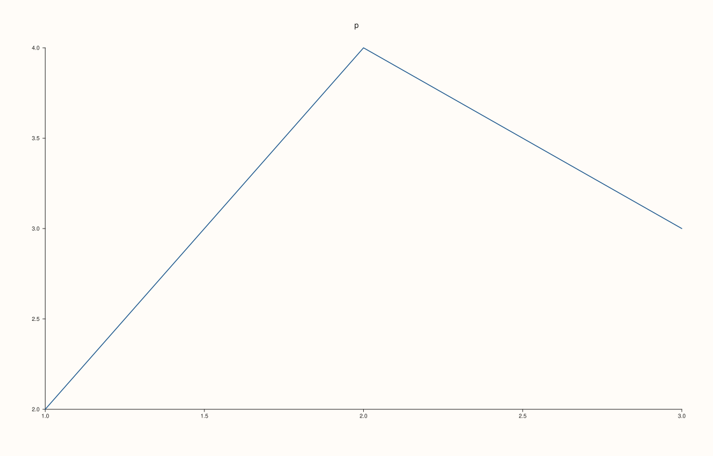

<!-- pluss-hand-authored -->

# Studio::name

[Back to Studio API Reference](../../studio_api_reference)

## Signature

```cpp
const std::string& Studio::name() const noexcept
```

## What It Does

Returns the figure's name: the string given to [`studio`](studio.md) or to the `Studio` constructor, or the latest one set with [`rename`](rename.md), and empty when none was given. The name is bookkeeping. It is never drawn on the figure (the visible title is the [`headline`](headline.md)), and it does not change the SVG, PDF or PNG: two figures that differ only in name render to identical bytes.

The name is used where a figure needs a label of its own: it is the title of the viewer window opened by [`show`](show.md) when no title is passed (with `"PlussPl Plot"` as the fallback for an empty name), and it is part of the temporary file names the exporters use. Nothing requires names to be unique.

## Parameters

*(none)*

## Returns

`const std::string&`
    The name; empty for an unnamed figure.

## Examples

Example 1. Where the name comes from. The factory takes it, the constructor takes it, and a figure made with neither is unnamed.

```cpp
auto by_factory = studio("from the factory");
Studio by_constructor("from the constructor");
Studio unnamed;
std::cout << "factory: '" << by_factory.name() << "'\n";
std::cout << "constructor: '" << by_constructor.name() << "'\n";
std::cout << "unnamed: '" << unnamed.name() << "', empty: " << unnamed.name().empty() << "\n";
by_factory.pane2("p").trend(std::vector<double>{1, 2, 3}, std::vector<double>{2, 4, 3});
by_factory.save_svg("figure.svg");
```

### Output

```text
factory: 'from the factory'
constructor: 'from the constructor'
unnamed: '', empty: 1
```


Example 2. Never drawn. Two figures with the same content and different names produce the same SVG, and the name does not appear in it.

```cpp
auto build = [](const char* name) {
  auto fig = studio(name);
  fig.pane2("p").trend(std::vector<double>{1, 2, 3}, std::vector<double>{2, 4, 3});
  return fig;
};
auto a = build("alpha");
auto b = build("a completely different name");
std::cout << "same SVG: " << (a.to_svg() == b.to_svg()) << "\n";
std::cout << "name in the SVG: " << (a.to_svg().find("alpha") != std::string::npos) << "\n";
a.save_svg("figure.svg");
```

### Output

```text
same SVG: 1
name in the SVG: 0
```



Example 3. A figure owns its name. A copy of a figure has the name at the time of the copy, and renaming one does not rename the other.

```cpp
auto original = studio("original");
original.pane2("p").trend(std::vector<double>{1, 2, 3}, std::vector<double>{2, 4, 3});
Studio copy = original;
copy.rename("copy");
std::cout << original.name() << " / " << copy.name() << "\n";
original.save_svg("figure.svg");
```

### Output

```text
original / copy
```


Example 4. Where the name is used. `show` with no title and `launch = false` renders the figure and writes the viewer page without opening a window; the page is titled with the figure's name (the fallback for an unnamed figure is `PlussPl Plot`).

```cpp
auto fig = studio("named figure");
fig.pane2("p").trend(std::vector<double>{1, 2, 3}, std::vector<double>{2, 4, 3});
std::cout << "page written: " << fig.show({}, 1280, 820, false) << "\n";
std::cout << "name is still: " << fig.name() << "\n";
fig.save_svg("figure.svg");
```

### Output

```text
page written: 1
name is still: named figure
```


## Notes

- `noexcept`, and has no effect on the figure.
- The returned reference is to the figure's own string and is changed by [`rename`](rename.md); copy it if it is needed afterwards.

## See Also

- [`Studio::rename`](rename.md): changes the name.
- [`Studio::headline`](headline.md): the title that is drawn.
- [`Studio::show`](show.md): uses the name as the window title.
- [`studio`](studio.md): the factory that takes the name.

<div class="pluss-inline-prev-next">
  <a class="prev-link" href="mosaic_layout.html">
    <span class="label">Previous</span>
    <span class="title">mosaic_layout</span>
  </a>
  <a class="next-link" href="pane2.html">
    <span class="label">Next</span>
    <span class="title">pane2</span>
  </a>
</div>
