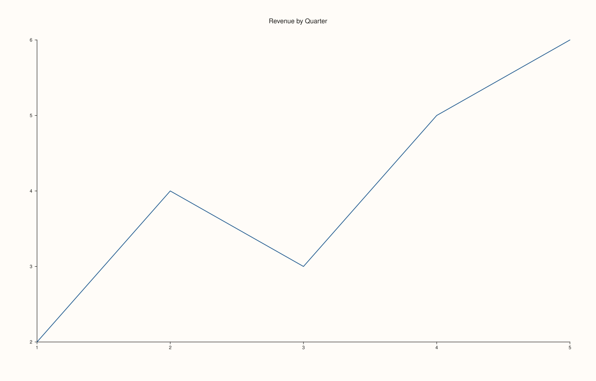
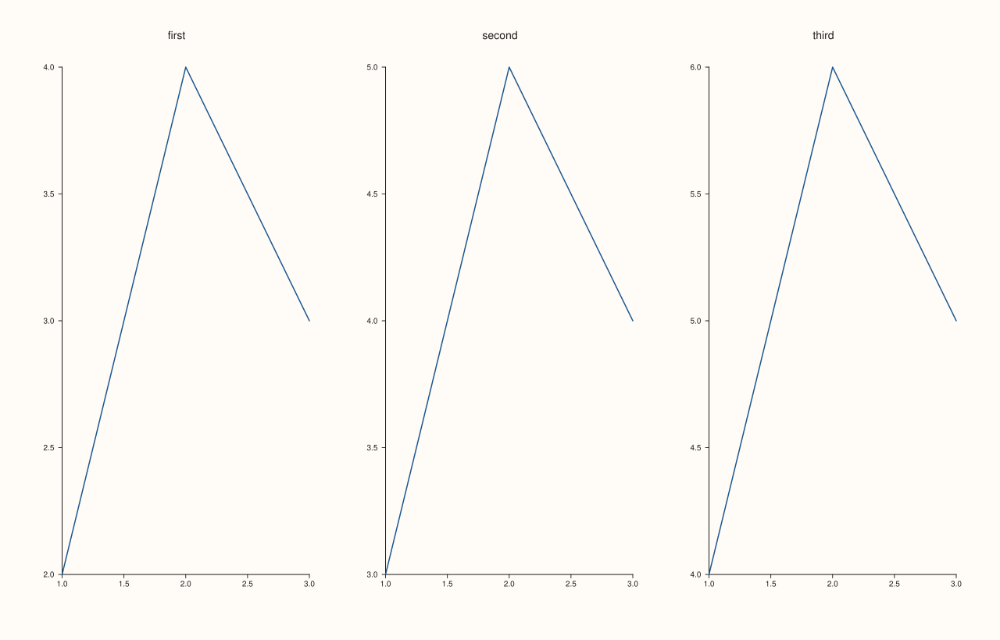
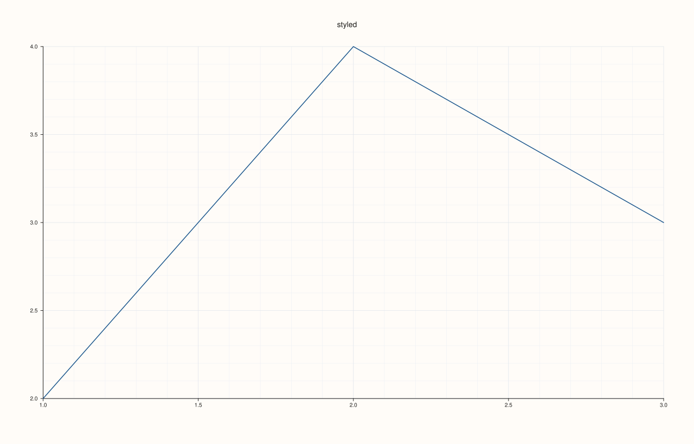

<!-- pluss-hand-authored -->

# Studio::pane2

[Back to Studio API Reference](../../studio_api_reference)

## Signature

```cpp
Pane& Studio::pane2(std::string title = {})
```

## What It Does

Creates a new 2D (`PaneKind::Planar`) pane, appends it to the figure, and returns a
reference to it. This is the primary entry point for building an ordinary 2D figure —
every `flash::` plotting function (`lineplot`, `scatterplot`, `barplot`, ...) takes a
`Pane&` to draw into, and `pane2()` is how that `Pane` gets created in the first place.

Each new pane automatically inherits the figure's current
[`context_scales()`](context_scales.md) (`tick_font_scale`/`axis_label_font_scale`) at the
moment of creation, and — if [`pane_style_defaults()`](pane_style_defaults.md) is
currently active — also inherits its captured theme/grid/legend/axes-visible template.
Both are creation-time snapshots: changing either setting afterward has no retroactive
effect on panes already created. See Example 4.

With no explicit call to [`mosaic()`](mosaic.md), panes render stacked top-to-bottom in
creation order; call `mosaic(rows, cols)` to arrange multiple panes into an explicit grid.

```{important} The returned Pane& is invalidated by later pane-creation calls
Panes are stored in a `std::vector<Pane>` internally. Every `pane2()`, `pane3()`,
`subpane2()`, or `subpane3()` call may reallocate that vector, which **invalidates every
`Pane&` obtained from an earlier call** — using a stale reference afterward is undefined
behavior. There is no mutable, index-based way to re-fetch a `Pane&` later either: `panes()`
only returns `const std::vector<Pane>&`. The safe pattern, used throughout every example on
this page and every other Studio page, is to fully configure and plot into each pane
**immediately** after creating it, before creating the next one. If a durable *identifier*
is needed later (not a mutable reference), capture it immediately via
[`pane_index()`](pane_index.md) — see that page's own important callout, which shows this
exact hazard triggering a real, observed failure.
```

## Parameters

**title** (`std::string`, default `{}`)
    The pane's title, drawn above the pane's plot area. An empty title (the default) draws
    no title text at all — see Example 1.

## Returns

`Pane&`
    A reference to the newly created pane, valid until the next pane-creation call (see the
    important callout above).

## Examples

Example 1. The default: no title argument, so the pane has no title text.

```cpp
using namespace pluss::pl;

auto fig = studio("pane2_default_title");
auto& pane = fig.pane2();
pane.trend(std::vector<double>{1.0, 2.0, 3.0, 4.0, 5.0}, std::vector<double>{2.0, 4.0, 3.0, 5.0, 6.0});
fig.show();

std::cout << pane.title_text().empty() << "\n";
```

### Output

```text
1
```


Example 2. An explicit title.

```cpp
using namespace pluss::pl;

auto fig = studio("pane2_with_title");
auto& pane = fig.pane2("Revenue by Quarter");
pane.trend(std::vector<double>{1.0, 2.0, 3.0, 4.0, 5.0}, std::vector<double>{2.0, 4.0, 3.0, 5.0, 6.0});
fig.show();

std::cout << pane.title_text() << "\n";
```

### Output

```text
Revenue by Quarter
```



Example 3. Three panes, each fully configured and plotted immediately after creation —
the safe ordering — then arranged into a `1x3` mosaic.

```cpp
using namespace pluss::pl;

auto fig = studio("pane2_multiple");
auto& first = fig.pane2("first");
first.trend(std::vector<double>{1.0, 2.0, 3.0}, std::vector<double>{2.0, 4.0, 3.0});
auto& second = fig.pane2("second");
second.trend(std::vector<double>{1.0, 2.0, 3.0}, std::vector<double>{3.0, 5.0, 4.0});
auto& third = fig.pane2("third");
third.trend(std::vector<double>{1.0, 2.0, 3.0}, std::vector<double>{4.0, 6.0, 5.0});
fig.mosaic(1, 3);
fig.show();

std::cout << fig.pane_count() << "\n";
```

### Output

```text
3
```



Example 4. A [`pane_style_defaults()`](pane_style_defaults.md) template applied before
`pane2()` — the new pane picks up the template's grid style.

```cpp
using namespace pluss::pl;

Pane style_template(PaneKind::Planar, Theme::paper());
style_template.grid(GridStyle::MajorMinor);

auto fig = studio("pane2_with_style_defaults");
fig.pane_style_defaults(style_template);
auto& styled = fig.pane2("styled");
styled.trend(std::vector<double>{1.0, 2.0, 3.0}, std::vector<double>{2.0, 4.0, 3.0});
fig.show();

std::cout << static_cast<int>(styled.grid_style()) << "\n";  // GridStyle::MajorMinor == 2
```

### Output

```text
2
```



## Notes

- Not `noexcept` — constructs a `Pane` and may reallocate the internal vector.
- Creates a `PaneKind::Planar` pane; use [`pane3()`](pane3.md) for a 3D (`Volumetric`)
  pane instead.
- Snapshots `context_scales()` and (if enabled) `pane_style_defaults()` at creation time —
  neither retroactively affects panes already created, nor is refreshed on panes created
  before the setting changed. See [`theme`](theme.md) for the same timing rule applied to
  the figure's overall theme.
- See the important callout above: the returned `Pane&` is invalidated by any subsequent
  `pane2()`/`pane3()`/`subpane2()`/`subpane3()` call. Configure and plot into each pane
  before creating the next.
- With no [`mosaic()`](mosaic.md) call, panes stack top-to-bottom in creation order.

## See Also

- [`Studio::pane3`](pane3.md): the 3D counterpart.
- [`Studio::pane_index`](pane_index.md): the only way to get a durable *identifier* (not a
  mutable reference) for a pane after creating others.
- [`Studio::subpane2`](subpane2.md): creates a pane occupying a sub-cell within another
  pane's own local grid, rather than a top-level mosaic cell.
- [`Studio::pane_style_defaults`](pane_style_defaults.md) / [`context_scales`](context_scales.md):
  the two creation-time snapshots every new pane picks up.
- [`Studio::mosaic`](mosaic.md): arranges panes into an explicit row/column grid.

<div class="pluss-inline-prev-next">
  <a class="prev-link" href="clear_row_titles.html">
    <span class="label">Previous</span>
    <span class="title">clear_row_titles</span>
  </a>
  <a class="next-link" href="pane3.html">
    <span class="label">Next</span>
    <span class="title">pane3</span>
  </a>
</div>
