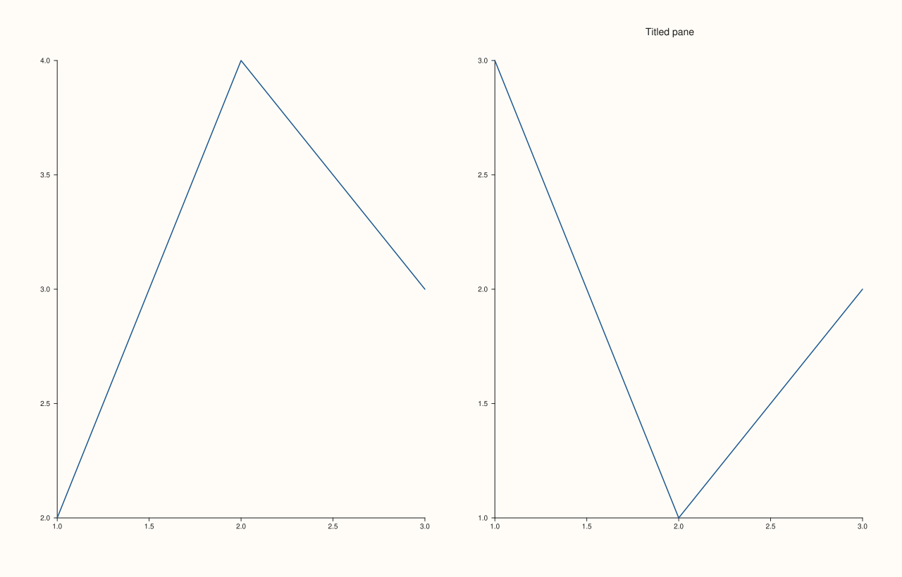
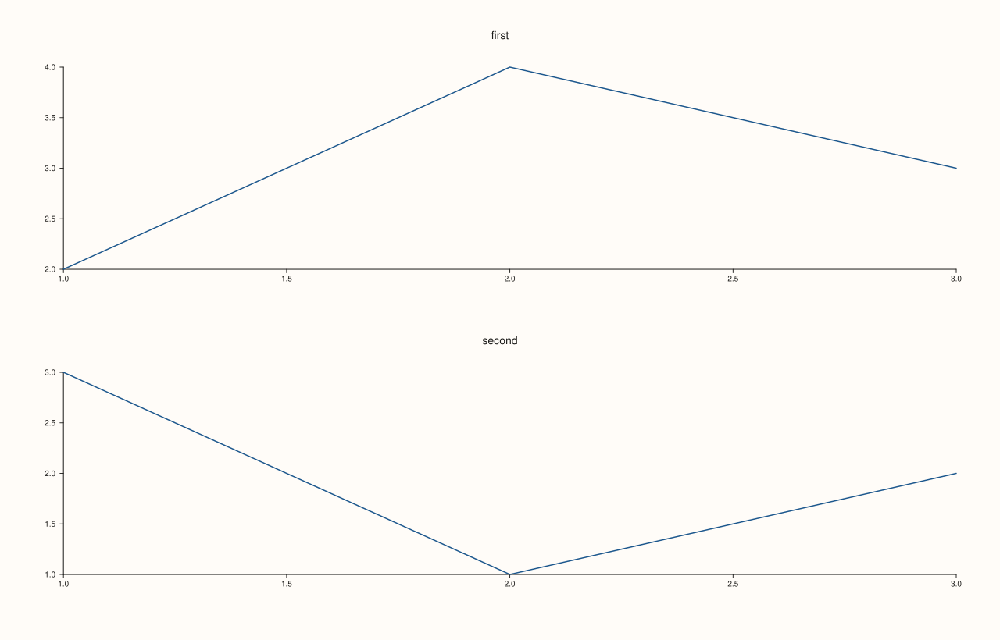
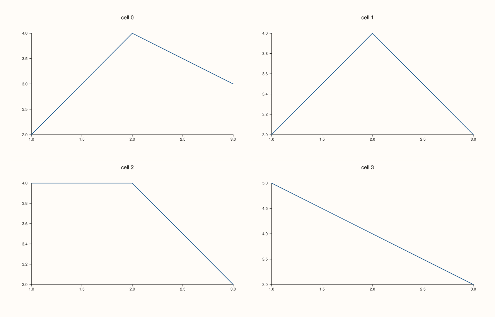
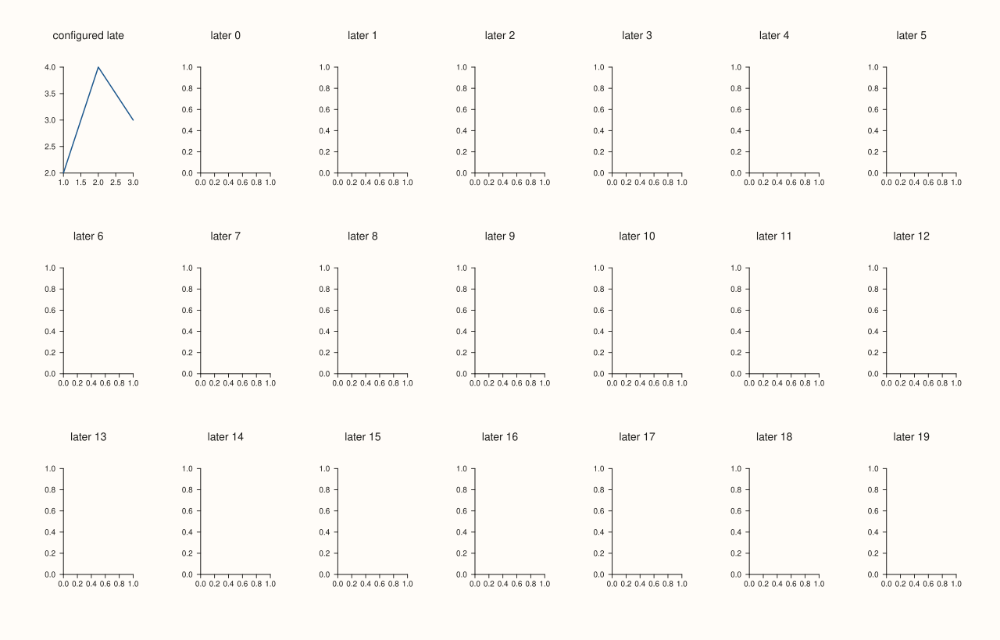
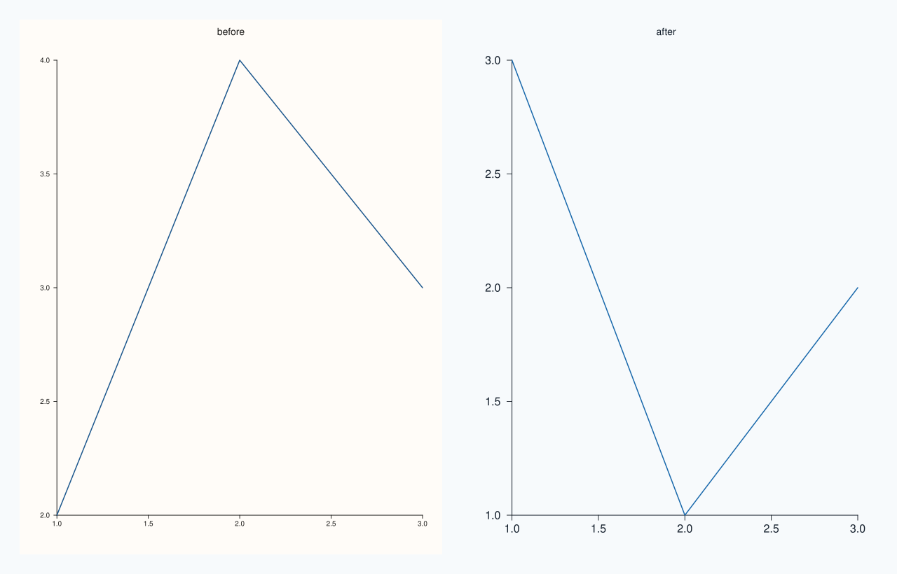
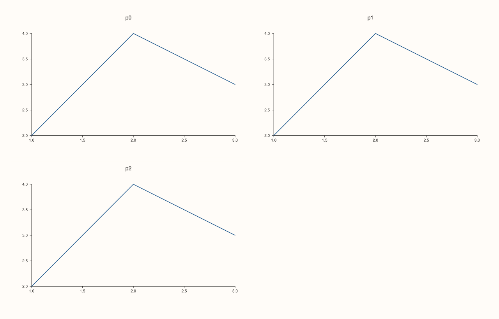

<!-- pluss-hand-authored -->

# Studio::pane2

[Back to Studio API Reference](../../studio_api_reference)

## Signature

```cpp
Pane& Studio::pane2(std::string title = {})
```

## What It Does

Adds a two-dimensional pane to the figure and returns it. A pane is one plot area with its own axes, title, legend and traces; the figure is the canvas that holds them. `pane2` makes a planar pane, the kind that takes `trend`, `cloud`, `columns`, `bucket`, `wedge`, `fieldmap` and the other 2D traces; [`pane3`](pane3.md) makes the volumetric kind.

The returned reference stays valid for the life of the figure, however many panes are added after it, so it can be kept and configured later. Panes are placed in creation order: with no [`mosaic`](mosaic.md) they stack top to bottom, and with a mosaic they fill the grid row by row, or go where [`Pane::place`](../pane/place.md) puts them. The title is drawn above the pane; an empty title (the default) draws none.

A new pane copies the figure's settings at that moment: the figure's theme ([`theme`](theme.md)), the font scales ([`context_scales`](context_scales.md)) and, when set, the style defaults ([`pane_style_defaults`](pane_style_defaults.md)). Changing those later affects only panes created afterwards.

## Parameters

**title** (`std::string`, default empty)
    The pane's title. Empty draws none.

## Returns

`Pane&`
    The new pane, valid for the life of the figure.

## Examples

Example 1. With and without a title. The first pane has none, so nothing is drawn above it; the second is titled.

```cpp
auto fig = studio("pane2_title");
fig.mosaic(1, 2);
auto& plain = fig.pane2();
plain.trend(std::vector<double>{1, 2, 3}, std::vector<double>{2, 4, 3});
auto& titled = fig.pane2("Titled pane");
titled.trend(std::vector<double>{1, 2, 3}, std::vector<double>{3, 1, 2});
std::cout << "first title: '" << plain.title_text() << "', second: '" << titled.title_text() << "'\n";
fig.save_svg("figure.svg");
```

### Output

```text
first title: '', second: 'Titled pane'
```



Example 2. Stacked by default. With no mosaic, panes stack top to bottom in creation order.

```cpp
auto fig = studio("pane2_stack");
fig.pane2("first").trend(std::vector<double>{1, 2, 3}, std::vector<double>{2, 4, 3});
fig.pane2("second").trend(std::vector<double>{1, 2, 3}, std::vector<double>{3, 1, 2});
std::cout << "panes: " << fig.pane_count() << ", mosaic active: " << fig.mosaic_layout().active << "\n";
fig.save_svg("figure.svg");
```

### Output

```text
panes: 2, mosaic active: 0
```



Example 3. On a grid. With `mosaic(2, 2)` four panes fill the cells row by row, and the first pane is the top-left cell.

```cpp
auto fig = studio("pane2_grid");
fig.mosaic(2, 2);
for (int i = 0; i < 4; ++i) {
  fig.pane2("cell " + std::to_string(i)).trend(std::vector<double>{1, 2, 3}, std::vector<double>{2.0 + i, 4.0, 3.0});
}
fig.save_svg("figure.svg");
```



Example 4. The reference stays valid. The first pane is configured after twenty more have been created, and it is the same object `panes()` holds.

```cpp
auto fig = studio("pane2_stable");
auto& first = fig.pane2("first");
for (int i = 0; i < 20; ++i) fig.pane2("later " + std::to_string(i));
first.trend(std::vector<double>{1, 2, 3}, std::vector<double>{2, 4, 3});
first.title("configured late");
std::cout << "same object: " << (&fig.panes()[0] == &first) << ", title: " << fig.panes()[0].title_text() << "\n";
fig.mosaic(3, 7);
fig.save_svg("figure.svg");
```

### Output

```text
same object: 1, title: configured late
```



Example 5. Settings are copied at creation. The pane created before `context_scales` and `theme` keeps its old settings; the one created after takes the new ones.

```cpp
auto fig = studio("pane2_snapshots");
fig.mosaic(1, 2);
fig.pane2("before").trend(std::vector<double>{1, 2, 3}, std::vector<double>{2, 4, 3});
fig.context_scales(1.6, 1.4);
fig.theme(Theme::ocean());
fig.pane2("after").trend(std::vector<double>{1, 2, 3}, std::vector<double>{3, 1, 2});
std::cout << "before: tick scale " << fig.panes()[0].tick_font_scale() << ", " << fig.panes()[0].theme_tokens().name() << "\n";
std::cout << "after:  tick scale " << fig.panes()[1].tick_font_scale() << ", " << fig.panes()[1].theme_tokens().name() << "\n";
fig.save_svg("figure.svg");
```

### Output

```text
before: tick scale 1, paper
after:  tick scale 1.6, ocean
```



Example 6. More panes than cells. A third pane in a 1 by 2 mosaic is created without complaint, because the grid could still change, and rendering the figure reports it.

```cpp
auto fig = studio("pane2_too_many");
fig.mosaic(1, 2);
for (int i = 0; i < 3; ++i) fig.pane2("p" + std::to_string(i)).trend(std::vector<double>{1, 2, 3}, std::vector<double>{2, 4, 3});
try {
  fig.to_svg();
} catch (const pluss::Error& e) {
  std::cout << e.message() << "\n";
}
auto fits = studio("pane2_fits");
fits.mosaic(2, 2);
for (int i = 0; i < 3; ++i) fits.pane2("p" + std::to_string(i)).trend(std::vector<double>{1, 2, 3}, std::vector<double>{2, 4, 3});
fits.save_svg("figure.svg");
```

### Output

```text
mosaic has no free cells left for pane placement
```



## Notes

- Not `noexcept`. It never fails for a bad title; any text is accepted.
- Hide a pane with [`Pane::hide`](../pane/visible.md); it keeps its place in the list and its cell in the grid.

## See Also

- [`Studio::pane3`](pane3.md): the 3D counterpart.
- [`Studio::subpane2`](subpane2.md): a pane inside another pane's grid.
- [`Studio::panes`](panes.md), [`pane_index`](pane_index.md): find panes again.
- [`Studio::mosaic`](mosaic.md): the grid panes are placed on.

<div class="pluss-inline-prev-next">
  <a class="prev-link" href="name.html">
    <span class="label">Previous</span>
    <span class="title">name</span>
  </a>
  <a class="next-link" href="pane3.html">
    <span class="label">Next</span>
    <span class="title">pane3</span>
  </a>
</div>
